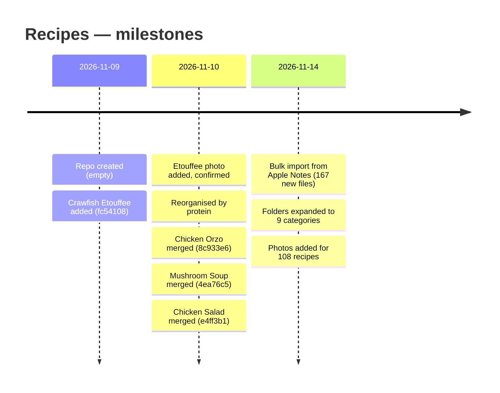
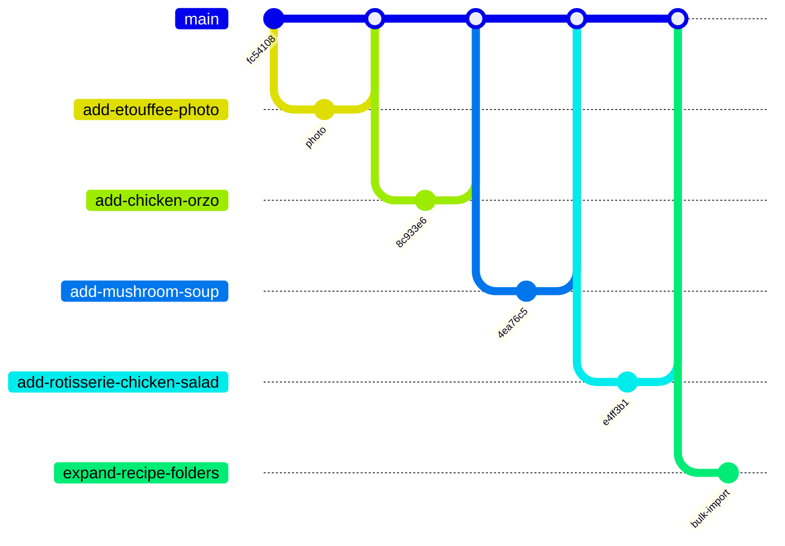

# Recipes

Personal recipes, in Markdown — organised by protein, with photos committed in the repo so they render in Forgejo.

> This README is the changelog for this repo. Newest first.

## Changelog

### November 14, 2026 — Recipe photos added (merged into main)

- **Photos added for 108 recipes** — pictures sent from Apple Notes, copied to each folder's `images/` and linked in the `.md` at 600px. Pork 8/8, Seafood 10/10 (incl. Easy Ginger Soy Cod, committed separately as `31db490`), Chicken 40/42, Beef 13/13, Soups 24/26, No Meat 6/6, Sauce 6/6, Sides 1/1, Desserts 0/1.
- **No pic found** — Soups: Coconut Lime Shrimp Soup, Mexican Sopa de Fideo with Potatoes, Beans, and Ground Beef. Desserts: Buttermilk Pie (no pics in Desserts). Chicken still open: Garlic Roast Chicken with Rosemary and Lemon (1 pic exists, not yet sent) and Creamy Chicken and Mushroom.
- **Scan corrections** — the photo scan flagged 2 pics for Honey Garlic Shrimp, Sausage & Broccoli, Stuffed Cabbage Rolls, Mexican Corn Chicken Soup, and the second Creamy Spicy Jalapeño Shrimp Soup; each turned out to have 1 pic, except the second Jalapeño Shrimp Soup, which did have a pic after all.

### November 14, 2026 — Bulk import from Apple Notes, folder expansion (merged into main)

- **Bulk import from Apple Notes complete** — 169 recipe notes counted (Beef 23, Chicken 59, Pork 8, Seafood 14, Soup 42, Sides 2, Sauce 11, Deserts 3, No Meat 7) and converted to 167 new `.md` files, read in full directly from Apple Notes on the MacBook Air. 2 duplicates skipped (a second Philly Cheesesteak Pasta, and Crawfish Étouffée, already in the repo). 14 notes initially had no readable text; opening them in Apple Notes fixed all 14.
- **Folder expansion** — added `beef/`, `pork/`, `sides/`, `sauce/`, `no-meat/`, `desserts/` alongside `chicken/`, `seafood/`, `soups/` (Notes "Soup" maps to `soups/`, Notes "Deserts" maps to `desserts/`). Repo now has 171 recipe files total.
- **Counts by folder** — Beef 22, Chicken 61, Pork 8, Seafood 14, Soups 43, Sides 2, Sauce 11, Desserts 3, No Meat 7.

### November 10, 2026 — Photos, reorganisation, and two more recipes (both merged)

- **Crawfish Étouffée photo added** — `images/crawfish-etouffee.jpg` on branch `add-etouffee-photo`, merged. Matthew confirmed: "Looks good".
- **Reorganised by protein** — `chicken/`, `seafood/`, `soups/` (Matthew chose `soups/` over `vegetarian/`). Étouffée moved to `seafood/crawfish-etouffee.md`.
- **Broccoli Cheddar Chicken Orzo added and merged** — commit `8c933e6` ("Add Broccoli Chicken Orzo and organize recipes by protein"), on branch `add-chicken-orzo`, with `chicken/images/broccoli-cheddar-chicken-orzo.jpg`. **On main — confirmed.**
- **Hungarian Mushroom Soup added and merged** — commit `4ea76c5` ("Add Hungarian Mushroom Soup"), `soups/hungarian-mushroom-soup.md` + photo. **On main — confirmed 2026-11-12 from `git log`.**
- **Rotisserie Chicken Salad added and merged** — commit `e4ff3b1` ("Add Rotisserie Chicken Salad"), `chicken/rotisserie-chicken-salad.md` + photo, 5 servings. **On main — confirmed 2026-11-12 from `git log`.**

### November 9, 2026 — Repo created, first recipe

- **Repo created** — empty.
- **Crawfish Étouffée added** — commit `fc54108` ("Adding crawfish etouffee recipe"), on branch `crawfish-etouffee`. `main` was created from this branch, since it did not exist yet. 4 servings.

> All branches in this repo are short-lived and merged — mushroom soup and rotisserie salad are both on main, confirmed from `git log` on 2026-11-12.

---

## Contents

Recipes are organised by protein. Recipe images are committed in the repo with a relative path, so Forgejo renders them.

### Beef (22)

- [Beef](beef/) — 22 recipes, imported from Apple Notes 2026-11-14.

### Chicken (61)

- [Broccoli Cheddar Chicken Orzo](chicken/broccoli-cheddar-chicken-orzo.md) — with photo. No servings count was given in the source — none is claimed here.
- [Rotisserie Chicken Salad](chicken/rotisserie-chicken-salad.md) — 5 servings. Shred the chicken first, then simply mix everything together. With photo.
- [Chicken](chicken/) — 59 more recipes, imported from Apple Notes 2026-11-14.

### Pork (8)

- [Pork](pork/) — 8 recipes, imported from Apple Notes 2026-11-14.

### Seafood (14)

- [Crawfish Étouffée](seafood/crawfish-etouffee.md) — 4 servings, with photo.
- [Seafood](seafood/) — 13 more recipes, imported from Apple Notes 2026-11-14.

### Soups (43)

- [Hungarian Mushroom Soup](soups/hungarian-mushroom-soup.md) — with photo.
- [Soups](soups/) — 42 more recipes, imported from Apple Notes 2026-11-14.

### Sides (2)

- [Sides](sides/) — 2 recipes, imported from Apple Notes 2026-11-14.

### Sauce (11)

- [Sauce](sauce/) — 11 recipes, imported from Apple Notes 2026-11-14.

### No Meat (7)

- [No Meat](no-meat/) — 7 recipes, imported from Apple Notes 2026-11-14.

### Desserts (3)

- [Desserts](desserts/) — 3 recipes, imported from Apple Notes 2026-11-14.

---

## Workflow

Short-lived branches: make the change, push, merge, delete, move on.
