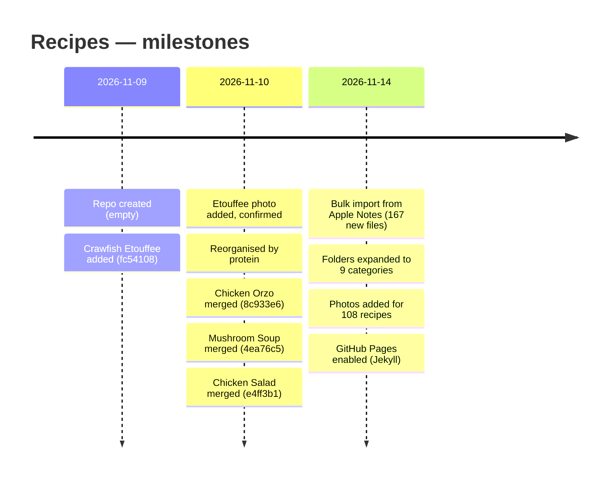
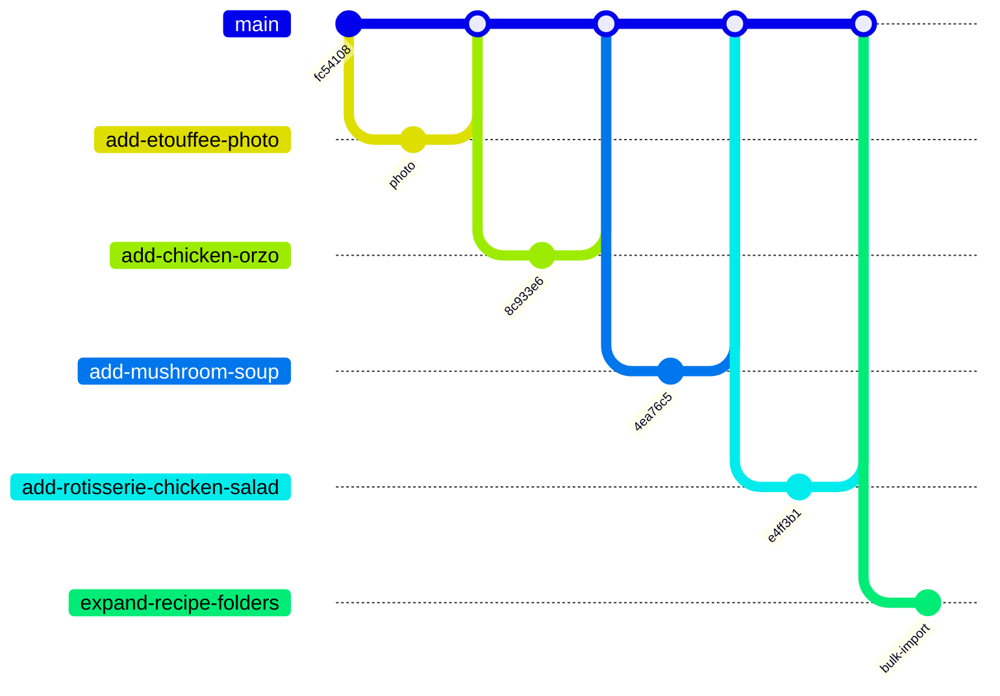

# Recipes

Personal recipes, in Markdown — organised by protein, with photos committed in the repo so they render in Forgejo.

> This README is the changelog for this repo. Newest first.

## Changelog

### November 16, 2026 — Honey Lime Chicken Bowls added

- **Honey Lime Chicken Bowls with Creamy Cilantro Lime Drizzle** — new chicken recipe from TikTok [@the__crave](https://www.tiktok.com/@the__crave/photo/7694899555892088077), serves 4, made with chicken thighs (Matthew's swap from the original breasts). Photo is a web-sourced stand-in (chefwatermelon.com), credited in the `.md` — it also shows black beans, which this recipe doesn't call for.
- **Counts** — Chicken 61 → 62, repo total 171 → 172.

### November 16, 2026 — Per-section favicons

- **Tab icon per protein section** — each section now shows its own home-page tile emoji in the browser tab: beef 🥩, chicken 🍗, pork 🐷, seafood 🦐, soups 🍲, sides 🥗, sauce 🫙, no-meat 🥦, desserts 🍰. Home page and other pages get 🍽️.
- **How it works** — `_includes/head-custom.html` picks the icon from the page URL (first path segment), and the icons live in `assets/icons/` (72px for the tab, 180px for the Apple touch icon). Icons are Twemoji renders of the same emojis used on the home-page cards.

### November 15, 2026 — Web-sourced photos for no-photo recipes

- **Photos added for all 58 remaining no-photo recipes** — representative dish photos found on the web and added to each folder's `images/`, linked in the `.md` at 600px and on the folder index cards. Every recipe in the repo (171) now has a photo. Sources are credited in each `.md`; the photos are stand-ins found online, not the author's own dishes, so some differ from the recipe in small details.
- **Beef (9)** — Beef and Parmesan Tortellini in Creamy Sauce; Caldillo de Chile Verde; Cowboy Stew; Fideo with Potatoes and Ground Beef; French Onion Beef and Noodles; Meat Loaf; Mongolian Ground Beef Noodles; Philly Cheesesteak Pasta; Sizzling Chinese Pepper Steak with Onions.
- **Chicken (18)** — Cajun Chicken Pasta; Caribbean Chicken and Rice; Cheesy Salsa Verde Chicken Casserole; Chicken Bacon and Pasta with Spinach and Tomatoes in Garlic Cream Sauce; Chicken Mushroom Stroganoff; Chicken Shyte; Coconut Curry Chicken with Lemongrass; Coconut Curry Chicken with Rice Noodles; Creamy Chicken and Mushroom; Filipino Pancit; Garlic Chicken with Broccoli and Spinich; Garlic Roast Chicken with Rosemary and Lemon; King Ranch Chicken; Lemon Garlic Chicken with Creamy Bowtie Pasta; Melt in Your Mouth Chicken; Mexican Street Corn Chicken Bowls; Slow Cooker Cream Cheese Chicken; Street Corn Chicken Rice Bowl.
- **Soups (18)** — Bacon Cabbage and Potato Soup; Bacon Cheeseburger Soup; Chicken Avocado Lime Soup; Chicken Noodle Soup; Coconut Lime Seafood Chowder; Coconut Lime Shrimp Soup; Creamy Beef Taco Soup; Creamy Crockpot Chicken Chili; Creamy Mushroom Chicken and Wild Rice Soup; Creamy Parmesan Italian Sausage Ditalini Soup; Crock Pot Green Enchilada Chicken Soup; Keto Unstuffed Cabbage Soup; Mexican Sopa de Fideo with Potatoes, Beans, and Ground Beef; Mexican Street Corn Chicken Soup; One Pot Macaroni Cheeseburger Soup; Texas Cowboy Stew; Thai Red Curry Chicken Noodle Soup; Thai Red Curry Dumpling Soup.
- **Sauce (5)** — Chunky Dumpling Sauce; Lemon-Herb Aioli; Ranch; Vietnamese Fish Sauce Recipe (Nước Chấm); Wing Stop Ranch.
- **Seafood (3)** — Creamy Tuscan Spaghetti with Jumbo Scallops; Shrimp Dirty Rice; Spicy Shrimp Tacos with Garlic Cilantro Lime Slaw.
- **No-meat (1)** — Italian Drunken Noodles. **Sides (1)** — Creamed Spinach, Bacon and Mushrooms.
- **Desserts (3)** — Buttermilk Pie; Peanut Butter Cream Pie; Sweet Potato Pie.

### November 15, 2026 — Web-sourced photo for Asparagus and Chicken Fricassee

- **Photo added for Asparagus and Chicken Fricassee** — no photo of the dish existed, so a representative photo was found on the web (Yeyfood's Chicken Fricassee with Spring Vegetables — chicken, mushrooms, and asparagus in a skillet) and added as `chicken/images/asparagus-and-chicken-fricassee.jpg`, linked in the `.md` at 600px and on the Chicken index card. The sauce in the photo looks creamier than this recipe's broth reduction — a stand-in, not the author's own dish; source credited in the `.md`.

### November 14, 2026 — GitHub Pages enabled

- **GitHub Pages** — Jekyll, deploy from `main` / (root), via `_config.yml`. Site: https://chknfrdstk.github.io/Recipes/
- **Theme switched to Midnight (dark, whole site)** — later on Nov 14, from Cayman to `jekyll-theme-midnight`. Slate was tried first, but only its header was dark.
- **Clean Pages home page** — `index.md` (separate from this README) with a 9-card protein grid, plus the full 171-recipe lists. No changelog on the Pages site.
- **Protein folder indexes** — each protein folder now has its own `README.md` index (Beef 22, Chicken 61, Pork 8, Seafood 14, Soups 43, Sides 2, Sauce 11, No Meat 7, Desserts 3), so clicking a protein on the Pages site opens a list instead of a 404.
- **Photo cards on protein pages** — each recipe is a card with its photo on top and name below (112 with photos, 59 title-only). Custom CSS `assets/css/style.scss` for the recipe cards.
- **Rendered-page links** — recipe card links now point to the rendered `.html` pages instead of the raw `.md` files, so a recipe opens themed with its photo instead of as plain white markdown. Links are absolute GitHub Pages URLs, so they work from Forgejo too (opening the rendered page on the public site) — Forgejo's raw-HTML relative links 404'd because it drops the folder from the path.
- **Clickable links** — bare URLs in talk/recipe files (YouTube, repos, slides) are now proper markdown links, so they are clickable on GitHub Pages (Pages does not auto-link bare URLs the way Forgejo does).
- **Custom dark CSS** — `assets/css/style.scss` overrides Midnight: dark background, accent `#58a6ff`, card grid with hover lift. Same CSS on both sites.
- **Repeatable setup** — every push to main rebuilds the site automatically. Same setup as the Conferences repo.

### November 14, 2026 — Recipe photos added (merged into main)

- **Photos added for 108 recipes** — pictures sent from Apple Notes, copied to each folder's `images/` and linked in the `.md` at 600px. Pork 8/8, Seafood 10/10 (incl. Easy Ginger Soy Cod, committed separately as `31db490`), Chicken 40/42, Beef 13/13, Soups 24/26, No Meat 6/6, Sauce 6/6, Sides 1/1, Desserts 0/1.
- **No pic found** — Soups: Coconut Lime Shrimp Soup, Mexican Sopa de Fideo with Potatoes, Beans, and Ground Beef. Desserts: Buttermilk Pie (no pics in Desserts). Chicken still open: Garlic Roast Chicken with Rosemary and Lemon (1 pic exists, not yet sent) and Creamy Chicken and Mushroom.
- **Scan corrections** — the photo scan flagged 2 pics for Honey Garlic Shrimp, Sausage & Broccoli, Stuffed Cabbage Rolls, Mexican Corn Chicken Soup, and the second Creamy Spicy Jalapeño Shrimp Soup; each turned out to have 1 pic, except the second Jalapeño Shrimp Soup, which did have a pic after all.

### November 14, 2026 — Bulk import from Apple Notes, folder expansion (merged into main)

- **Bulk import from Apple Notes complete** — 169 recipe notes counted (Beef 23, Chicken 59, Pork 8, Seafood 14, Soup 42, Sides 2, Sauce 11, Deserts 3, No Meat 7) and converted to 167 new `.md` files, read in full directly from Apple Notes on the MacBook Air. 2 duplicates skipped (a second Philly Cheesesteak Pasta, and Crawfish Étouffée, already in the repo). 14 notes initially had no readable text; opening them in Apple Notes fixed all 14.
- **Folder expansion** — added `beef/`, `pork/`, `sides/`, `sauce/`, `no-meat/`, `desserts/` alongside `chicken/`, `seafood/`, `soups/` (Notes "Soup" maps to `soups/`, Notes "Deserts" maps to `desserts/`). Repo now has 171 recipe files total.
- **Counts by folder** — Beef 22, Chicken 61, Pork 8, Seafood 14, Soups 43, Sides 2, Sauce 11, Desserts 3, No Meat 7.

### November 10, 2026 — Photos, reorganisation, and two more recipes (both merged)

- **Crawfish Étouffée photo added** — `images/crawfish-etouffee.jpg` on branch `add-etouffee-photo`, merged. Matthew confirmed: "Looks good".
- **Reorganised by protein** — `chicken/`, `seafood/`, `soups/` (Matthew chose `soups/` over `vegetarian/`). Étouffée moved to `seafood/crawfish-etouffee.md`.
- **Broccoli Cheddar Chicken Orzo added and merged** — commit `8c933e6` ("Add Broccoli Chicken Orzo and organize recipes by protein"), on branch `add-chicken-orzo`, with `chicken/images/broccoli-cheddar-chicken-orzo.jpg`. **On main — confirmed.**
- **Hungarian Mushroom Soup added and merged** — commit `4ea76c5` ("Add Hungarian Mushroom Soup"), `soups/hungarian-mushroom-soup.md` + photo. **On main — confirmed 2026-11-12 from `git log`.**
- **Rotisserie Chicken Salad added and merged** — commit `e4ff3b1` ("Add Rotisserie Chicken Salad"), `chicken/rotisserie-chicken-salad.md` + photo, 5 servings. **On main — confirmed 2026-11-12 from `git log`.**

### November 9, 2026 — Repo created, first recipe

- **Repo created** — empty.
- **Crawfish Étouffée added** — commit `fc54108` ("Adding crawfish etouffee recipe"), on branch `crawfish-etouffee`. `main` was created from this branch, since it did not exist yet. 4 servings.

> All branches in this repo are short-lived and merged — mushroom soup and rotisserie salad are both on main, confirmed from `git log` on 2026-11-12.

---

## Contents

Recipes are organised by protein. Recipe images are committed in the repo with a relative path, so Forgejo renders them.

### Beef (22)

- [Beef](beef/) — 22 recipes, imported from Apple Notes 2026-11-14.

### Chicken (61)

- [Broccoli Cheddar Chicken Orzo](chicken/broccoli-cheddar-chicken-orzo.md) — with photo. No servings count was given in the source — none is claimed here.
- [Rotisserie Chicken Salad](chicken/rotisserie-chicken-salad.md) — 5 servings. Shred the chicken first, then simply mix everything together. With photo.
- [Chicken](chicken/) — 59 more recipes, imported from Apple Notes 2026-11-14.

### Pork (8)

- [Pork](pork/) — 8 recipes, imported from Apple Notes 2026-11-14.

### Seafood (14)

- [Crawfish Étouffée](seafood/crawfish-etouffee.md) — 4 servings, with photo.
- [Seafood](seafood/) — 13 more recipes, imported from Apple Notes 2026-11-14.

### Soups (43)

- [Hungarian Mushroom Soup](soups/hungarian-mushroom-soup.md) — with photo.
- [Soups](soups/) — 42 more recipes, imported from Apple Notes 2026-11-14.

### Sides (2)

- [Sides](sides/) — 2 recipes, imported from Apple Notes 2026-11-14.

### Sauce (11)

- [Sauce](sauce/) — 11 recipes, imported from Apple Notes 2026-11-14.

### No Meat (7)

- [No Meat](no-meat/) — 7 recipes, imported from Apple Notes 2026-11-14.

### Desserts (3)

- [Desserts](desserts/) — 3 recipes, imported from Apple Notes 2026-11-14.

---

## Workflow

Short-lived branches: make the change, push, merge, delete, move on.
