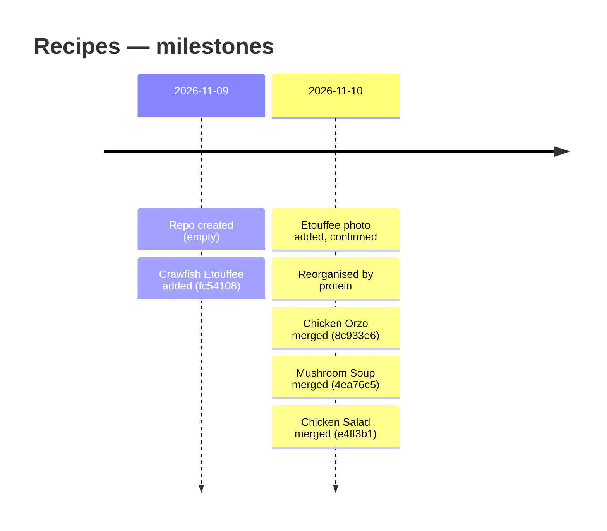
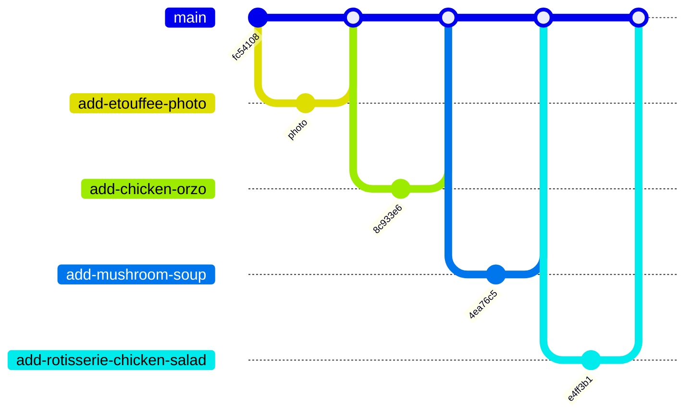

# Recipes

Personal recipes, in Markdown — organised by protein, with photos committed in the repo so they render in Forgejo.

> This README is the changelog for this repo. Newest first.

## Changelog

### November 10, 2026 — Photos, reorganisation, and two more recipes (both merged)

- **Crawfish Étouffée photo added** — `images/crawfish-etouffee.jpg` on branch `add-etouffee-photo`, merged. Matthew confirmed: "Looks good".
- **Reorganised by protein** — `chicken/`, `seafood/`, `soups/` (Matthew chose `soups/` over `vegetarian/`). Étouffée moved to `seafood/crawfish-etouffee.md`.
- **Broccoli Cheddar Chicken Orzo added and merged** — commit `8c933e6` ("Add Broccoli Chicken Orzo and organize recipes by protein"), on branch `add-chicken-orzo`, with `chicken/images/broccoli-cheddar-chicken-orzo.jpg`. **On main — confirmed.**
- **Hungarian Mushroom Soup added and merged** — commit `4ea76c5` ("Add Hungarian Mushroom Soup"), `soups/hungarian-mushroom-soup.md` + photo. **On main — confirmed 2026-11-12 from `git log`.**
- **Rotisserie Chicken Salad added and merged** — commit `e4ff3b1` ("Add Rotisserie Chicken Salad"), `chicken/rotisserie-chicken-salad.md` + photo, 5 servings. **On main — confirmed 2026-11-12 from `git log`.**

### November 9, 2026 — Repo created, first recipe

- **Repo created** — empty.
- **Crawfish Étouffée added** — commit `fc54108` ("Adding crawfish etouffee recipe"), on branch `crawfish-etouffee`. `main` was created from this branch, since it did not exist yet. 4 servings.

> All branches in this repo are short-lived and merged — mushroom soup and rotisserie salad are both on main, confirmed from `git log` on 2026-11-12.

---

## Contents

Recipes are organised by protein. Recipe images are committed in the repo with a relative path, so Forgejo renders them.

### Chicken

- [Broccoli Cheddar Chicken Orzo](chicken/broccoli-cheddar-chicken-orzo.md) — with photo. No servings count was given in the source — none is claimed here.
- [Rotisserie Chicken Salad](chicken/rotisserie-chicken-salad.md) — 5 servings. Shred the chicken first, then simply mix everything together. With photo.

### Seafood

- [Crawfish Étouffée](seafood/crawfish-etouffee.md) — 4 servings, with photo.

### Soups

- [Hungarian Mushroom Soup](soups/hungarian-mushroom-soup.md) — with photo.

---

## Workflow

Short-lived branches: make the change, push, merge, delete, move on.
