# Beef Recipes

23 recipes.



<a href="https://chknfrdstk.github.io/Recipes/beef/barbacoa-beef-tacos.html">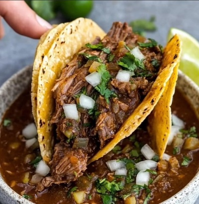Barbacoa Beef Tacos</a>

<a href="https://chknfrdstk.github.io/Recipes/beef/beef-and-parmesan-tortellini-in-creamy-sauce.html">Beef and Parmesan Tortellini in Creamy Sauce</a>

<a href="https://chknfrdstk.github.io/Recipes/beef/beef-pasta-in-a-creamy-garlic-sauce.html">Beef Pasta in a Creamy Garlic Sauce</a>

<a href="https://chknfrdstk.github.io/Recipes/beef/beijing-beef.html">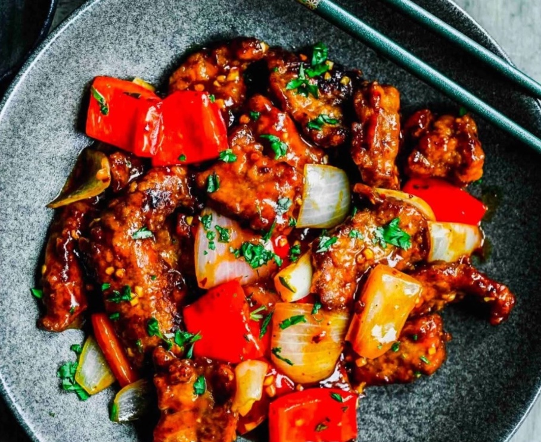Beijing Beef</a>

<a href="https://chknfrdstk.github.io/Recipes/beef/caldillo-de-chile-verde.html">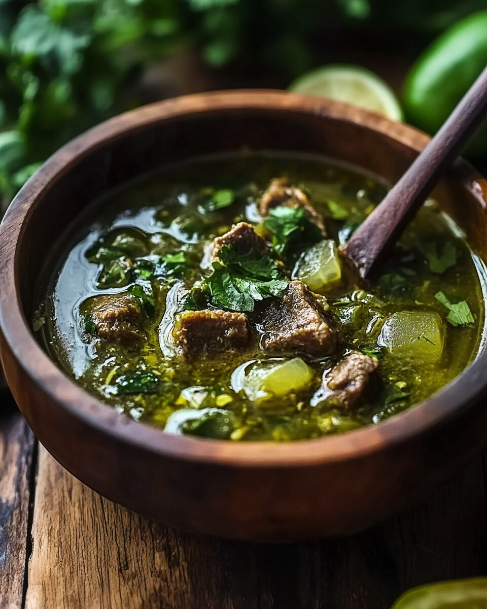Caldillo de Chile Verde</a>

<a href="https://chknfrdstk.github.io/Recipes/beef/chili-oil-cabbage.html">Chili Oil Cabbage✨ New</a>

<a href="https://chknfrdstk.github.io/Recipes/beef/chinese-beef-and-mushroom-stir-fry.html">Chinese Beef and Mushroom Stir Fry</a>

<a href="https://chknfrdstk.github.io/Recipes/beef/coconut-red-curry-drip-beef.html">Coconut Red Curry Drip Beef</a>

<a href="https://chknfrdstk.github.io/Recipes/beef/cowboy-stew.html">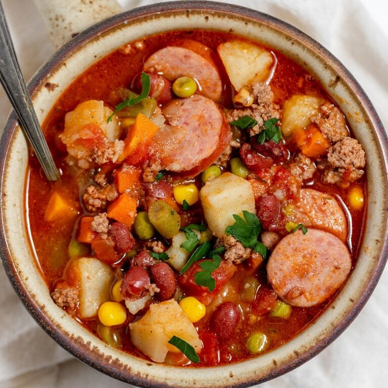Cowboy Stew</a>

<a href="https://chknfrdstk.github.io/Recipes/beef/fideo-with-potatoes-and-ground-beef.html">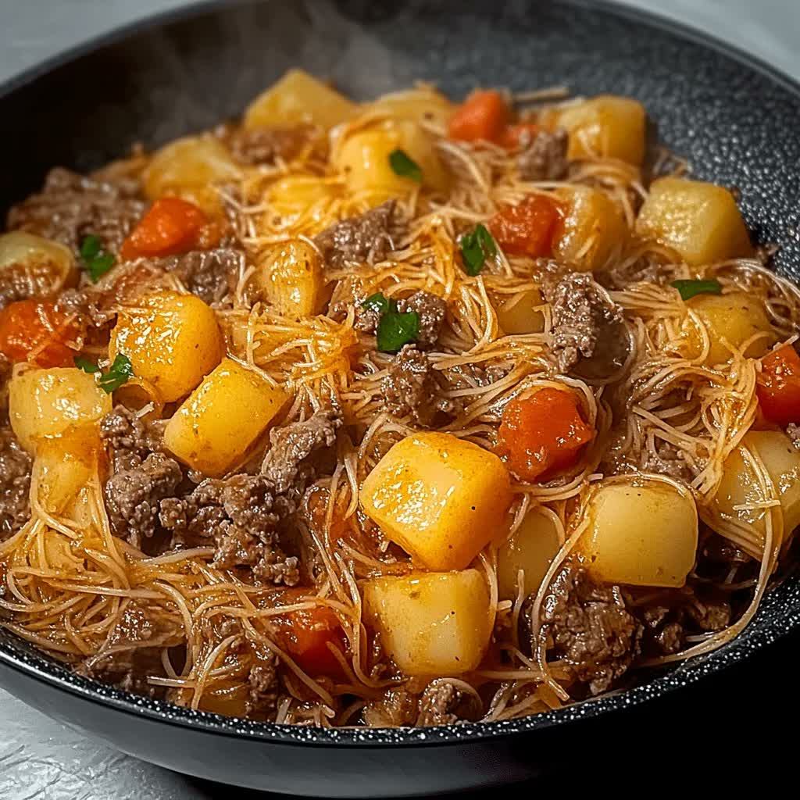Fideo with Potatoes and Ground Beef</a>

<a href="https://chknfrdstk.github.io/Recipes/beef/french-onion-beef-and-noodles.html">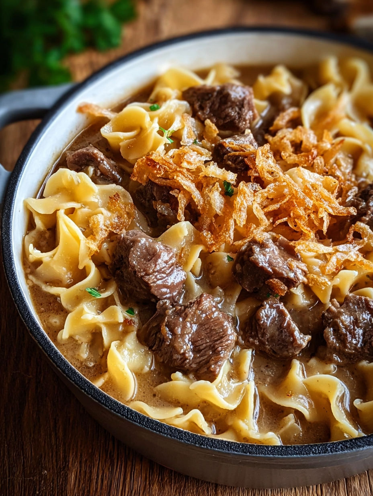French Onion Beef and Noodles</a>

<a href="https://chknfrdstk.github.io/Recipes/beef/homemade-mexican-pizza.html">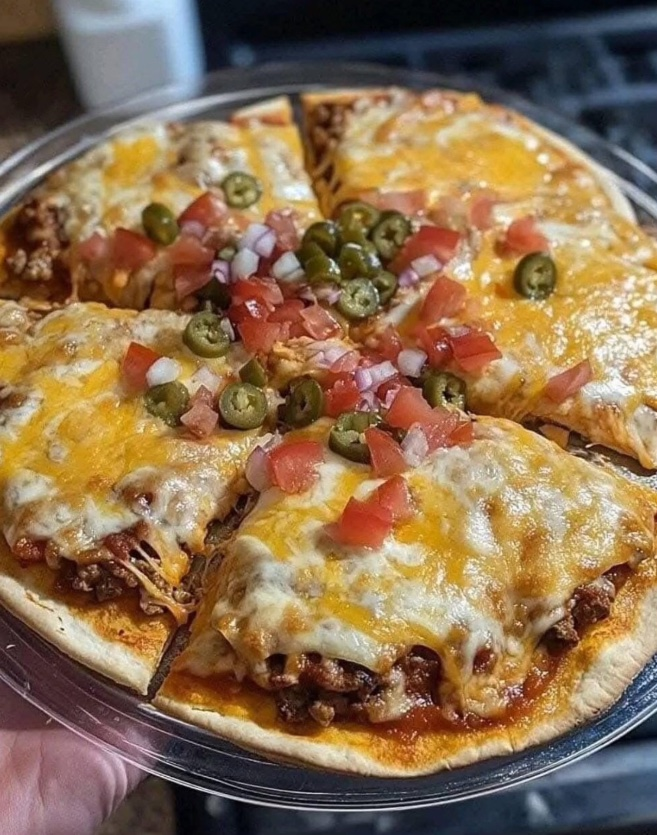Homemade Mexican Pizza</a>

<a href="https://chknfrdstk.github.io/Recipes/beef/meat-loaf.html">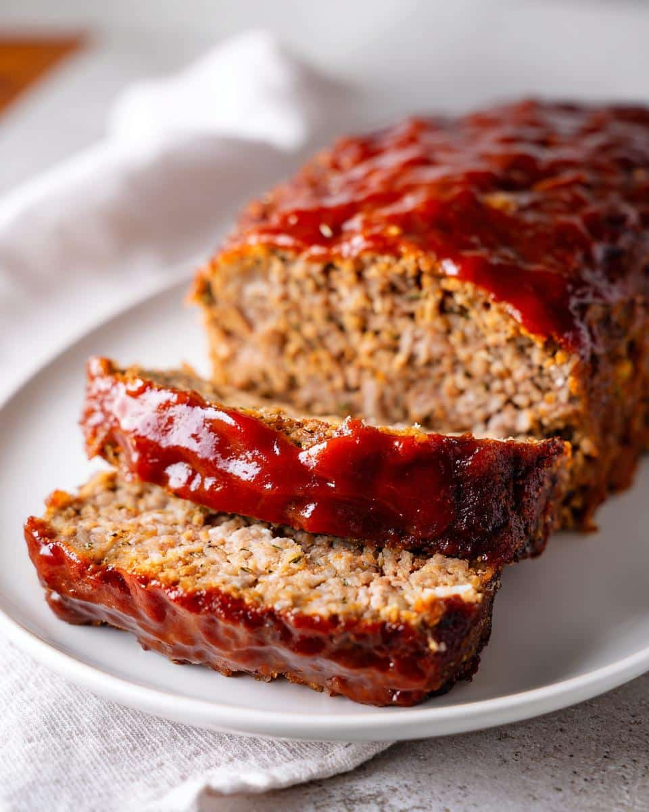Meat Loaf</a>

<a href="https://chknfrdstk.github.io/Recipes/beef/million-dollar-spaghetti.html">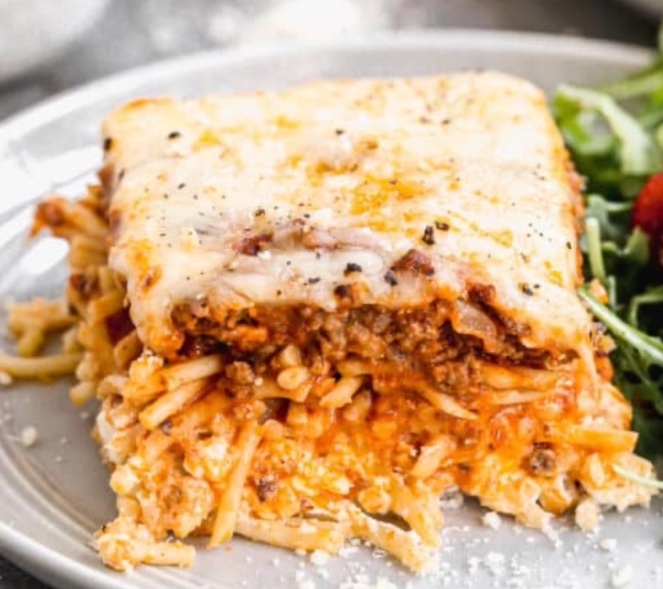Million Dollar Spaghetti</a>

<a href="https://chknfrdstk.github.io/Recipes/beef/mongolian-ground-beef-noodles.html">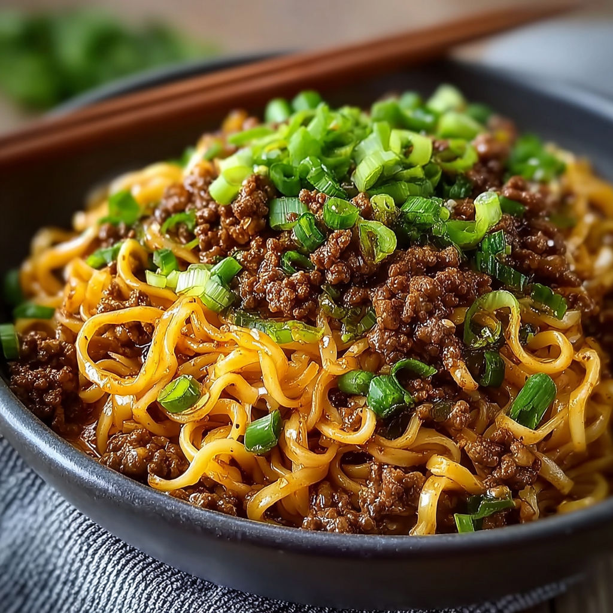Mongolian Ground beef Noodles</a>

<a href="https://chknfrdstk.github.io/Recipes/beef/one-skillet-spicy-cajun-beef-pasta.html">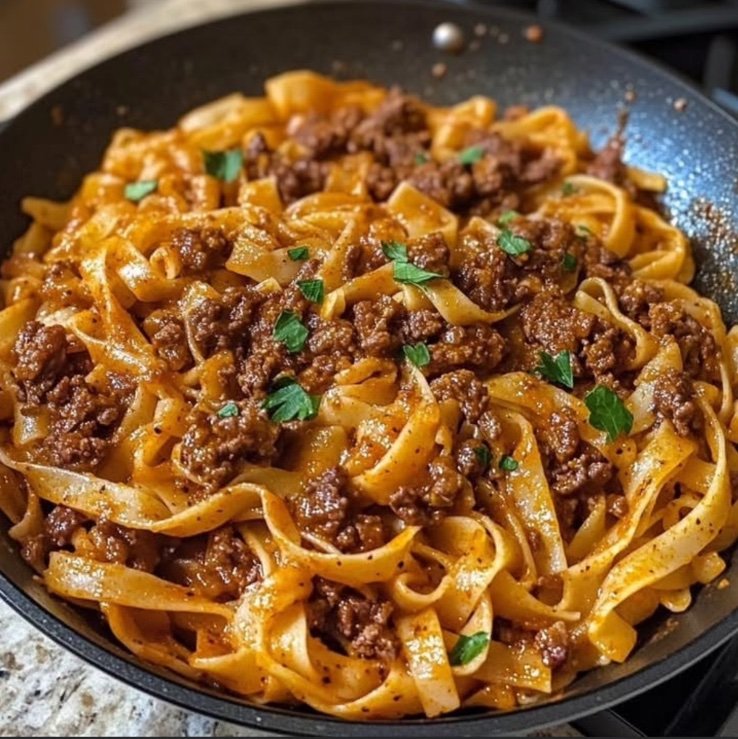One-Skillet Spicy Cajun Beef Pasta</a>

<a href="https://chknfrdstk.github.io/Recipes/beef/philly-cheesesteak-pasta.html">Philly Cheesesteak Pasta</a>

<a href="https://chknfrdstk.github.io/Recipes/beef/sizzling-chinese-pepper-steak-with-onions.html">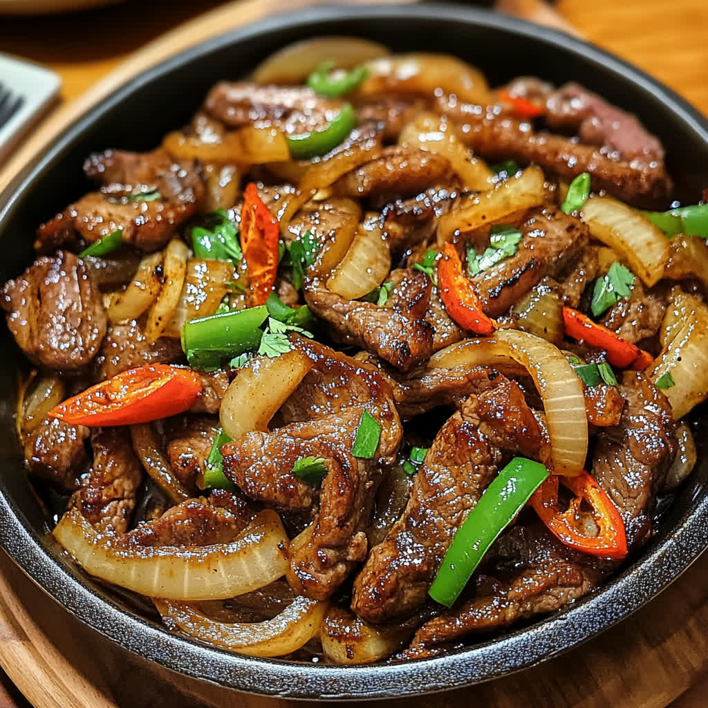Sizzling Chinese Pepper Steak with Onions</a>

<a href="https://chknfrdstk.github.io/Recipes/beef/smokey-jalapeno-popper-meatloaf-with-creamy-ranch-drizzle.html">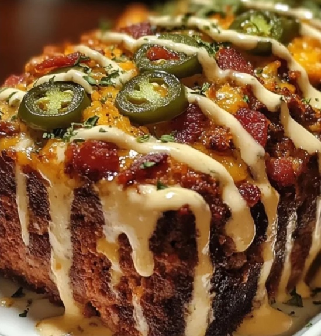Smokey Jalapeño  Popper Meatloaf with Creamy Ranch Drizzle</a>

<a href="https://chknfrdstk.github.io/Recipes/beef/stuffed-cabbage-rolls-with-ground-beef-and-rice.html">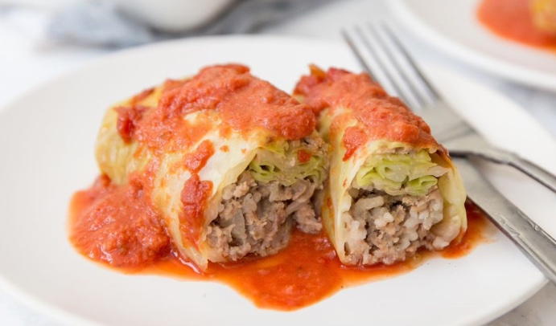Stuffed Cabbage Rolls With Ground Beef and Rice</a>

<a href="https://chknfrdstk.github.io/Recipes/beef/teriyaki-beef-broccoli-and-mushroom-bowl-with-ginger-aioli.html">Teriyaki Beef, Broccoli, and Mushroom Bowl with Ginger Aioli</a>

<a href="https://chknfrdstk.github.io/Recipes/beef/vietnamese-lemongrass-beef.html">Vietnamese Lemongrass Beef</a>

<a href="https://chknfrdstk.github.io/Recipes/beef/warm-taco-slaw.html">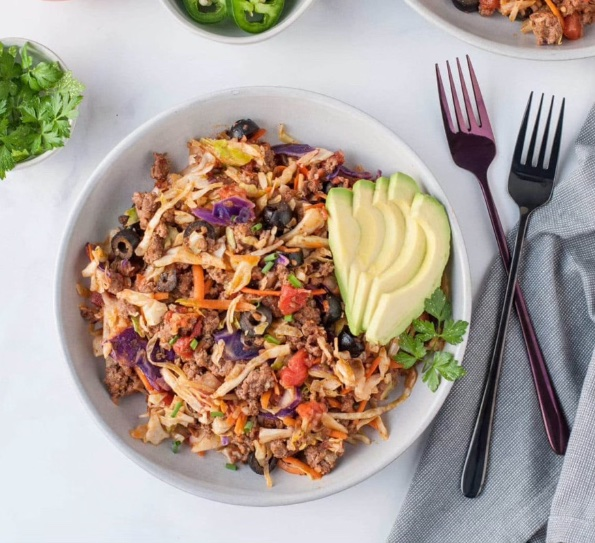Warm Taco Slaw</a>

- [Back to all recipes](https://chknfrdstk.github.io/Recipes/)
