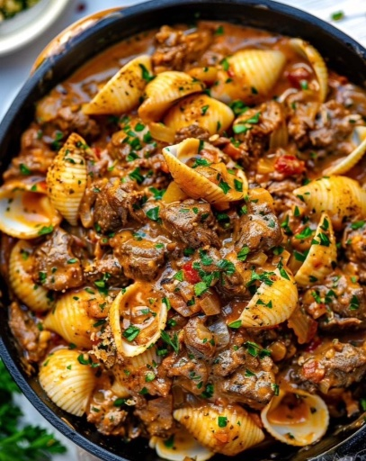
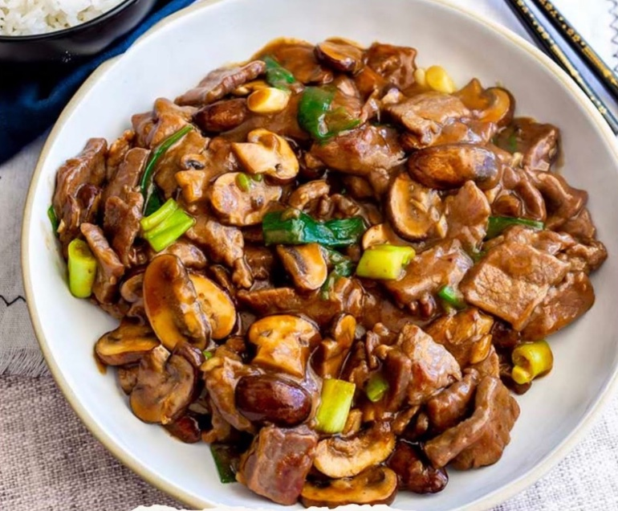
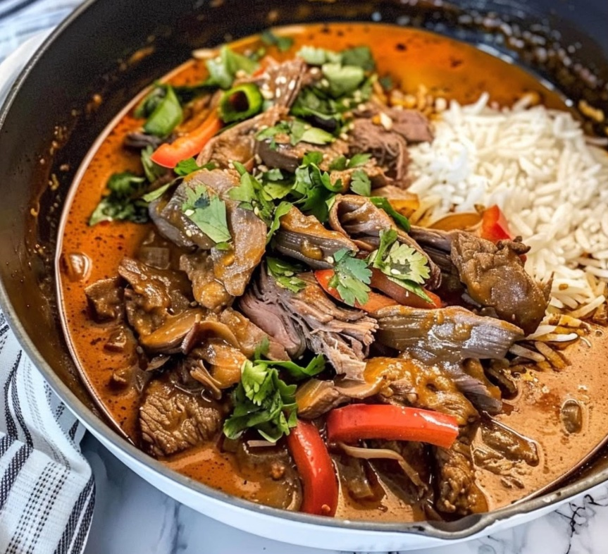
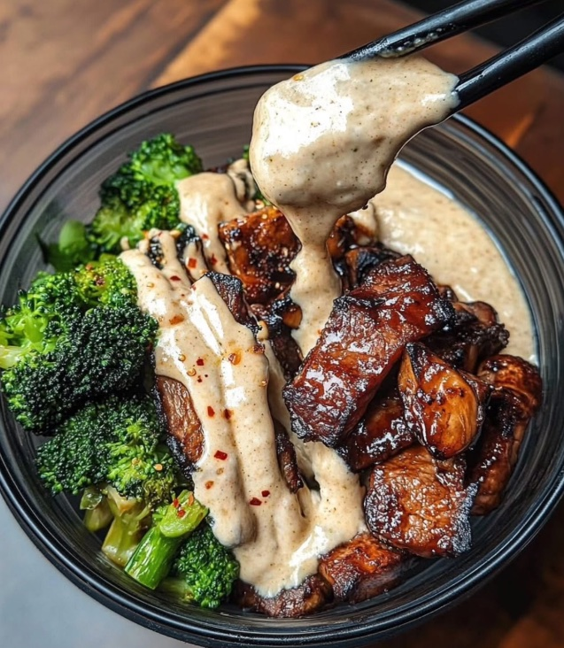
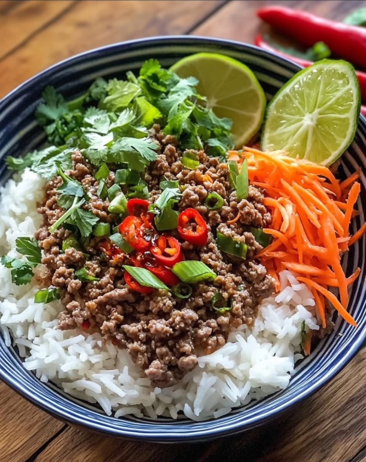

# Beef Recipes

22 recipes.

<a href="barbacoa-beef-tacos.md">Barbacoa Beef Tacos</a>

<a href="beef-and-parmesan-tortellini-in-creamy-sauce.md">Beef and Parmesan Tortellini in Creamy Sauce</a>

<a href="beef-pasta-in-a-creamy-garlic-sauce.md">Beef Pasta in a Creamy Garlic Sauce</a>

<a href="beijing-beef.md">Beijing Beef</a>

<a href="caldillo-de-chile-verde.md">Caldillo de Chile Verde</a>

<a href="chinese-beef-and-mushroom-stir-fry.md">Chinese Beef and Mushroom Stir Fry</a>

<a href="coconut-red-curry-drip-beef.md">Coconut Red Curry Drip Beef</a>

<a href="cowboy-stew.md">Cowboy Stew</a>

<a href="fideo-with-potatoes-and-ground-beef.md">Fideo with Potatoes and Ground Beef</a>

<a href="french-onion-beef-and-noodles.md">French Onion Beef and Noodles</a>

<a href="homemade-mexican-pizza.md">Homemade Mexican Pizza</a>

<a href="meat-loaf.md">Meat Loaf</a>

<a href="million-dollar-spaghetti.md">Million Dollar Spaghetti</a>

<a href="mongolian-ground-beef-noodles.md">Mongolian Ground beef Noodles</a>

<a href="one-skillet-spicy-cajun-beef-pasta.md">One-Skillet Spicy Cajun Beef Pasta</a>

<a href="philly-cheesesteak-pasta.md">Philly Cheesesteak Pasta</a>

<a href="sizzling-chinese-pepper-steak-with-onions.md">Sizzling Chinese Pepper Steak with Onions</a>

<a href="smokey-jalapeno-popper-meatloaf-with-creamy-ranch-drizzle.md">Smokey Jalapeño  Popper Meatloaf with Creamy Ranch Drizzle</a>

<a href="stuffed-cabbage-rolls-with-ground-beef-and-rice.md">Stuffed Cabbage Rolls With Ground Beef and Rice</a>

<a href="teriyaki-beef-broccoli-and-mushroom-bowl-with-ginger-aioli.md">Teriyaki Beef, Broccoli, and Mushroom Bowl with Ginger Aioli</a>

<a href="vietnamese-lemongrass-beef.md">Vietnamese Lemongrass Beef</a>

<a href="warm-taco-slaw.md">Warm Taco Slaw</a>

- [Back to all recipes](../README.md)
