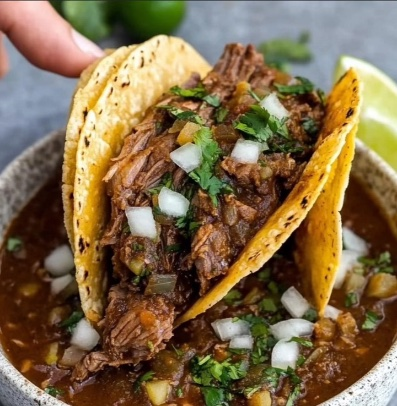

# Barbacoa Beef Tacos

## Ingredients

- 3 lbs beef chuck roast or brisket
- 4 dried guajillo chiles, stems and seeds removed
- 2 dried ancho chiles, stems and seeds removed
- 1 onion, chopped
- 1 onion, diced, for tacos
- 4 cloves garlic minced
- 1/2 cup beef broth
- 1/4 cup apple cider vinegar
- 2 tsp ground cumin
- 2 tsp dried oregano
- 1 tsp black pepper
- Salt to taste
- 2 bay leaves
- Juice of 1 lime
- Corn tortillas
- Fresh cilantro, chopped
- Lime wedges
- Salsa or hot sauce (optional)

## Instructions

1. Toast the guajillo and ancho chiles in a dry skillet over medium heat for about 2-3 minutes until fragrant. Soak the chiles in hot water for about 15 minutes until softened.
2. In a blender, combine the soaked chiles, onion, garlic, beef broth, apple cider vinegar, cumin, oregano, black pepper, and salt. Blend until smooth.
3. In a slow cooker, place the beef chuck roast or brisket. Pour the blended sauce over the meat, add bay leaves, and lime juice. Cover and cook on low for 8 hours or until the meat is tender and shreds easily.
4. Once cooked, remove the beef from the slow cooker and shred it using two forks. Return the shredded beef to the pot, mixing it with the sauce.
5. Heat the corn tortillas on a skillet or directly over an open flame until warm and pliable.
6. Fill each tortilla with a generous amount of barbacoa beef. Top with chopped cilantro, diced onions, and radishes if desired.
7. Serve with lime wedges and salsa on the side.
