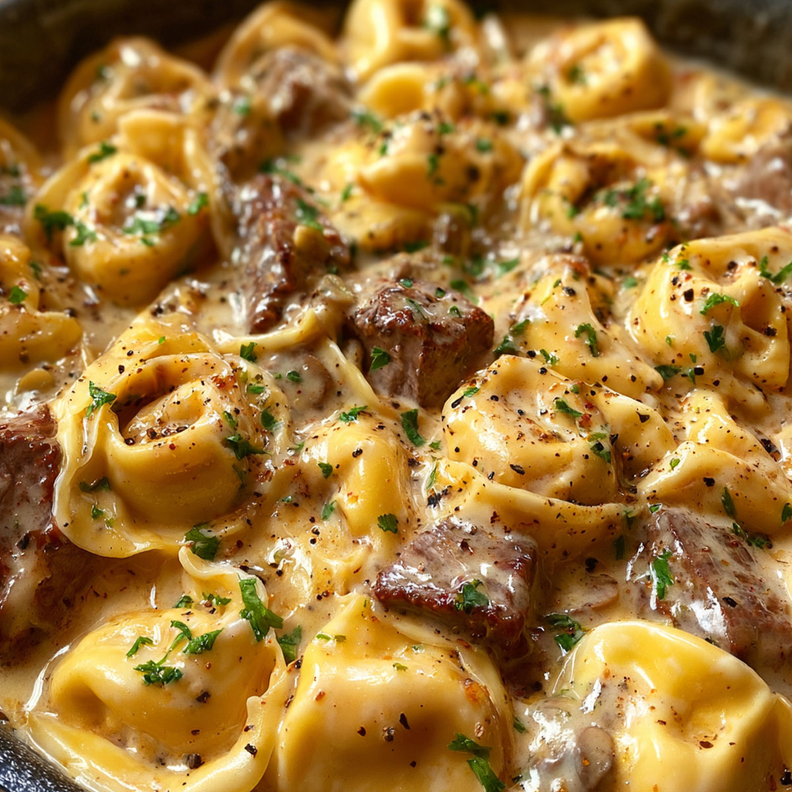

# Beef and Parmesan Tortellini in Creamy Sauce

## Ingredients

- 8 oz beef chuck cubed
- 12 oz cheese tortellini cooked according to package instructions
- 2 tbsp olive oil
- 1/2 cups beef broth onion diced
- 2 cloves garlic minced
- 1 tsp dried basil
- Salt and pepper to taste
- 1 cup heavy cream
- 1/4 cups Parmesan cheese
- Fresh parsley, chopped for garnish

## Instructions

1. In a large skillet, heat olive oil over medium-high heat. Add the beef and season with salt and pepper. Cook until the beef is browned on all sides. Remove and set aside.
2. In the same skillet, add the onions and garlic, cooking the onions until they are translucent and fragrant.
3. Retune the beef to the skillet. pour in heavy cream and bring to a gentle simmer. Stir in dried basil and half of the grated Parmesan, simmering until the sauce thickens slightly.
4. Add the cooked tortellini to the skillet, mixing to thoroughly coat the pasta.
5. Season with additional salt and pepper to taste.
6. Serve the tortellini hot, sprinkled with remaining Parmesan and fresh parsley.

*Photo: Optimal Recipes — [Beef Parmesan Tortellini – Easy 25-Minute Creamy Recipe](https://optimalrecipes.com/beef-parmesan-tortellini-recipe-creamy-delicious-meal/)*
