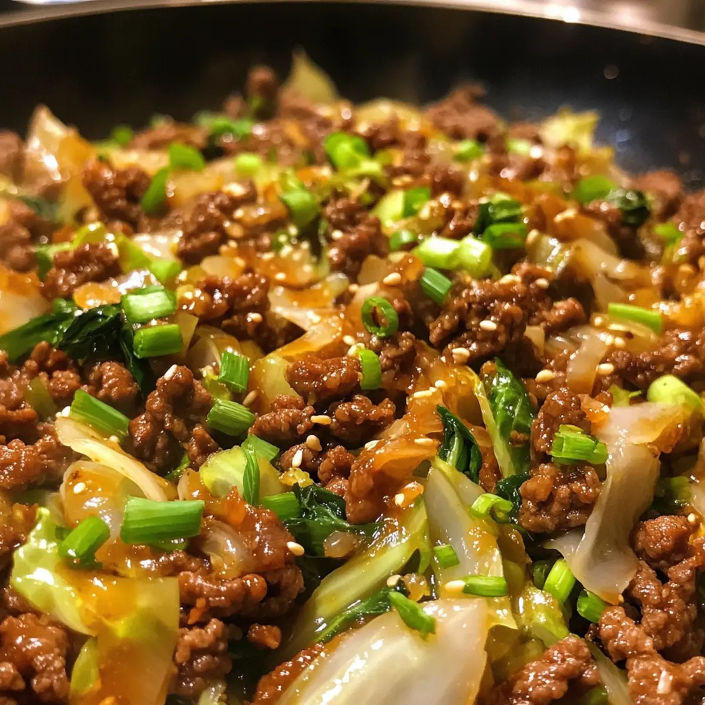

# Chili Oil Cabbage

## Ingredients

- 1 lb ground beef
- ½ large green cabbage, chopped
- 1 red bell pepper, sliced
- 1 yellow bell pepper, sliced
- 3 green onions, sliced
- 3 cloves garlic, minced
- 1 tsp garlic powder
- 1 tsp onion powder
- 1 tsp ginger powder
- 2 tbsp coconut aminos
- 2 tbsp ponzu sauce
- 2 tbsp chili oil, plus more for topping
- Salt & black pepper, to taste
- 1 tbsp sesame seeds, for topping

Ground beef can be swapped for ground turkey or ground pork.

## Instructions

1. Heat a large skillet over medium-high heat. Add the ground beef and cook until browned and cooked through.
2. Season with garlic powder, onion powder, ginger powder, salt, and pepper.
3. Add the red and yellow bell peppers and cook for 3–4 minutes until they begin to soften.
4. Add the chopped cabbage and cook for 6–8 minutes, stirring occasionally, until tender but still slightly crisp.
5. Add coconut aminos, ponzu sauce, and chili oil. Toss everything together and cook for another 2–3 minutes so all those flavors soak in.
6. Stir in half of the green onions.
7. Top with the remaining green onions, sesame seeds, and an extra drizzle of chili oil.
8. Serve hot and enjoy!

*Source: [Low Carb Love on Facebook](https://facebook.com/reel/1899701494353474/)*
*Photo: madebypenelope.com — [Asian-Inspired Beef Cabbage Skillet](https://madebypenelope.com/asian-inspired-beef-cabbage-skillet/)*
