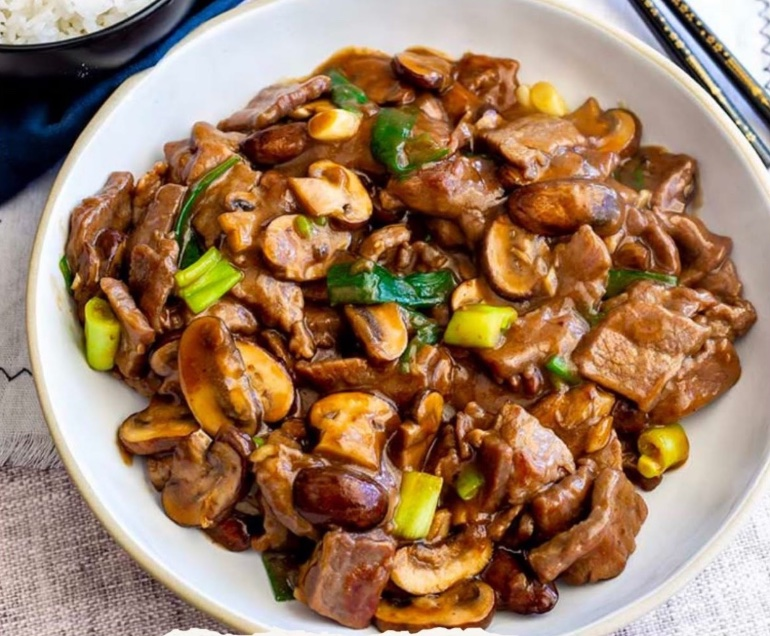

# Chinese Beef and Mushroom Stir Fry

## Ingredients

- 1 lb flank steak or skirt steak
- 1 ½ tbsp baking soda (for tenderizing the beef)
- 2½ cups sliced mushrooms
- 2 cloves garlic, thinly sliced
- 2 green onions, chopped into 2-inch pieces
- 2 tbsp oil

### For the Sauce

- ¾ cup cold beef stock or broth
- 2 ½ tbsp cornstarch
- 2 tbsp Chinese cooking wine (or dry sherry)
- 3 tbsp soy sauce
- 2 tsp oyster sauce
- 2 tsp sesame oil
- ¼ tsp white pepper
- 1 tsp sugar

## Instructions

1. Cut the beef into thin strips across the grain.
2. Sprinkle with baking soda, stir to coat, and let sit for 15 minutes.
3. Rinse the beef well under cold water, then pat dry and set aside.
4. Combine all sauce ingredients in a large measuring cup, ensuring the beef broth is cold to prevent cornstarch clumping.
5. Heat oil in a heavy-based frying pan over high heat. Stir fry green onions for 1 minute to flavor the oil. Add beef and cook for 1 minute, stirring constantly. Add mushrooms and stir fry for 2 more minutes. Add garlic and stir for another minute.
6. Stir the sauce again before pouring it into the pan. The sauce will thicken quickly; stir to coat the stir fry and cook for 1 minute to heat through.
7. Serve the beef and mushroom stir fry immediately, ideally with fried rice or noodles.
