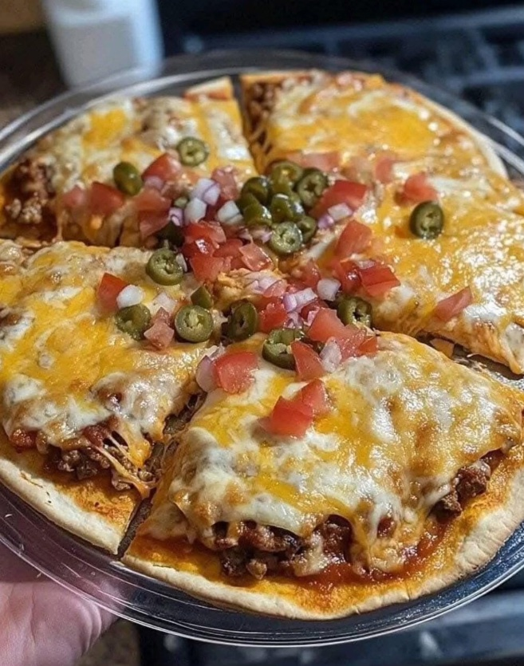

# Homemade Mexican Pizza

## Ingredients

- 1 lb lean ground beef
- 1 packet (1 oz) taco seasoning
- 1/2 cup water
- 6 medium flour tortillas
- 1 can (16 oz) refried beans
- 1 can (10 oz) red enchilada sauce
- 1 cup shredded cheddar cheese
- 1 cup shredded pepper-jack cheese
- 1 roma tomato, diced
- 1 green onion, diced
- 1 small can sliced black olives

## Instructions

1. Preheat oven to 375°F. Spray two baking sheets with non-stick spray. Place 3 tortillas on each sheet.
2. Bake the tortillas for 3-5 minutes, flip them, and bake for another 2-5 minutes until golden and crispy. Set aside.
3. In a skillet, cook and crumble the ground beef over medium-high heat. Drain the grease.
4. Add taco seasoning and water to the beef, bring to a boil, then reduce heat to medium-low. Simmer for 10 minutes and set aside.
5. In a microwave-safe bowl, warm the refried beans. Spread a thin layer of beans on one tortilla.
6. Top with 1/3 of the meat mixture, then place another tortilla on top.
7. Spread 3 tablespoons of enchilada sauce on the top tortilla.
8. Sprinkle with cheddar and pepper-jack cheese. Add diced tomato, green onion, and sliced black olives.
9. Repeat this process with the remaining tortillas to create three pizzas in total.
10. Bake the pizzas for 5 minutes, or until the cheese is melted and bubbly. Allow them to cool slightly before slicing and serving.
