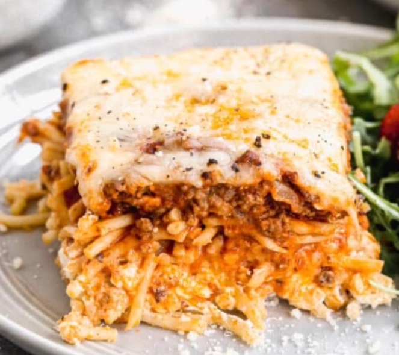

# Million Dollar Spaghetti

## Ingredients

- 16 oz spaghetti noodles
- 1/2 lb ground beef
- 1/2 lb ground Italian sausage or pork sausage
- salt and pepper, to taste
- 1 small onion, chopped
- 2 cloves garlic, minced
- 24 oz marinara sauce
- 3 tbsp butter
- 8 oz cream cheese, softened
- 1/4 cup sour cream
- 1 cup cottage cheese or ricotta cheese
- 2 cups shredded mozzarella cheese
- 2/3 cup freshly grated parmesan cheese

## Instructions

1. Preheat oven to 350 degrees F.
2. In a large skillet cook and crumble the ground beef and Italian sausage and season with salt and pepper. Remove most of the grease.
3. Add onions and garlic and cook for a few minutes until onion is translucent.
4. Add all but ½ cup of the marinara sauce (reserve ½ cup for later) to the mixture and stir to combine. Set aside.
5. Cook Spaghetti according to package instructions, just until "al dente".
6. Drain, and place hot spaghetti in a large mixing bowl with butter and ½ cup reserved marinara sauce and toss to combine.
7. Combine cream cheese, sour cream and cottage cheese in a bowl and mix well.
8. Pour HALF of the pasta into a 9x13" pan. Smooth cheese layer on top. Top with remaining noodles. Add meat sauce on top and smooth into an even layer. Top with mozzarella cheese and parmesan cheese.
9. Bake for 30-40 minutes or until hot and bubbly. Check it around 20 minutes and if the cheese is browning too quickly, tent a piece of tinfoil over it. Wait at least 15 minutes before cutting and serving, to allow it to set up.
