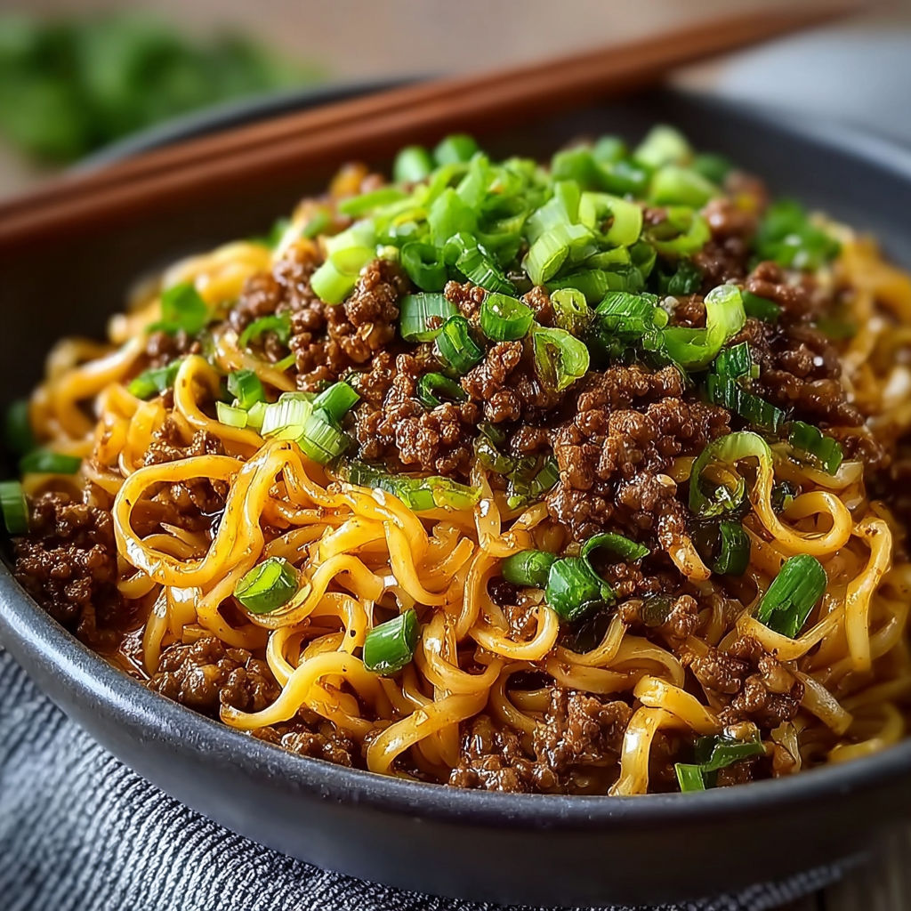

# Mongolian Ground beef Noodles

## Ingredients

- 1 lb ground beef
- 5 cloves garlic minced
- 1/3 cup brown sugar
- 1/4 cup beef broth
- 1/3 cup soy sauce
- 3 tbsp hoisin sauce
- 1/2 tsp ground ginger
- 1/2 tab ground black pepper
- Pinch of red pepper flake
- 10 oz linguine
- 1 tbsp corn starch
- 2 tbsp water
- 4 green onions slice for garnish

## Instructions

1. Cook the pasta according to the package instructions.
2. In a large skillet over medium-high heat until it is no longer pink. Drain excess fat.
3. Add the minced garlic to the browned meat and cook until fragrant. Then, add the soy sauce, beef broth, brown sugar, hoisin sauce, ground ginger, black pepper and red pepper flakes. Stir to combine.
4. Mix the corn starch with cold water until smooth and stir into the skillet. Bring to a gentle boil; the sauce will thicken.
5. Toss the cooked noodles in the skillet ensuring they are fully coated with the sauce. Allow to simmer together for 2-3 minutes.
6. Sprinkle sliced green onions over the noodles and serve hot.

*Photo: Cookrisp — [Mongolian Ground Beef Noodles with Rich Savory Sauce](https://cookrisp.com/recipes/easy-mongolian-ground-beef-noodles)*
