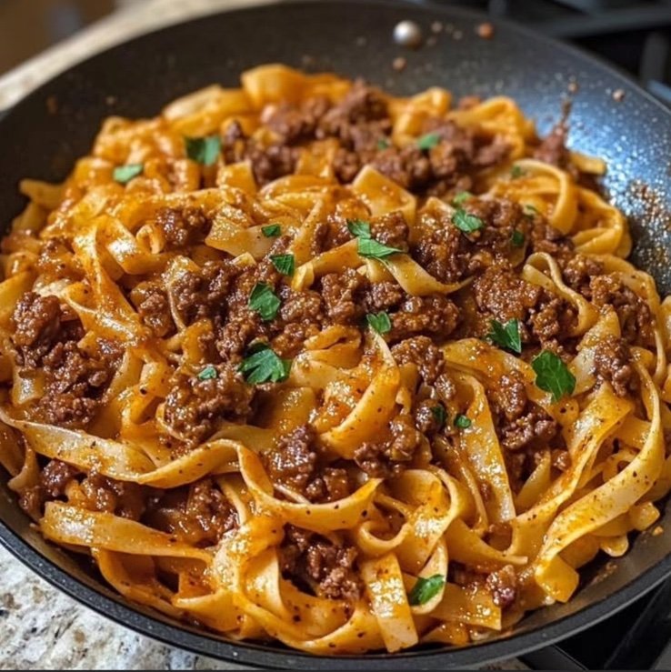

# One-Skillet Spicy Cajun Beef Pasta

## Ingredients

- 1 lb ground beef
- 1 tbsp olive oil
- 1 small onion, diced
- 3 cloves garlic, minced
- 1 red bell pepper, diced
- 1 green bell pepper, diced
- 2 tsp Cajun seasoning (adjust to taste)
- 1 tsp smoked paprika
- ½ tsp red pepper flakes (optional, for extra spice)
- 2 cups beef broth
- 1 (14.5 oz) can diced tomatoes (with juices)
- 1 cup heavy cream
- 8 oz penne or rotini pasta
- 1 cup shredded cheddar cheese
- ¼ cup grated Parmesan cheese
- 2 green onions, sliced (for garnish)
- Fresh parsley, chopped (for garnish)
- Salt & black pepper, to taste

## Instructions

1. In a large skillet over medium heat, add olive oil and ground beef. Cook until browned, breaking it apart with a spatula. Drain excess fat if needed.
2. Add diced onion, garlic, red bell pepper, and green bell pepper to the skillet. Sauté for 2-3 minutes until softened.
3. Stir in Cajun seasoning, smoked paprika, and red pepper flakes. Cook for another minute to let the flavors meld.
4. Pour in beef broth, diced tomatoes (with juices), and heavy cream. Stir well, then add the uncooked pasta.
5. Bring to a gentle boil.
6. Reduce heat to low, cover, and let simmer for about 12-15 minutes, stirring occasionally, until the pasta is tender and has absorbed most of the liquid.
7. Stir in shredded cheddar cheese and Parmesan cheese until melted and creamy.
8. Adjust seasoning with salt and black pepper to taste.
9. Remove from heat and garnish with sliced green onions and fresh parsley. Serve hot and enjoy!
