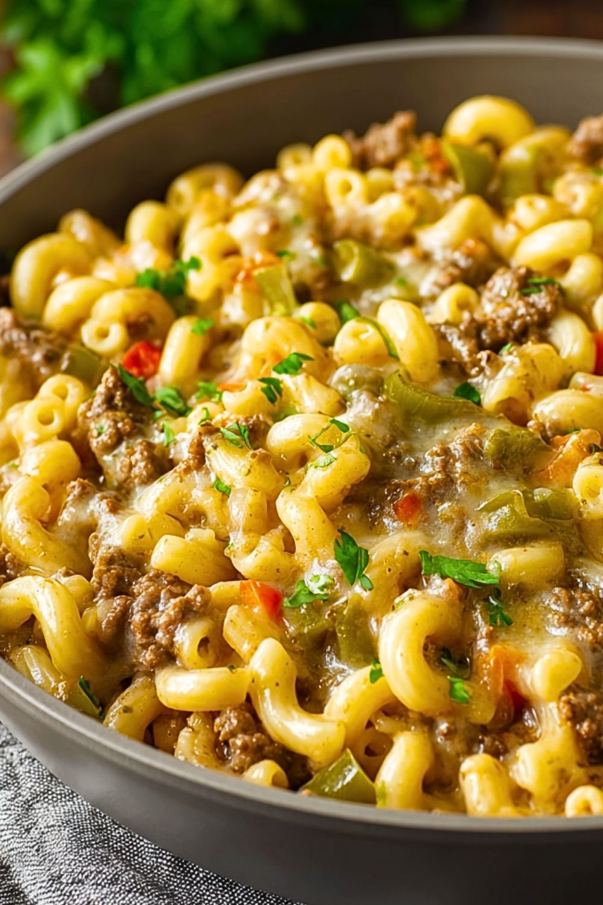

# Philly Cheesesteak Pasta

## Ingredients

- 2 tbsp olive oil
- 1 lb ground beef
- 1/2 onion diced
- salt and pepper to taste
- 2 tsp Worcestershire sauce
- 1 green bell pepper diced
- 8 oz elbow macaroni uncooked
- 1 cup water
- 2 cups beef broth
- 1/2 cup milk
- 2 oz cream cheese cubed
- 1/2 cup mozzarella cheese shredded
- 6 to 8 oz provolone cheese sliced and torn into pieces
- chopped fresh parsley for garnish

## Instructions

1. Heat olive oil in a 12 inch skillet over medium heat. Brown ground beef and onion in skillet until meat is no longer pink and onions are soft and translucent. Season with salt and pepper to taste.
2. Add Worchestire, green bell pepper, macaroni noodles, water and beef broth.
3. Bring to a boil over high heat. Once water comes to a boil reduce heat to low, cover and simmer for 15 minutes. Check to ensure the pasta has fully cooked and most of the liquid has been absorbed/evaporated.
4. Keeping the skillet over low heat add the ½ cup of milk and cubed cream cheese. Stir until the cream cheese has been incorporated.
5. Remove from heat. Sprinkle the mozzarella and half of the provolone cheese into the pan and stir to distribute.
6. Top with the remaining provolone cheese. Put the lid back on the skillet for a couple of minutes to melt the cheese.
7. Garnish with chopped parsley.

*Photo: Ava Chef Life — [Philly Cheesesteak Pasta](https://avacheflife.com/philly-cheesesteak-pasta/)*
