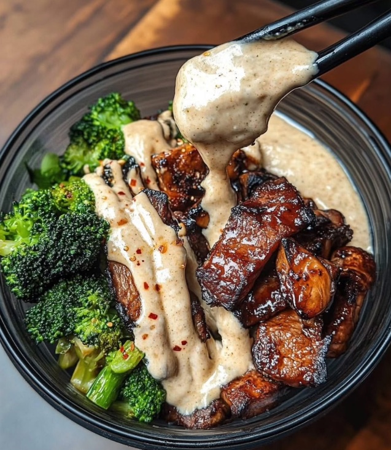

# Teriyaki Beef, Broccoli, and Mushroom Bowl with Ginger Aioli

## Ingredients

### For the Beef

- 1 lb boneless, skinless beef (flank steak, skirt steak, or sirloin tip)
- 1/4 cup soy sauce
- 1/4 cup honey
- 2 tbsp rice vinegar
- 1 tsp garlic powder
- 1/2 tsp ginger powder
- 1/4 tsp salt
- 1/8 tsp black pepper

### For the Bowl

- 1 cup broccoli florets, steamed
- 1 cup sliced mushrooms

### For the Ginger Aioli

- 1/2 cup mayonnaise
- 1 tbsp grated ginger
- 1 clove garlic, minced
- 1 tbsp lemon juice
- 1/4 tsp salt
- 1/8 tsp black pepper

## Instructions

1. In a bowl, combine beef with soy sauce, honey, rice vinegar, garlic powder, ginger powder, salt, and pepper. Marinate for at least 30 minutes, or up to 2 hours.
2. Preheat grill to medium-high heat. Grill the beef for 2-3 minutes per side, or until cooked through. Let rest for 5 minutes before slicing.
3. In a small bowl, whisk together mayonnaise, grated ginger, garlic, lemon juice, salt, and pepper.
4. Divide the broccoli and mushrooms among bowls. Top with sliced beef and drizzle generously with the Ginger Aioli.

## Tips

- You can use any type of beef you like for this recipe.
- For a spicier sauce, add a pinch of red pepper flakes to the Ginger Aioli.
