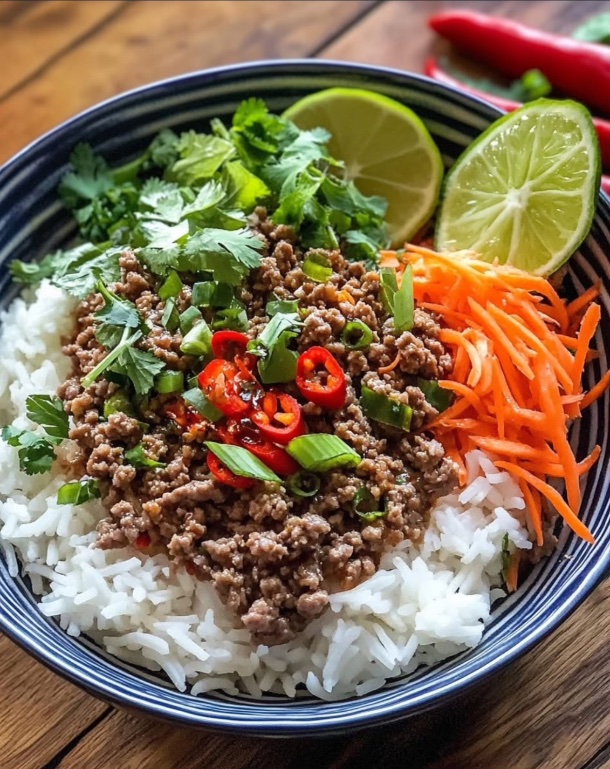

# Vietnamese Lemongrass Beef

## Ingredients

- 1 lb ground beef (or pork/chicken)
- 3 stalks lemongrass, minced
- 1 shallot, finely diced
- 1 tbsp garlic, minced
- 1 tbsp ginger, grated
- 2 tsp cumin seeds, toasted and ground
- 1/4 tsp turmeric
- 1 bird's eye chili, sliced
- 1 lime (zest and juice)
- 2 tbsp fish sauce
- 2 tbsp palm sugar (or brown sugar)
- 1 tbsp cilantro, chopped
- 1 tbsp mint, chopped
- 1 tbsp basil, chopped

## Instructions

1. Cook ground beef in a skillet over medium-high heat; drain excess grease.
2. Add lemongrass, shallot, garlic, ginger, cumin, turmeric, and chili. Cook for 3 minutes.
3. Stir in lime juice, fish sauce, and sugar. Adjust seasoning.
4. Mix in cilantro, mint, and basil.
5. Serve over rice.
