# Chicken Recipes

61 recipes.

<a href="asparagus-and-chicken-fricassee.md">Asparagus and Chicken Fricassee</a>

<a href="bang-bang-chicken-skewers.md">Bang Bang Chicken Skewers</a>

<a href="black-pepper-chicken-with-mushrooms.md">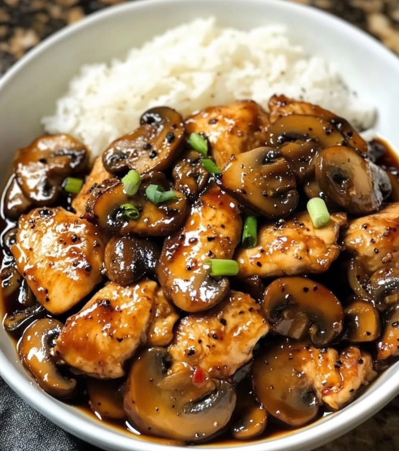Black Pepper Chicken with Mushrooms</a>

<a href="black-pepper-chicken-with-mushrooms-2.md">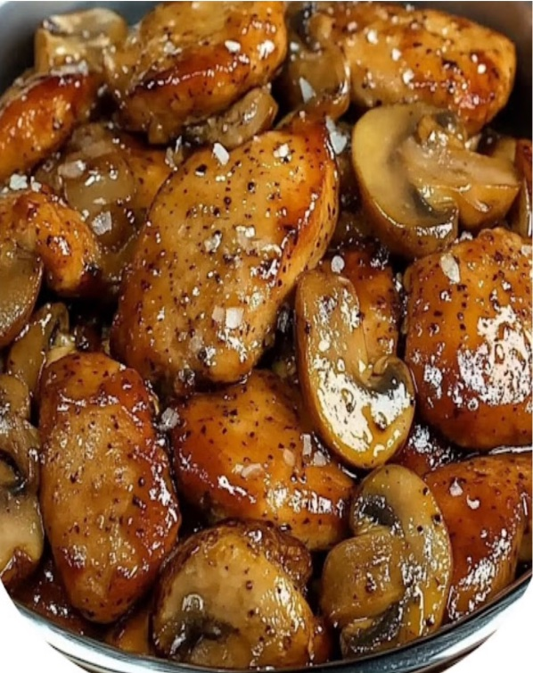Black Pepper Chicken with Mushrooms</a>

<a href="broccoli-cheddar-chicken-orzo.md">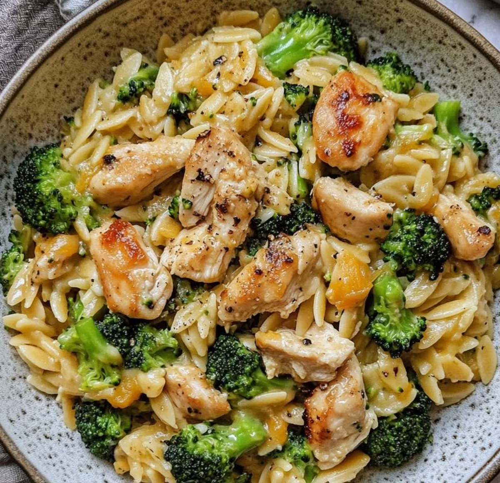Broccoli Cheddar Chicken Orzo</a>

<a href="burrito-bowls-with-pico-de-gallo-and-chipotle-aioli.md">Burrito Bowls with Pico de Gallo & Chipotle Aioli</a>

<a href="cajun-chicken-and-sausage-pasta-skillet.md">Cajun Chicken and Sausage Pasta Skillet</a>

<a href="cajun-chicken-pasta.md">Cajun Chicken Pasta</a>

<a href="caribbean-chicken-and-rice.md">Caribbean Chicken and Rice</a>

<a href="cheesy-salsa-verde-chicken-casserole.md">Cheesy Salsa Verde Chicken Casserole</a>

<a href="cheesy-tuscan-chicken-bites-with-sun-dried-tomato-rotini.md">Cheesy Tuscan Chicken Bites with Sun-Dried Tomato Rotini</a>

<a href="chicken-and-cabbage-stir-fry.md">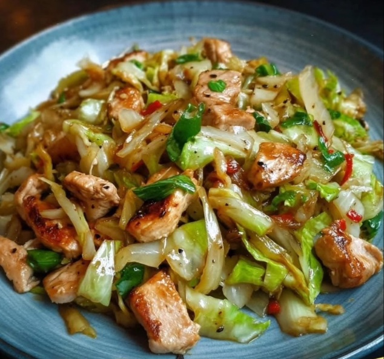Chicken and Cabbage Stir-fry</a>

<a href="chicken-bacon-and-pasta-with-spinach-and-tomatoes-in-garlic-cream-sauce.md">Chicken Bacon and Pasta with Spinach and Tomatoes in Garlic Cream Sauce</a>

<a href="chicken-mushroom-stroganoff.md">Chicken Mushroom Stroganoff</a>

<a href="chicken-shawarma-with-creamy-garlic-sauce.md">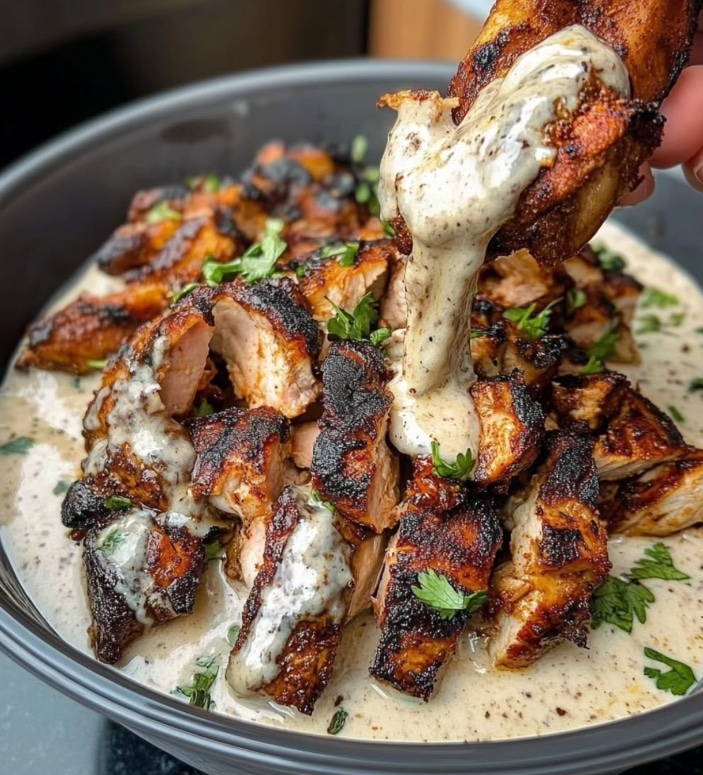Chicken Shawarma with Creamy Garlic Sauce</a>

<a href="chicken-shyte.md">Chicken Shyte</a>

<a href="chicken-spinach-and-mushroom-low-carb-oven-dish.md">Chicken Spinach and Mushroom Low Carb Oven Dish</a>

<a href="chicken-yakisoba.md">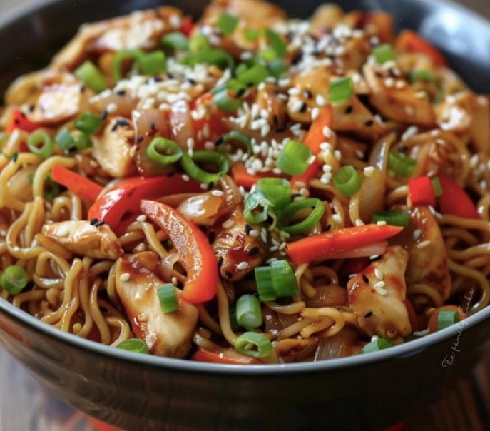Chicken yakisoba</a>

<a href="chipotle-chicken-burrito-rice-bowl.md">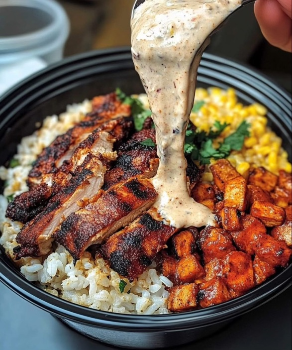Chipotle Chicken Burrito Rice Bowl</a>

<a href="chipotle-lime-chicken-with-corn-and-peppers.md">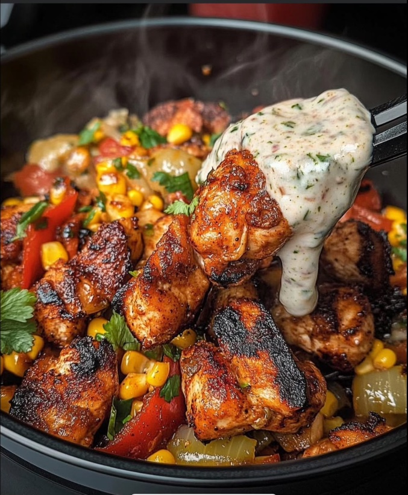Chipotle Lime Chicken with Corn & Peppers</a>

<a href="coconut-chicken-rice-bowl.md">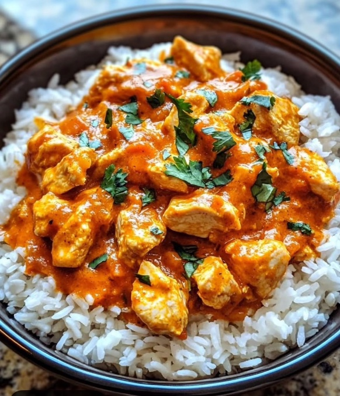Coconut Chicken Rice Bowl</a>

<a href="coconut-curry-chicken-with-lemongrass.md">Coconut Curry Chicken with Lemongrass</a>

<a href="coconut-curry-chicken-with-rice-noodles.md">Coconut Curry Chicken with Rice Noodles</a>

<a href="cowboy-butter-chicken-linguine.md">Cowboy Butter Chicken Linguine</a>

<a href="cowboy-butter-chicken-linguine-2.md">Cowboy Butter Chicken Linguine</a>

<a href="creamy-chicken-and-mushroom.md">Creamy Chicken and Mushroom</a>

<a href="egg-roll-stir-fry.md">Egg Roll Stir Fry</a>

<a href="filipino-pancit.md">Filipino Pancit</a>

<a href="garlic-butter-chicken-and-parmesan-rice.md">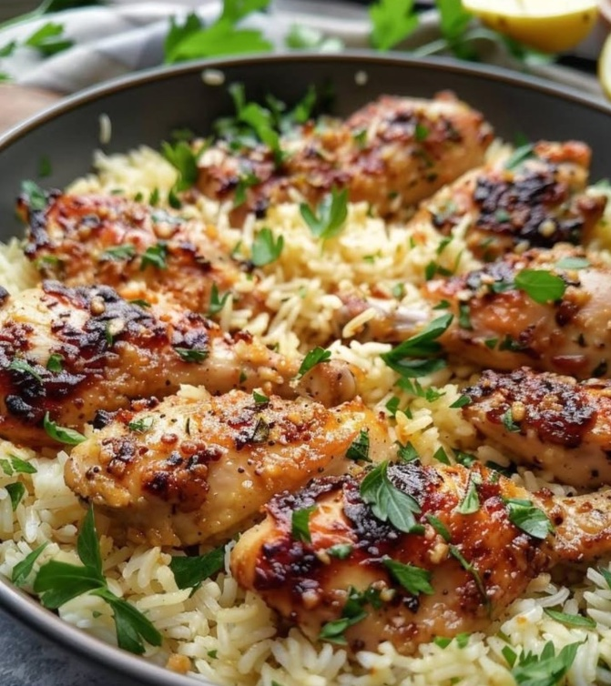Garlic Butter Chicken and Parmesan Rice</a>

<a href="garlic-butter-chicken-bites-with-creamy-parmesan-pasta.md">Garlic Butter Chicken Bites with Creamy Parmesan Pasta</a>

<a href="garlic-chicken-with-broccoli-and-spinich.md">Garlic Chicken with Broccoli and Spinich</a>

<a href="garlic-parmesan-chicken-and-roasted-brussels-sprouts-with-aioli-dipping-sauce.md">Garlic Parmesan Chicken and Roasted Brussels Sprouts with Aioli Dipping Sauce</a>

<a href="garlic-roast-chicken-with-rosemary-and-lemon.md">Garlic Roast Chicken with Rosemary and Lemon</a>

<a href="greek-chicken-gyros.md">Greek Chicken Gyros</a>

<a href="grilled-chicken-and-broccoli-bowls-with-creamy-garlic-sauce.md">Grilled Chicken & Broccoli Bowls with Creamy Garlic Sauce</a>

<a href="herbed-chicken-and-mushrooms.md">Herbed Chicken and Mushrooms</a>

<a href="italian-garlic-chicken-meatballs-with-creamy-bowties.md">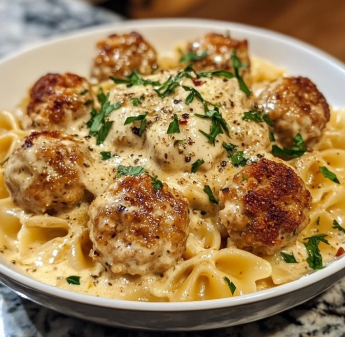Italian Garlic Chicken Meatballs with Creamy Bowties</a>

<a href="jalapeño-chicken-with-bell-peppers.md">Jalapeño Chicken with Bell Peppers</a>

<a href="king-ranch-chicken.md">King Ranch Chicken</a>

<a href="lemon-garlic-chicken-with-creamy-bowtie-pasta.md">Lemon Garlic Chicken with Creamy Bowtie Pasta</a>

<a href="lemon-ginger-soy-marinated-grilled-chicken.md">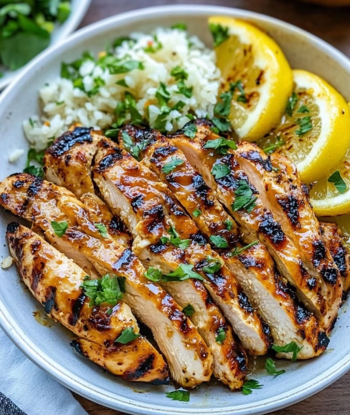Lemon Ginger Soy Marinated Grilled Chicken</a>

<a href="lime-marinated-chicken-with-avocado-salsa.md">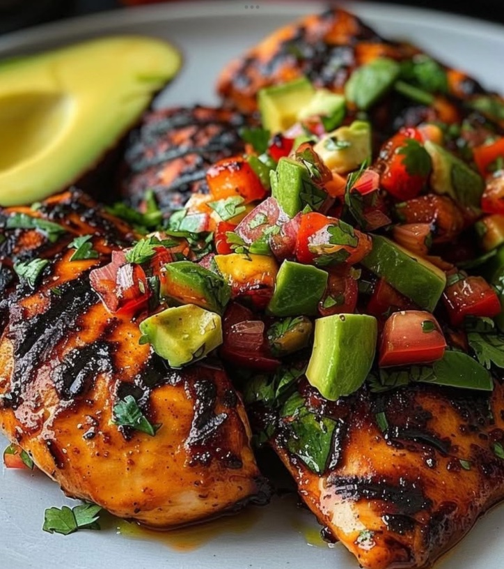Lime-Marinated Chicken with Avocado Salsa</a>

<a href="melt-in-your-mouth-chicken.md">Melt in Your Mouth Chicken</a>

<a href="mexican-street-corn-chicken-bowls.md">Mexican Street Corn Chicken Bowls</a>

<a href="mexican-white-chicken-chili.md">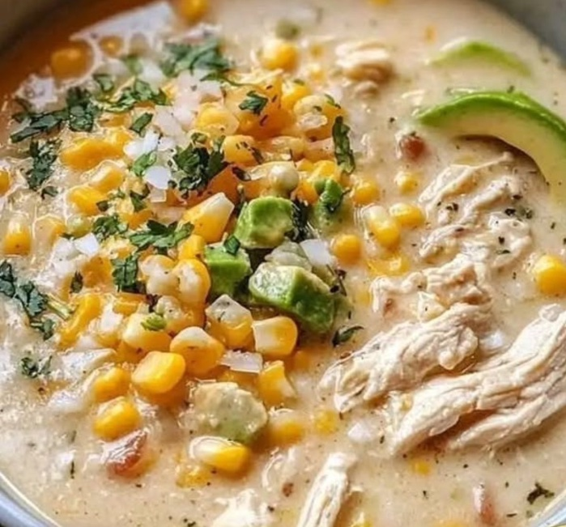Mexican White Chicken Chili</a>

<a href="one-pan-cheesy-jalapeño-chicken.md">One Pan Cheesy Jalapeño Chicken</a>

<a href="one-pan-honey-garlic-chicken-with-red-potatoes-and-green-beans.md">One Pan Honey Garlic Chicken with Red Potatoes and Green Beans</a>

<a href="one-pan-chicken-with-buttered-noodles.md">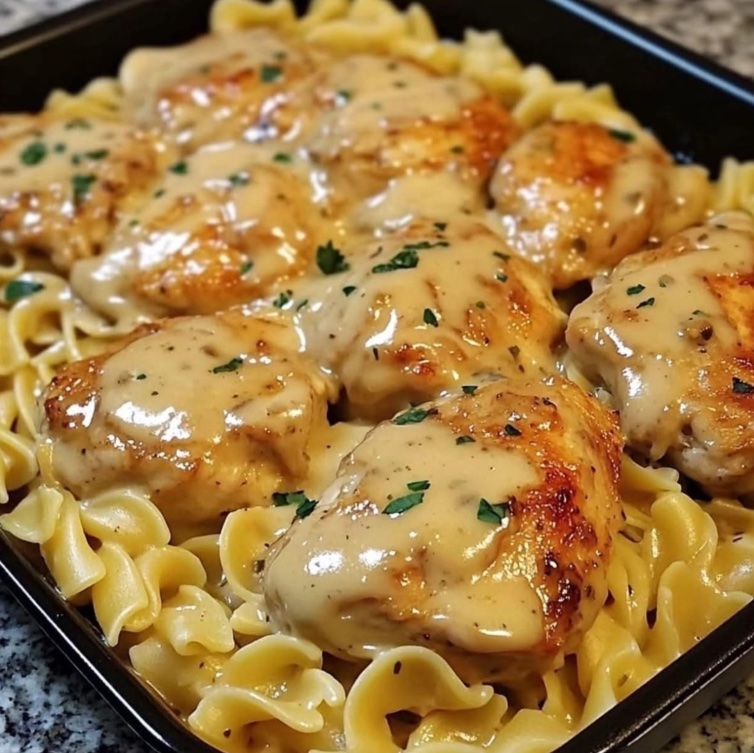One-Pan Chicken with Buttered Noodles</a>

<a href="one-pan-coconut-lime-chicken.md">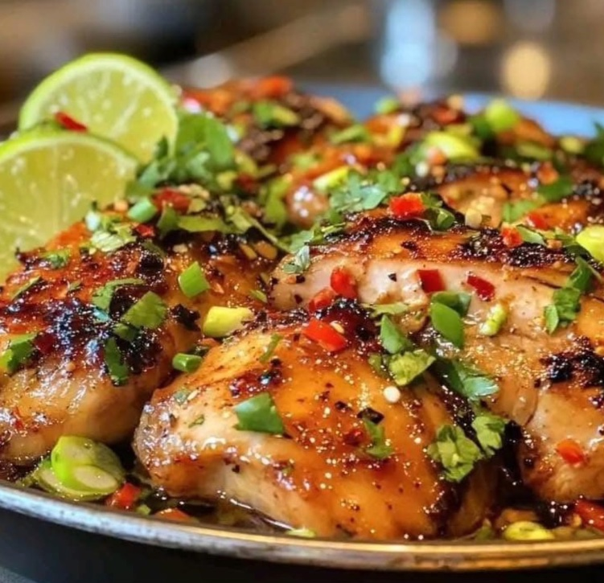One-Pan Coconut-Lime Chicken</a>

<a href="peruvian-chicken-and-rice-with-zesty-green-sauce.md">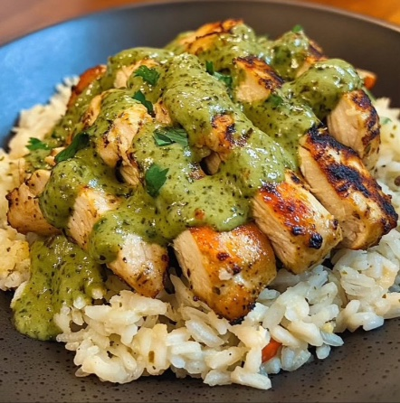Peruvian chicken & rice with zesty green sauce</a>

<a href="poblanos-rellenos-de-pollo-y-queso-chicken-and-cheese-stuffed-poblanos.md">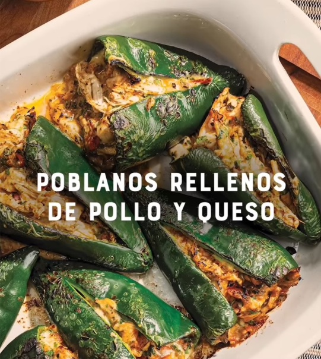Poblanos Rellenos de Pollo y Queso (Chicken & Cheese Stuffed Poblanos)</a>

<a href="rotisserie-chicken-salad.md">Rotisserie Chicken Salad</a>

<a href="slow-cooker-cream-cheese-chicken.md">Slow Cooker Cream Cheese Chicken</a>

<a href="slow-cooker-cream-cheese-chicken-chili.md">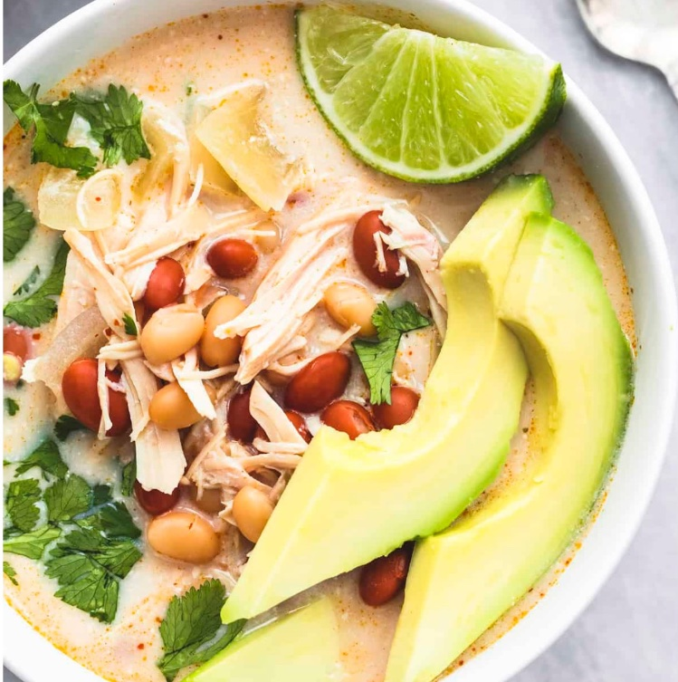Slow Cooker Cream Cheese Chicken Chili</a>

<a href="smoky-chipotle-chicken-bowls-with-cilantro-lime-crema.md">Smoky Chipotle Chicken Bowls with Cilantro Lime Crema</a>

<a href="smothered-chicken-and-rice.md">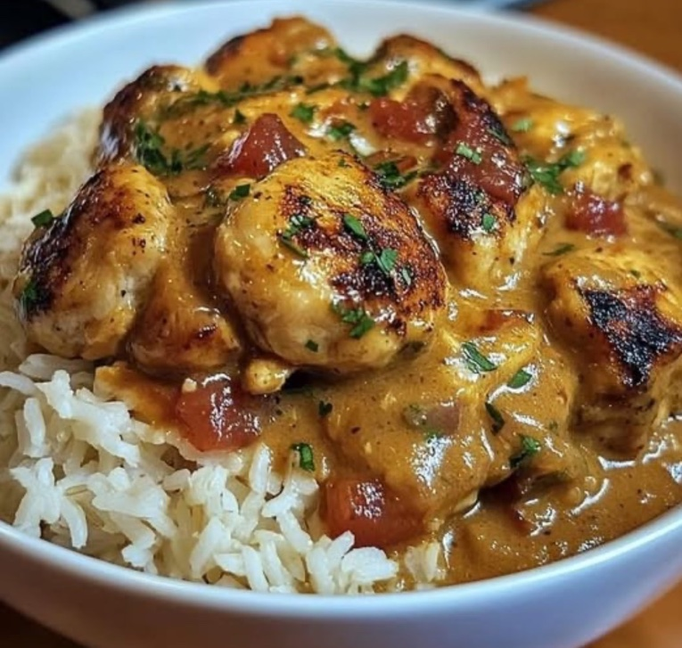Smothered Chicken and Rice</a>

<a href="southwest-chicken-cutlet-rice-bowl.md">Southwest Chicken Cutlet Rice Bowl</a>

<a href="spiced-coconut-basil-chicken-with-rice.md">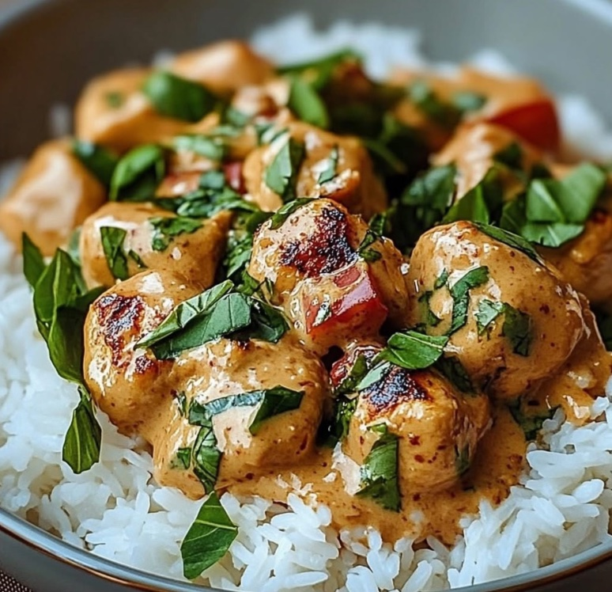Spiced Coconut Basil Chicken with Rice</a>

<a href="spinach-and-feta-chicken-rolls.md">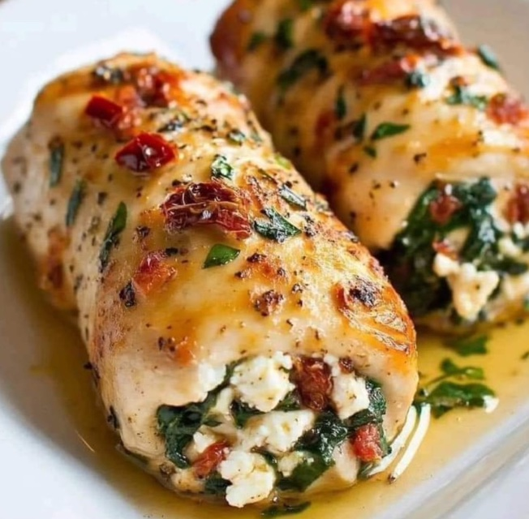Spinach and Feta Chicken Rolls</a>

<a href="street-corn-chicken-rice-bowl.md">Street Corn Chicken Rice Bowl</a>

<a href="thai-chili-chicken-lettuce-wraps.md">Thai Chili Chicken Lettuce Wraps</a>

- [Back to all recipes](../README.md)
