# Chicken Recipes

62 recipes.

<a href="https://chknfrdstk.github.io/Recipes/chicken/asparagus-and-chicken-fricassee.html">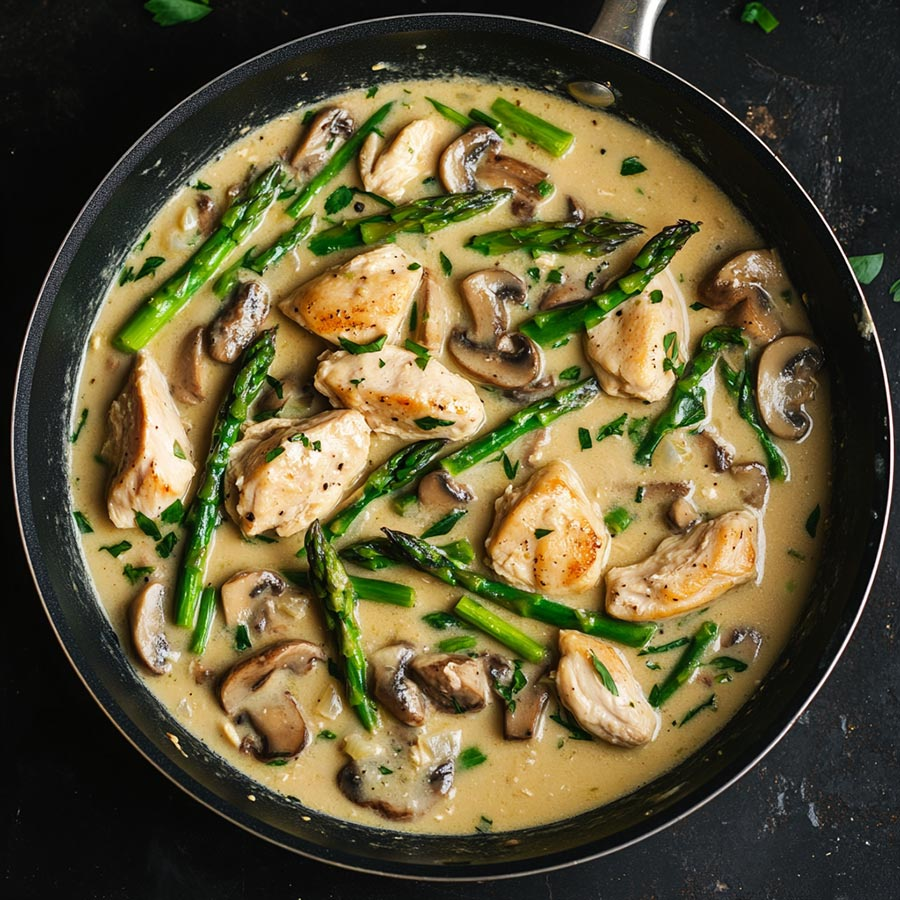Asparagus and Chicken Fricassee</a>

<a href="https://chknfrdstk.github.io/Recipes/chicken/bang-bang-chicken-skewers.html">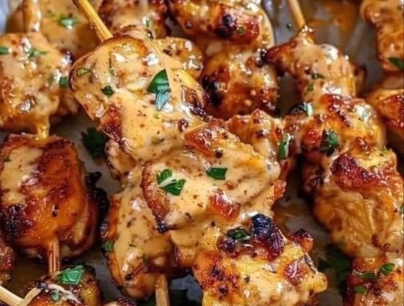Bang Bang Chicken Skewers</a>

<a href="https://chknfrdstk.github.io/Recipes/chicken/black-pepper-chicken-with-mushrooms.html">Black Pepper Chicken with Mushrooms</a>

<a href="https://chknfrdstk.github.io/Recipes/chicken/black-pepper-chicken-with-mushrooms-2.html">Black Pepper Chicken with Mushrooms</a>

<a href="https://chknfrdstk.github.io/Recipes/chicken/broccoli-cheddar-chicken-orzo.html">Broccoli Cheddar Chicken Orzo</a>

<a href="https://chknfrdstk.github.io/Recipes/chicken/burrito-bowls-with-pico-de-gallo-and-chipotle-aioli.html">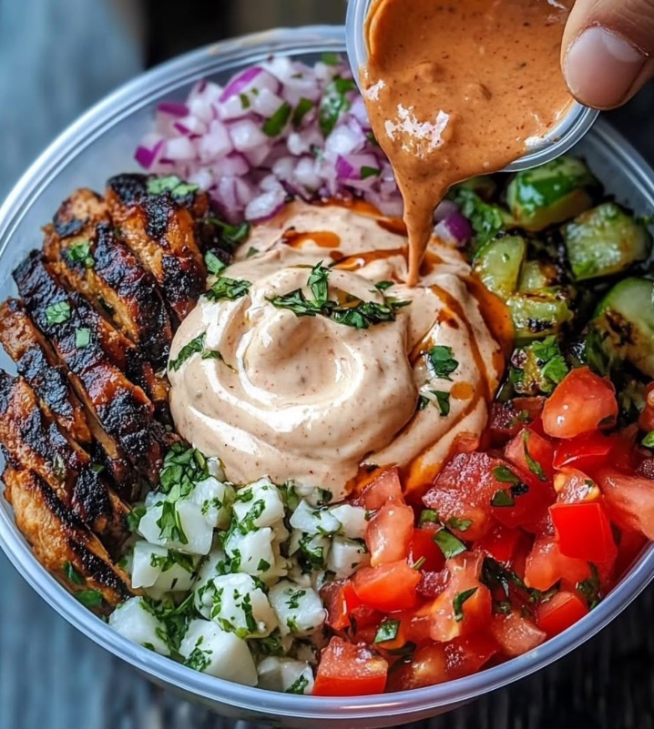Burrito Bowls with Pico de Gallo & Chipotle Aioli</a>

<a href="https://chknfrdstk.github.io/Recipes/chicken/cajun-chicken-and-sausage-pasta-skillet.html">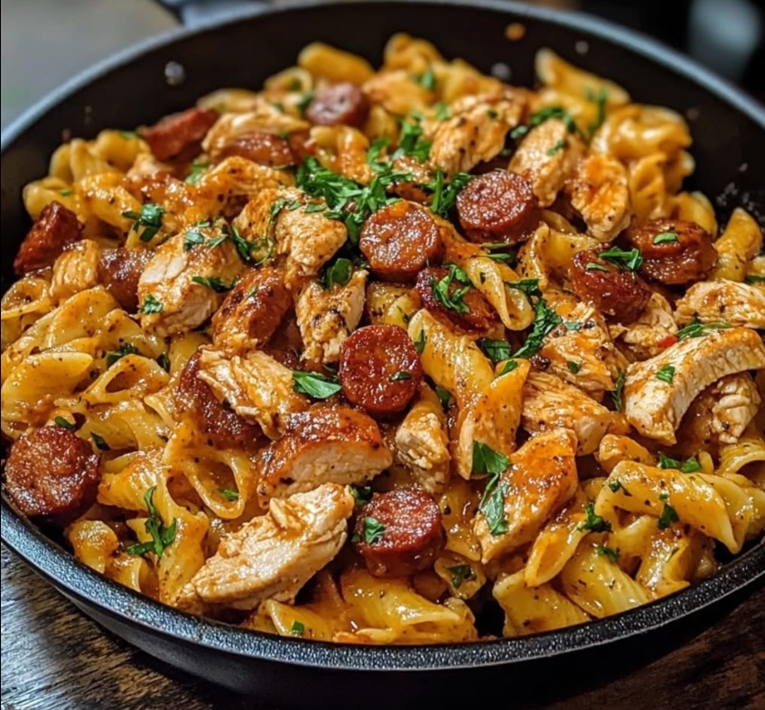Cajun Chicken and Sausage Pasta Skillet</a>

<a href="https://chknfrdstk.github.io/Recipes/chicken/cajun-chicken-pasta.html">Cajun Chicken Pasta</a>

<a href="https://chknfrdstk.github.io/Recipes/chicken/caribbean-chicken-and-rice.html">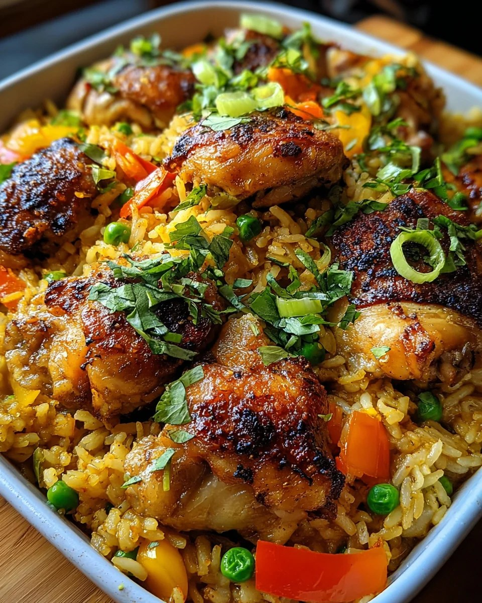Caribbean Chicken and Rice</a>

<a href="https://chknfrdstk.github.io/Recipes/chicken/cheesy-salsa-verde-chicken-casserole.html">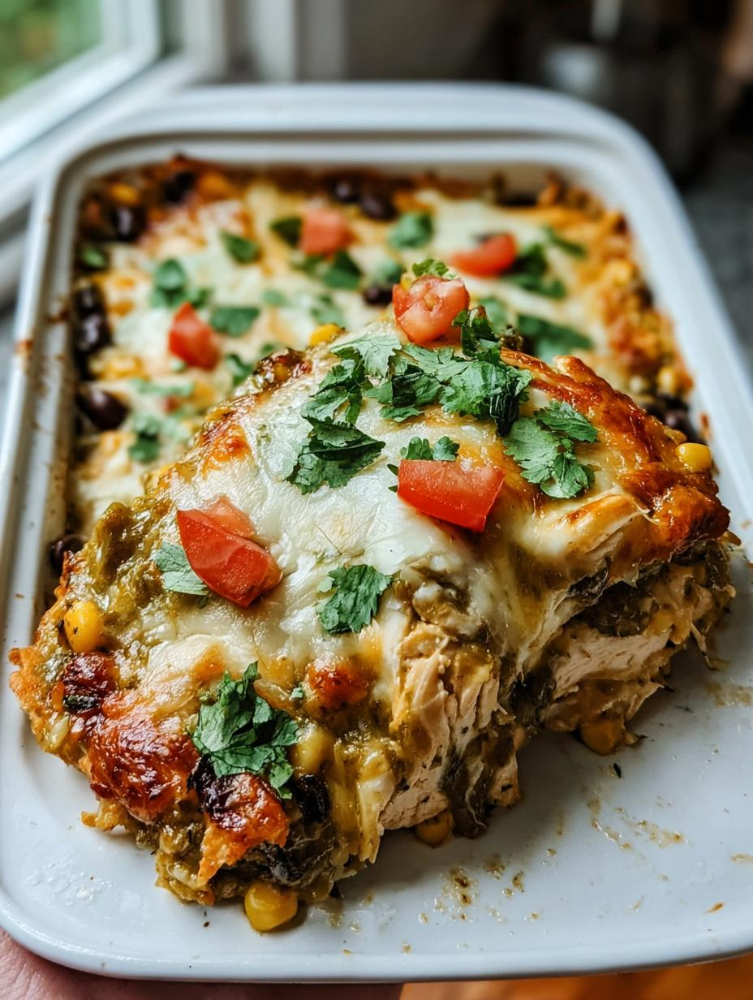Cheesy Salsa Verde Chicken Casserole</a>

<a href="https://chknfrdstk.github.io/Recipes/chicken/cheesy-tuscan-chicken-bites-with-sun-dried-tomato-rotini.html">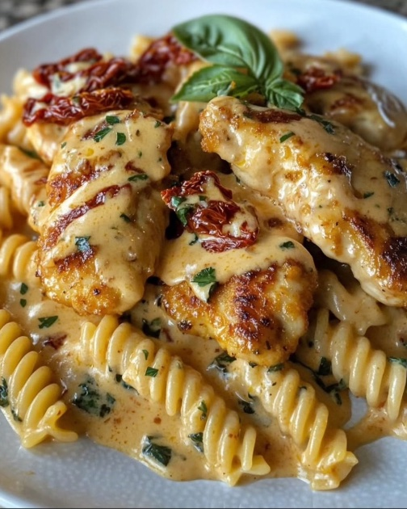Cheesy Tuscan Chicken Bites with Sun-Dried Tomato Rotini</a>

<a href="https://chknfrdstk.github.io/Recipes/chicken/chicken-and-cabbage-stir-fry.html">Chicken and Cabbage Stir-fry</a>

<a href="https://chknfrdstk.github.io/Recipes/chicken/chicken-bacon-and-pasta-with-spinach-and-tomatoes-in-garlic-cream-sauce.html">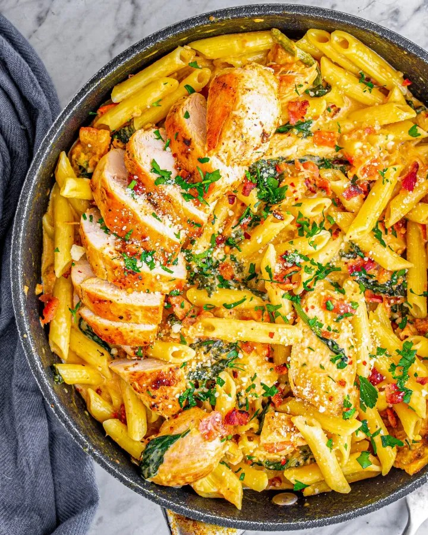Chicken Bacon and Pasta with Spinach and Tomatoes in Garlic Cream Sauce</a>

<a href="https://chknfrdstk.github.io/Recipes/chicken/chicken-mushroom-stroganoff.html">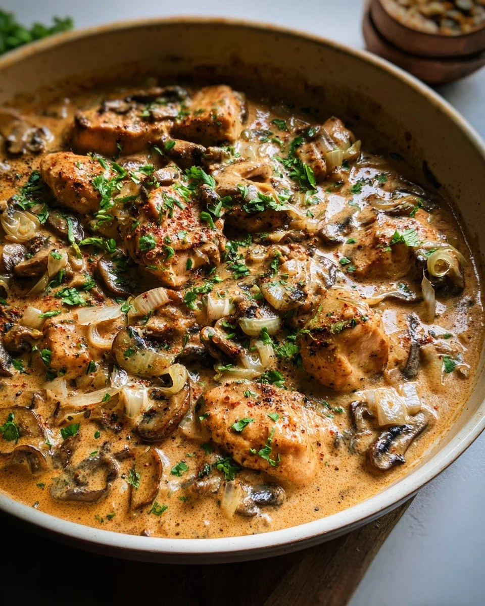Chicken Mushroom Stroganoff</a>

<a href="https://chknfrdstk.github.io/Recipes/chicken/chicken-shawarma-with-creamy-garlic-sauce.html">Chicken Shawarma with Creamy Garlic Sauce</a>

<a href="https://chknfrdstk.github.io/Recipes/chicken/chicken-shyte.html">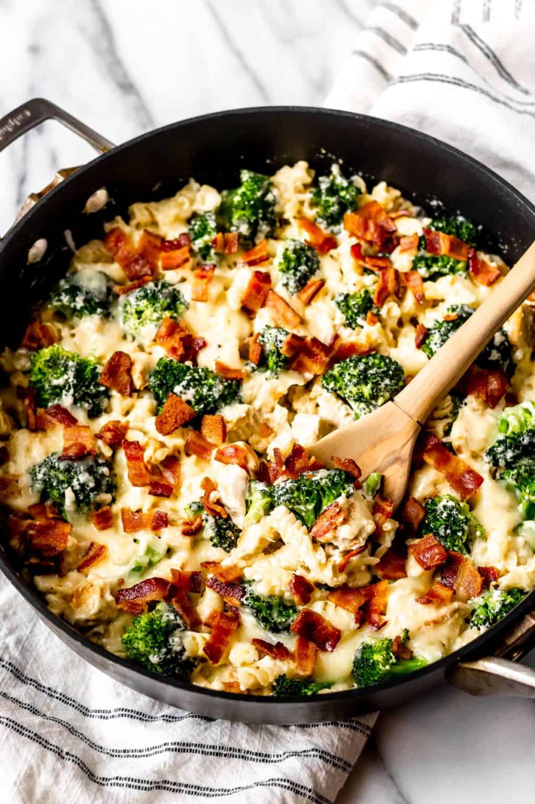Chicken Shyte</a>

<a href="https://chknfrdstk.github.io/Recipes/chicken/chicken-spinach-and-mushroom-low-carb-oven-dish.html">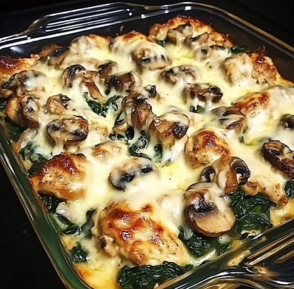Chicken Spinach and Mushroom Low Carb Oven Dish</a>

<a href="https://chknfrdstk.github.io/Recipes/chicken/chicken-yakisoba.html">Chicken yakisoba</a>

<a href="https://chknfrdstk.github.io/Recipes/chicken/chipotle-chicken-burrito-rice-bowl.html">Chipotle Chicken Burrito Rice Bowl</a>

<a href="https://chknfrdstk.github.io/Recipes/chicken/chipotle-lime-chicken-with-corn-and-peppers.html">Chipotle Lime Chicken with Corn & Peppers</a>

<a href="https://chknfrdstk.github.io/Recipes/chicken/coconut-chicken-rice-bowl.html">Coconut Chicken Rice Bowl</a>

<a href="https://chknfrdstk.github.io/Recipes/chicken/coconut-curry-chicken-with-lemongrass.html">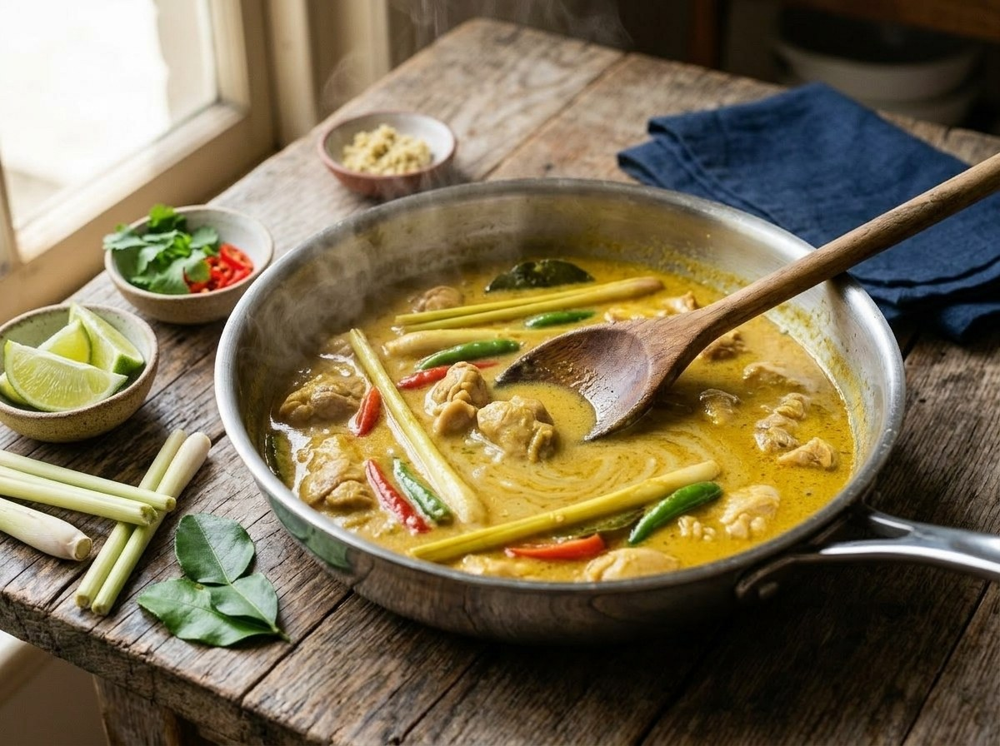Coconut Curry Chicken with Lemongrass</a>

<a href="https://chknfrdstk.github.io/Recipes/chicken/coconut-curry-chicken-with-rice-noodles.html">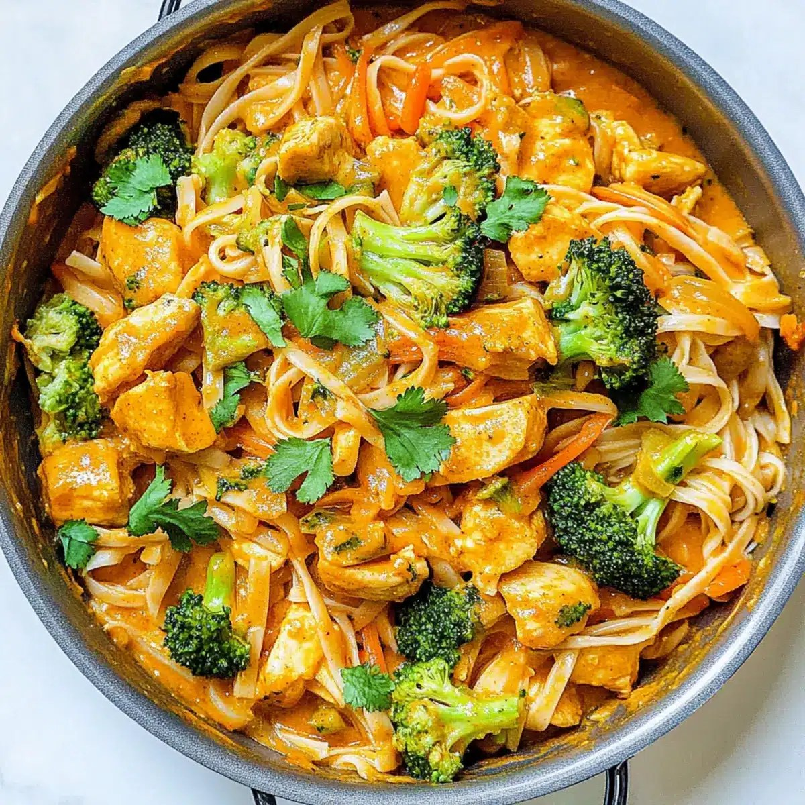Coconut Curry Chicken with Rice Noodles</a>

<a href="https://chknfrdstk.github.io/Recipes/chicken/cowboy-butter-chicken-linguine.html">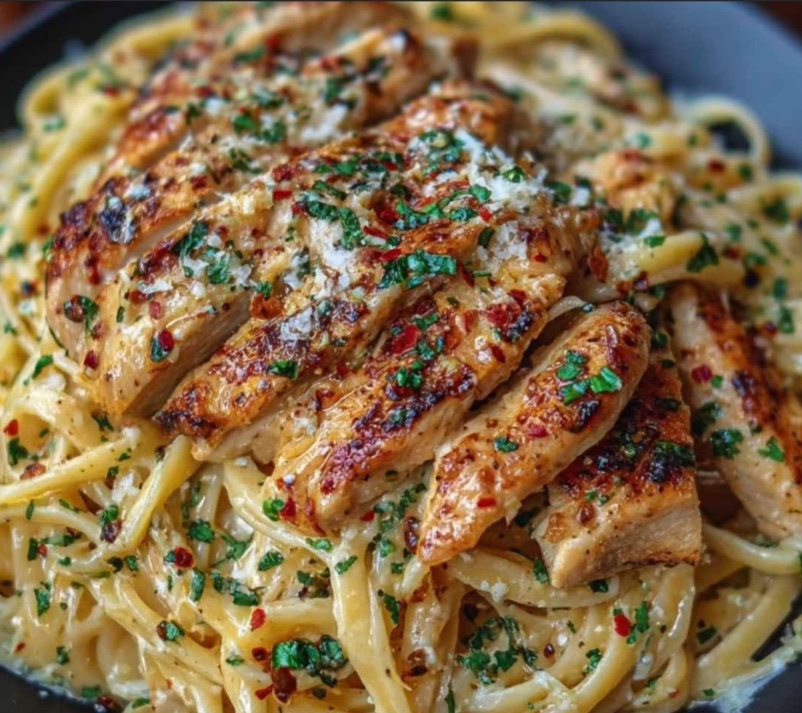Cowboy Butter Chicken Linguine</a>

<a href="https://chknfrdstk.github.io/Recipes/chicken/cowboy-butter-chicken-linguine-2.html">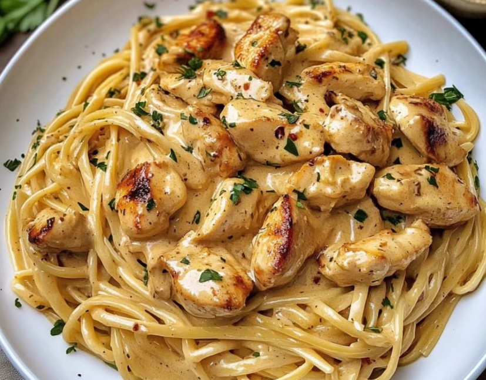Cowboy Butter Chicken Linguine</a>

<a href="https://chknfrdstk.github.io/Recipes/chicken/creamy-chicken-and-mushroom.html">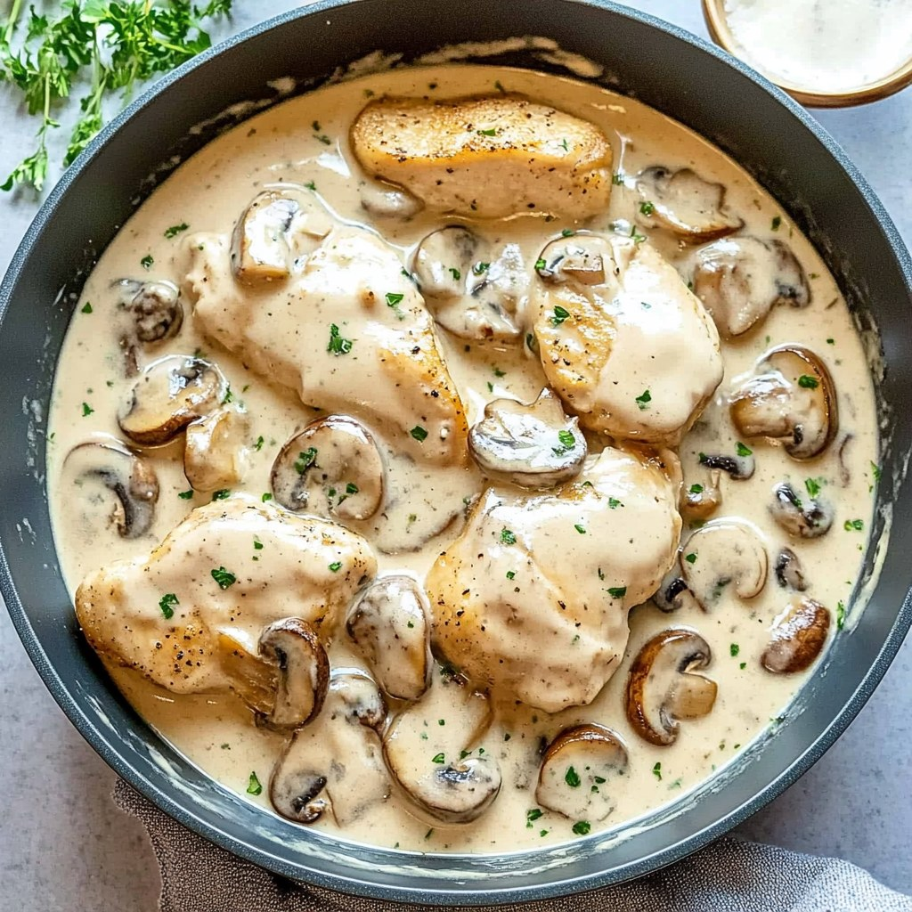Creamy Chicken and Mushroom</a>

<a href="https://chknfrdstk.github.io/Recipes/chicken/egg-roll-stir-fry.html">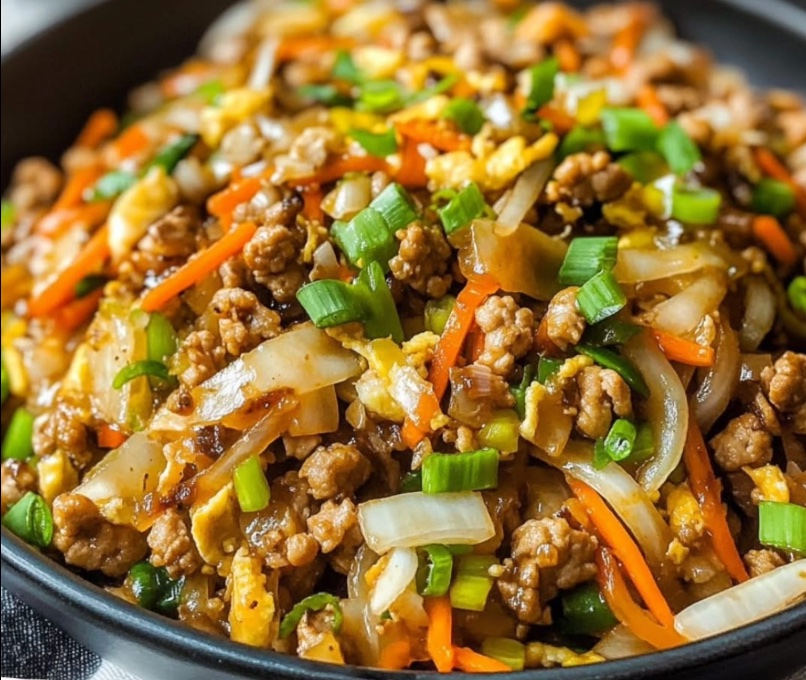Egg Roll Stir Fry</a>

<a href="https://chknfrdstk.github.io/Recipes/chicken/filipino-pancit.html">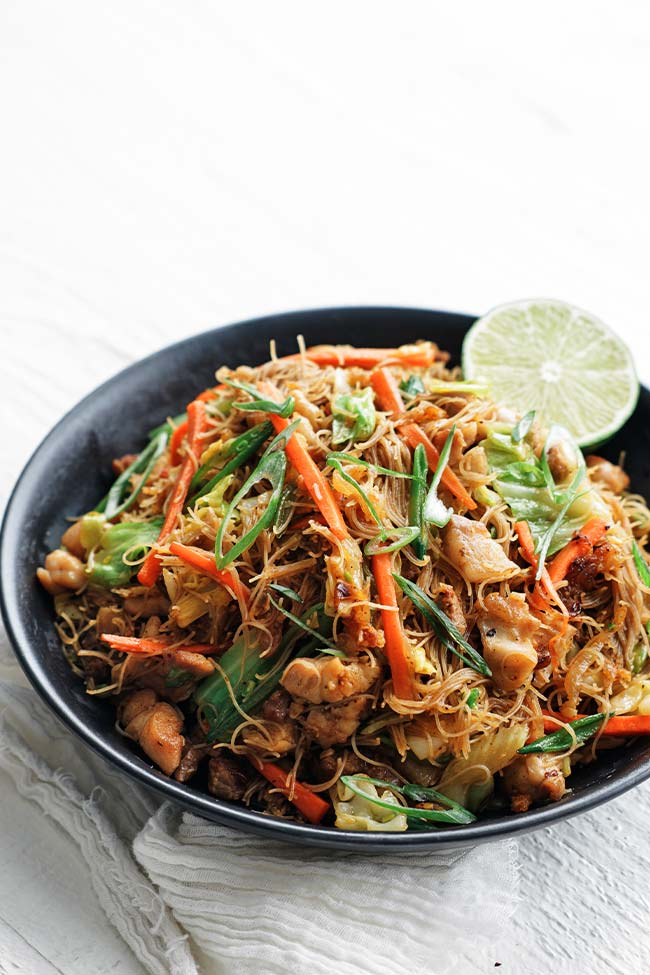Filipino Pancit</a>

<a href="https://chknfrdstk.github.io/Recipes/chicken/garlic-butter-chicken-and-parmesan-rice.html">Garlic Butter Chicken and Parmesan Rice</a>

<a href="https://chknfrdstk.github.io/Recipes/chicken/garlic-butter-chicken-bites-with-creamy-parmesan-pasta.html">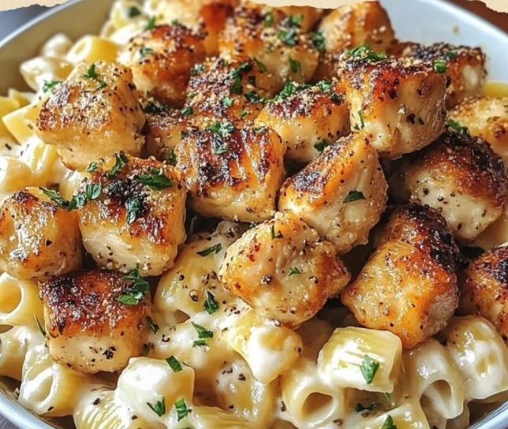Garlic Butter Chicken Bites with Creamy Parmesan Pasta</a>

<a href="https://chknfrdstk.github.io/Recipes/chicken/garlic-chicken-with-broccoli-and-spinach.html">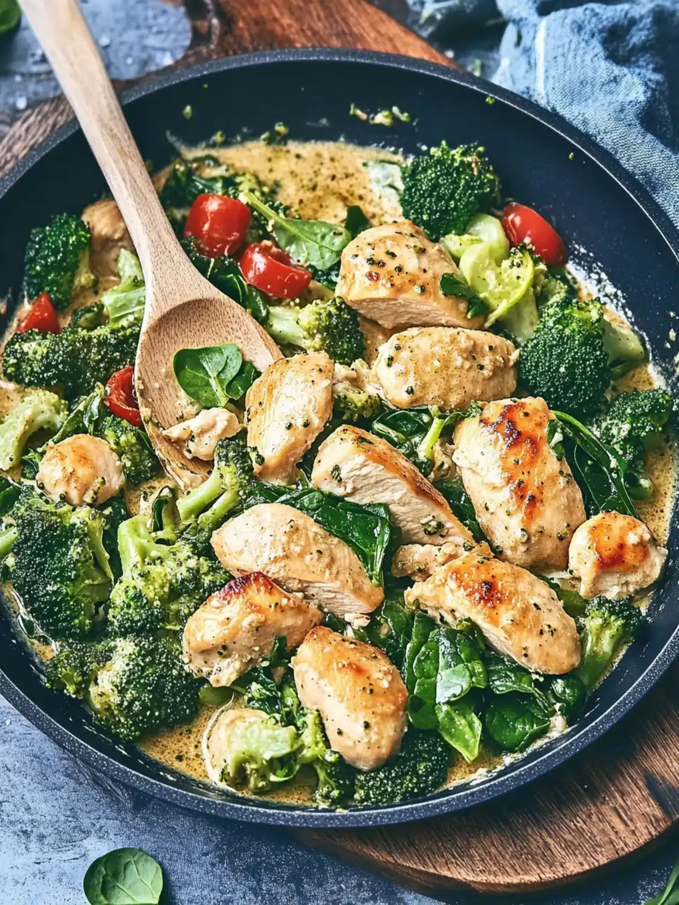Garlic Chicken with Broccoli and Spinach</a>

<a href="https://chknfrdstk.github.io/Recipes/chicken/garlic-parmesan-chicken-and-roasted-brussels-sprouts-with-aioli-dipping-sauce.html">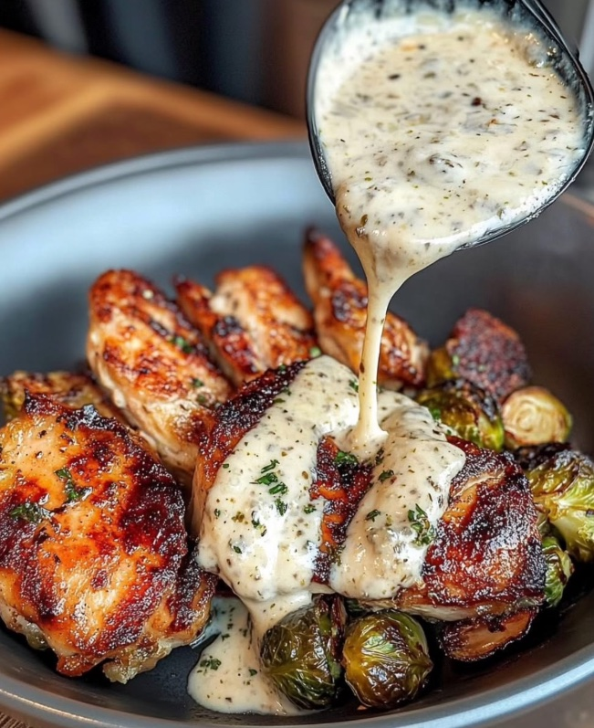Garlic Parmesan Chicken and Roasted Brussels Sprouts with Aioli Dipping Sauce</a>

<a href="https://chknfrdstk.github.io/Recipes/chicken/garlic-roast-chicken-with-rosemary-and-lemon.html">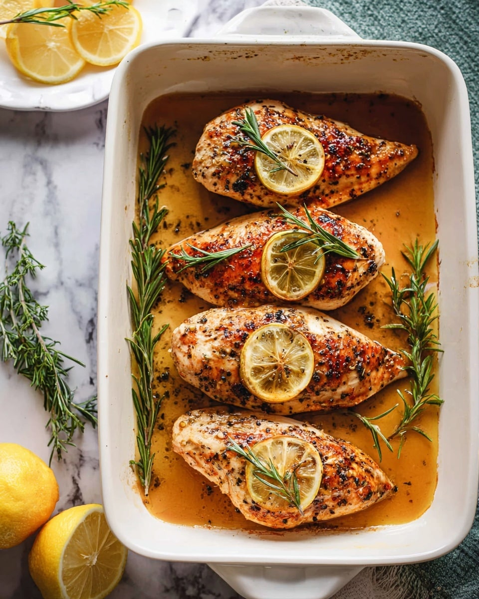Garlic Roast Chicken with Rosemary and Lemon</a>

<a href="https://chknfrdstk.github.io/Recipes/chicken/greek-chicken-gyros.html">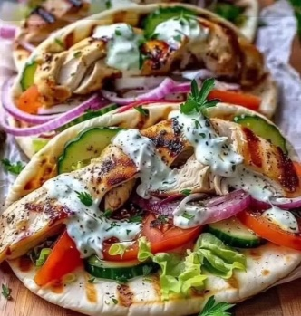Greek Chicken Gyros</a>

<a href="https://chknfrdstk.github.io/Recipes/chicken/grilled-chicken-and-broccoli-bowls-with-creamy-garlic-sauce.html">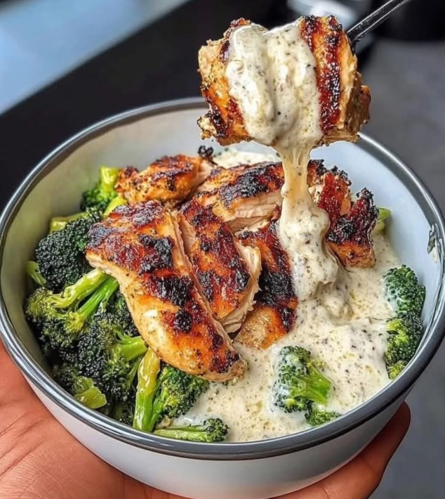Grilled Chicken & Broccoli Bowls with Creamy Garlic Sauce</a>

<a href="https://chknfrdstk.github.io/Recipes/chicken/herbed-chicken-and-mushrooms.html">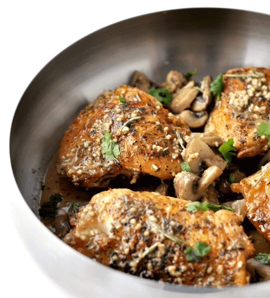Herbed Chicken and Mushrooms</a>

<a href="https://chknfrdstk.github.io/Recipes/chicken/honey-lime-chicken-bowls.html">Honey Lime Chicken Bowls with Creamy Cilantro Lime Drizzle✨ New</a>

<a href="https://chknfrdstk.github.io/Recipes/chicken/italian-garlic-chicken-meatballs-with-creamy-bowties.html">Italian Garlic Chicken Meatballs with Creamy Bowties</a>

<a href="https://chknfrdstk.github.io/Recipes/chicken/jalapeño-chicken-with-bell-peppers.html">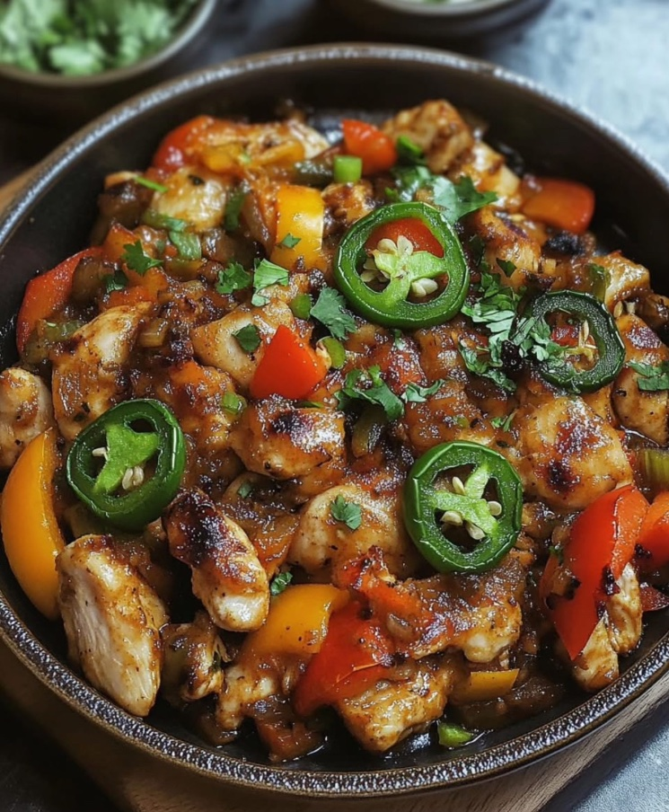Jalapeño Chicken with Bell Peppers</a>

<a href="https://chknfrdstk.github.io/Recipes/chicken/king-ranch-chicken.html">King Ranch Chicken</a>

<a href="https://chknfrdstk.github.io/Recipes/chicken/lemon-garlic-chicken-with-creamy-bowtie-pasta.html">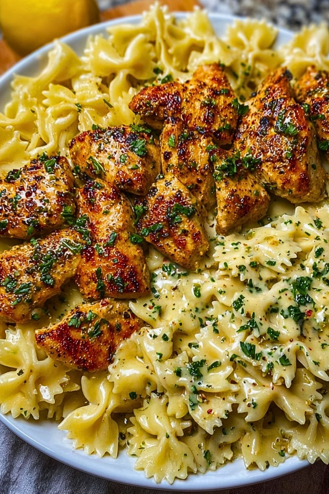Lemon Garlic Chicken with Creamy Bowtie Pasta</a>

<a href="https://chknfrdstk.github.io/Recipes/chicken/lemon-ginger-soy-marinated-grilled-chicken.html">Lemon Ginger Soy Marinated Grilled Chicken</a>

<a href="https://chknfrdstk.github.io/Recipes/chicken/lime-marinated-chicken-with-avocado-salsa.html">Lime-Marinated Chicken with Avocado Salsa</a>

<a href="https://chknfrdstk.github.io/Recipes/chicken/melt-in-your-mouth-chicken.html">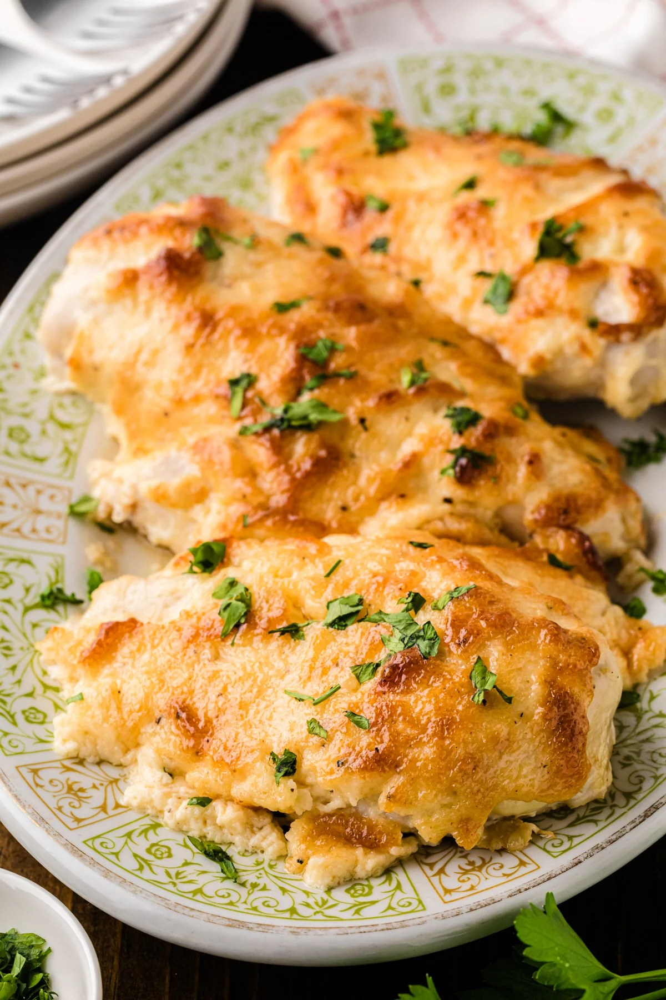Melt in Your Mouth Chicken</a>

<a href="https://chknfrdstk.github.io/Recipes/chicken/mexican-street-corn-chicken-bowls.html">Mexican Street Corn Chicken Bowls</a>

<a href="https://chknfrdstk.github.io/Recipes/chicken/mexican-white-chicken-chili.html">Mexican White Chicken Chili</a>

<a href="https://chknfrdstk.github.io/Recipes/chicken/one-pan-cheesy-jalapeño-chicken.html">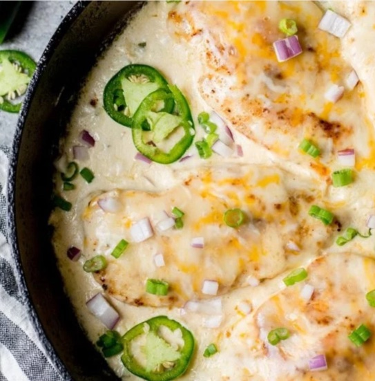One Pan Cheesy Jalapeño Chicken</a>

<a href="https://chknfrdstk.github.io/Recipes/chicken/one-pan-honey-garlic-chicken-with-red-potatoes-and-green-beans.html">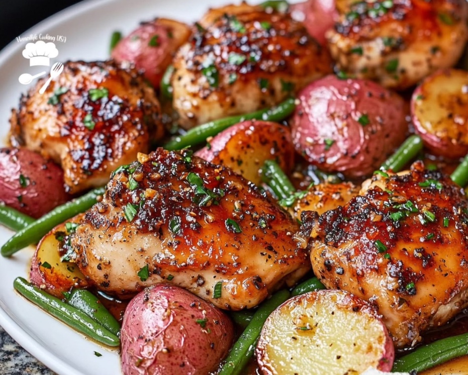One Pan Honey Garlic Chicken with Red Potatoes and Green Beans</a>

<a href="https://chknfrdstk.github.io/Recipes/chicken/one-pan-chicken-with-buttered-noodles.html">One-Pan Chicken with Buttered Noodles</a>

<a href="https://chknfrdstk.github.io/Recipes/chicken/one-pan-coconut-lime-chicken.html">One-Pan Coconut-Lime Chicken</a>

<a href="https://chknfrdstk.github.io/Recipes/chicken/peruvian-chicken-and-rice-with-zesty-green-sauce.html">Peruvian chicken & rice with zesty green sauce</a>

<a href="https://chknfrdstk.github.io/Recipes/chicken/poblanos-rellenos-de-pollo-y-queso-chicken-and-cheese-stuffed-poblanos.html">Poblanos Rellenos de Pollo y Queso (Chicken & Cheese Stuffed Poblanos)</a>

<a href="https://chknfrdstk.github.io/Recipes/chicken/rotisserie-chicken-salad.html">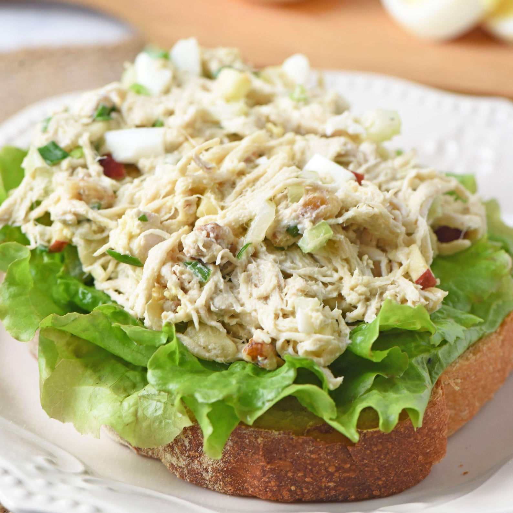Rotisserie Chicken Salad</a>

<a href="https://chknfrdstk.github.io/Recipes/chicken/slow-cooker-cream-cheese-chicken.html">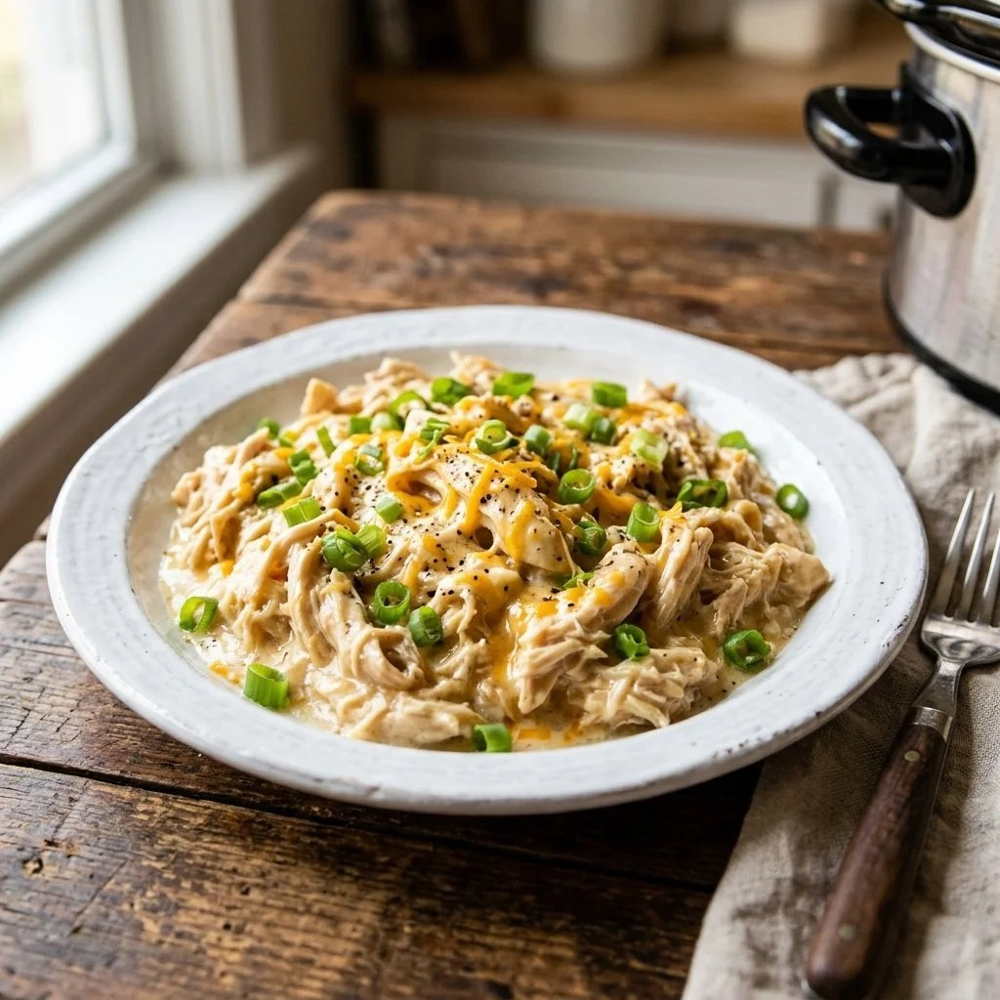Slow Cooker Cream Cheese Chicken</a>

<a href="https://chknfrdstk.github.io/Recipes/chicken/slow-cooker-cream-cheese-chicken-chili.html">Slow Cooker Cream Cheese Chicken Chili</a>

<a href="https://chknfrdstk.github.io/Recipes/chicken/smoky-chipotle-chicken-bowls-with-cilantro-lime-crema.html">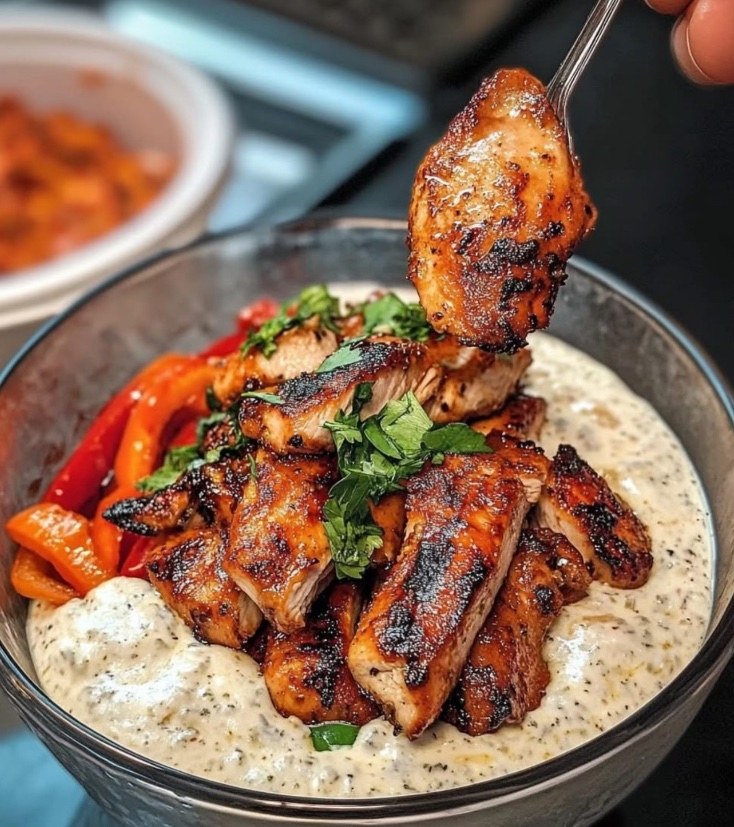Smoky Chipotle Chicken Bowls with Cilantro Lime Crema</a>

<a href="https://chknfrdstk.github.io/Recipes/chicken/smothered-chicken-and-rice.html">Smothered Chicken and Rice</a>

<a href="https://chknfrdstk.github.io/Recipes/chicken/southwest-chicken-cutlet-rice-bowl.html">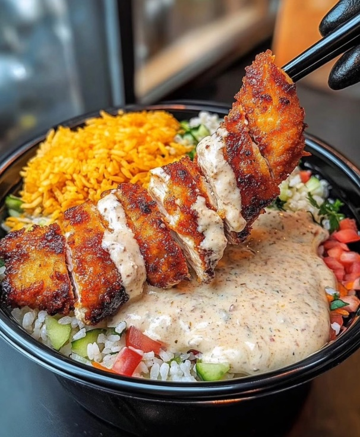Southwest Chicken Cutlet Rice Bowl</a>

<a href="https://chknfrdstk.github.io/Recipes/chicken/spiced-coconut-basil-chicken-with-rice.html">Spiced Coconut Basil Chicken with Rice</a>

<a href="https://chknfrdstk.github.io/Recipes/chicken/spinach-and-feta-chicken-rolls.html">Spinach and Feta Chicken Rolls</a>

<a href="https://chknfrdstk.github.io/Recipes/chicken/street-corn-chicken-rice-bowl.html">Street Corn Chicken Rice Bowl</a>

<a href="https://chknfrdstk.github.io/Recipes/chicken/thai-chili-chicken-lettuce-wraps.html">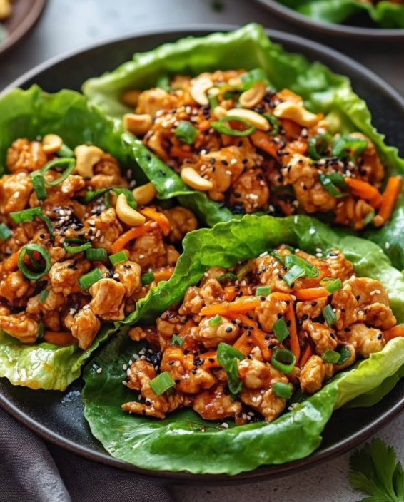Thai Chili Chicken Lettuce Wraps</a>

- [Back to all recipes](https://chknfrdstk.github.io/Recipes/)
