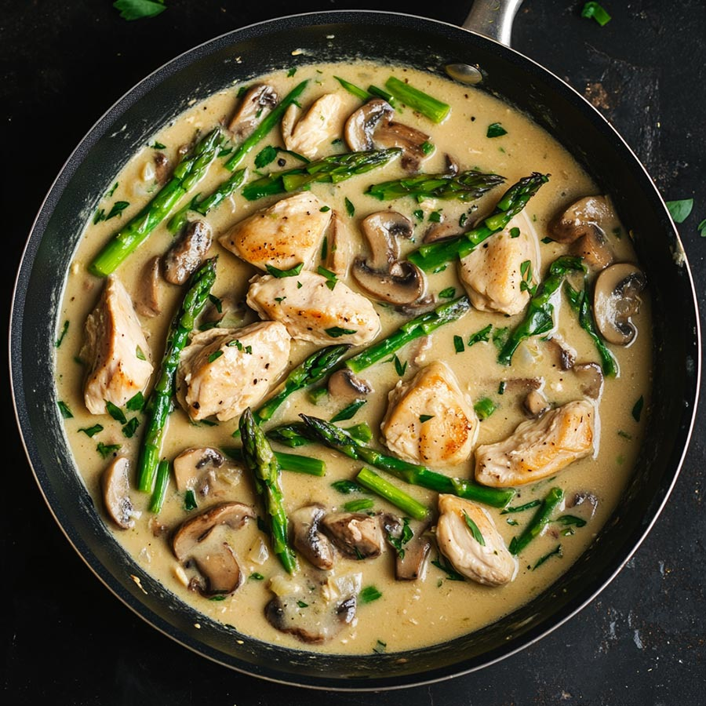

# Asparagus and Chicken Fricassee

## Ingredients

- 2 tbsp olive oil
- 18 oz boneless skinless chicken sliced thin and cut into 1/2" pieces
- 1/4 cup chopped onions
- 8oz sliced mushrooms
- 2 cloves minced garlic
- 1/2 cup chicken brooth
- 1 bunch asparagus cut into 1/2" pieces

## Instructions

1. Heat oil in a large non-stick skillet over medium-high heat.
2. Season chicken with salt and pepper to taste.
3. Cook chicken in batches until golden brown and cooked through. Remove the chicken from the skillet and set aside.
4. Saute onions until translucent.
5. Stir in mushrooms and cook until golden.
6. Add garlic.
7. Pour in chicken brooth and simmer until reduced by half.
8. Stir in asparagus and cook until tender.
9. Return chicken to the skillet and heat through.

*Photo: Yeyfood — [Chicken Fricassee with Spring Vegetables](https://yeyfood.com/chicken-fricassee-with-spring-vegetables/)*
