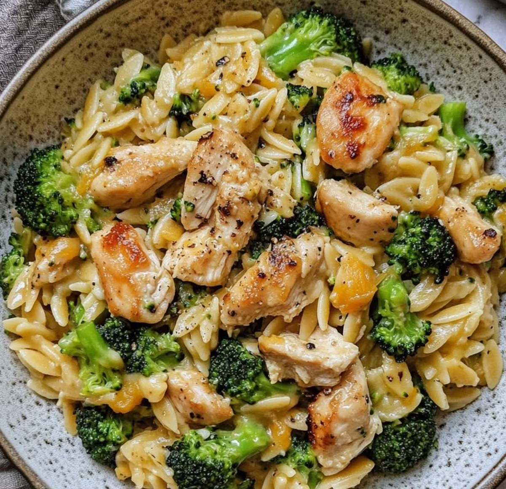

# Broccoli Cheddar Chicken Orzo

> Source: screenshots IMG_5255.PNG, IMG_5256.PNG, and IMG_5257.PNG, 2026-11-10

## Ingredients

### Meat

- 1 chicken breast, diced

### Produce

- 2 cups small broccoli florets
- 3 cloves garlic, minced
- 1 shallot, finely chopped

### Canned Goods

- 2 1/2 cups chicken broth

### Pasta & Grains

- 1 cup orzo

### Baking & Spices

- 1 tbsp avocado oil
- 1/2 tsp black pepper
- 1 tbsp Italian seasoning
- 1/4 tsp salt

### Dairy

- 2 tbsp butter
- 3 oz cheddar cheese, shredded

## Instructions

### 1. Cook the Chicken

Heat avocado oil in a large skillet over medium-high heat. Add diced chicken, season with salt, black pepper, and Italian seasoning, and cook for 5-6 minutes until golden brown. Remove from the skillet and set aside.

### 2. Sauté the Aromatics

In the same skillet, melt butter over medium heat. Add shallot and garlic, cooking for 1-2 minutes until fragrant.

### 3. Cook the Orzo

Stir in orzo and toast for 1 minute. Pour in chicken broth and bring to a simmer. Cook for 8-10 minutes, stirring occasionally, until the orzo is tender.

### 4. Add Broccoli & Chicken

Stir in broccoli florets and return the cooked chicken to the skillet. Cover and let cook for 3-4 minutes, until broccoli is tender.

### 5. Melt the Cheese & Serve

Stir in cheddar cheese until melted and creamy. Remove from heat and serve warm!

## Pro Tip

Add a sprinkle of Parmesan cheese or red pepper flakes for extra flavor!
