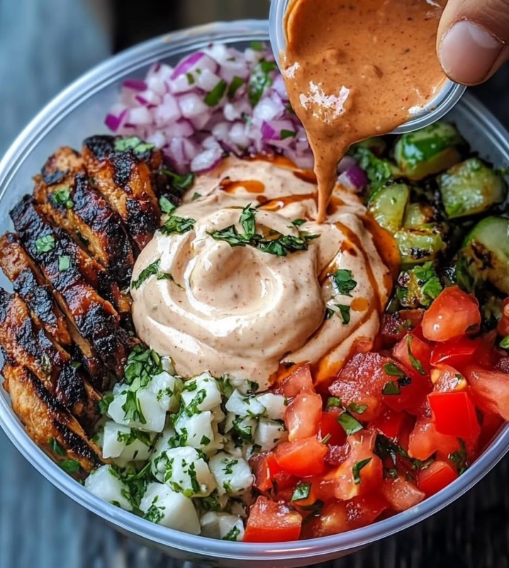

# Burrito Bowls with Pico de Gallo & Chipotle Aioli

## Ingredients

### For the protein

- 1 pound boneless, skinless chicken thighs or steak, cut into strips
- 1 tbsp olive oil
- 1 tsp chili powder
- 1/2 tsp cumin
- 1/4 tsp salt
- 1/8 tsp black pepper

### For the Pico de Gallo

- 1 cup diced tomatoes
- 1/4 cup chopped red onion
- 1/4 cup chopped cilantro
- 1 jalapeño, seeded and minced (optional)
- 1 lime, juiced
- Salt and pepper to taste

### For the Chipotle Aioli

- 1/4 cup mayonnaise
- 1 tbsp chipotle pepper in adobo sauce
- 1 clove garlic, minced
- 1/2 tsp lime juice
- 1/4 tsp salt
- 1/8 tsp black pepper

### For the Bowls

- 1 cup cooked rice
- 1/4 cup chopped cilantro (for garnish)

## Instructions

1. In a bowl, combine the chicken or steak strips with olive oil, chili powder, cumin, salt, and black pepper. Mix well to coat the meat evenly.
2. Heat a skillet over medium-high heat.
3. Add the seasoned protein and cook until cooked through and browned. Remove from heat and set aside.
4. In a medium bowl, combine diced tomatoes, chopped red onion, chopped cilantro, minced jalapeño (if using), lime juice, salt and pepper. Mix well and set aside to let the flavors meld.
5. In a small bowl, whisk together mayonnaise, chipotle pepper in adobo sauce, minced garlic, lime juice, salt, and black pepper until smooth. Adjust seasoning to taste.
6. In serving bowls, layer the cooked rice, cooked protein, and top with pico de gallo. Drizzle with chipotle aioli and garnish with chopped cilantro.
