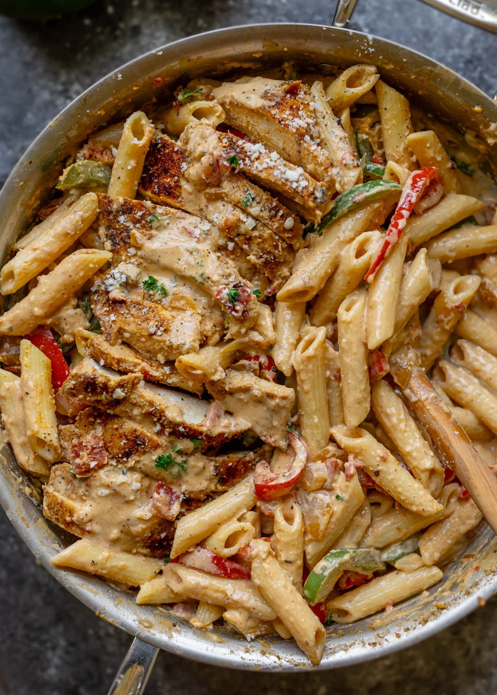

# Cajun Chicken Pasta

## Ingredients

- 1 lb fettuccine
- 3 lb boneless skinless chicken thighs cubed
- 1 tbsp Cajun seasoning divided
- 2 tbsp olive oil divided
- 2 tbsp salted butter divided
- 1 green bell pepper seeded and sliced
- 1 red bell pepper seeded and sliced
- 1/2 red onion peeled and thinly sliced
- 3 cloves garlic minced
- Salt and pepper to taste
- 4 roma tomatoes diced
- 1/2 cup white wine can substitute with chicken stock
- 2 cup chicken broth
- 1 cup heavy cream
- Cayenne pepper to taste
- Chopped fresh parsley for garnish

## Instructions

1. Cook pasta according to package directions. Drain when pasta is still al dente.
2. Sprinkle 1 1/2 teaspoons of the Cajun seasoning over the chicken pieces. Toss to coat.
3. In a heavy skillet, heat 1 tablespoon of the oil and 1 tablespoon butter over high heat. Add half of the chicken in a single layer; do not stir. Allow the chicken to brown on one side, about 1 minute. Flip to the other side and cook for an additional minute. Using a slotted spoon, remove the chicken and set aside. Repeat with the remaining chicken. Remove the chicken, leaving the pan on high heat.
4. Add the remaining 1 tablespoon of olive oil and 1 tablespoon of butter to the pan. When heated, add the peppers, onion, and garlic. Sprinkle on the remaining 1 1/2 teaspoons of Cajun seasoning and season with salt, if needed. Cook over high heat for 1 minute, stirring gently and trying to get the vegetables as dark/black as possible. Add the tomatoes and cook for 30 seconds more. Remove all of the vegetables from the pan.
5. With the pan over high heat, pour in the wine and chicken broth. Cook on high for 3 to 5 minutes, scraping the bottom of the pan to deglaze. Reduce the heat to medium-low and pour in the cream, stirring/whisking constantly. Cook the sauce over medium-low heat until the cream starts to thicken the mixture. Taste and add black pepper, cayenne pepper and salt to taste. The sauce should be spicy!
6. Finally, add the chicken and vegetables to the sauce, making sure to include all the juices that have drained onto the plate. Stir and cook until the mixture is bubbly and hot, 1 to 2 minutes. Add the drained pasta and toss to combine.
7. Top with chopped fresh parsley and chow down!

*Photo: Alyona's Cooking — [Creamy Cajun Chicken Pasta (with Homemade Cajun Seasoning)](https://www.alyonascooking.com/cajun-chicken-pasta-recipe/)*
