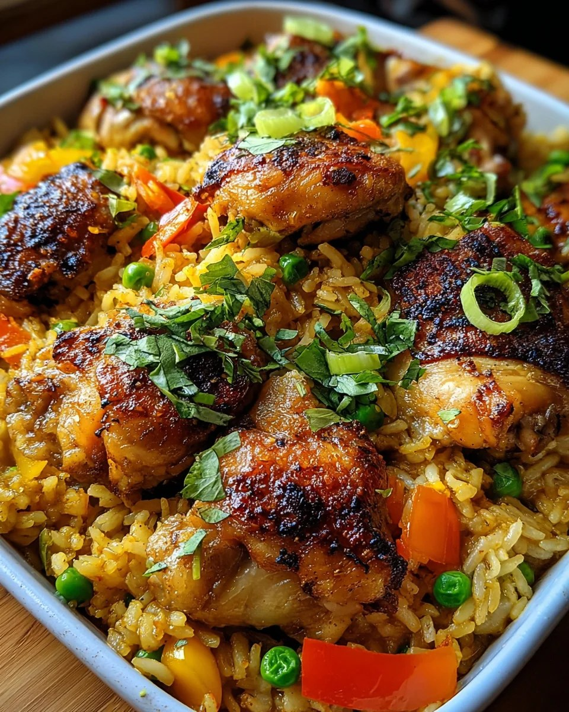

# Caribbean Chicken and Rice

## Ingredients

- 2.5-3 lbs boneless, skinless chicken thighs
- 2 tbsp olive oil
- 1 onion chopped
- 3 cloves minced garlic
- 1 red bell pepper chopped
- 1 green bell pepper chopped
- 1 cup long-grain white rice
- 1 can diced tomatoes
- 1 can black beans rinsed and drained
- 1 cup chicken broth
- 1/2 cup coconut milk
- 1 tsp cumin
- 1 tsp paprika
- 1 tsp dried thyme
- 1/2 tsp cayenne pepper
- Salt and pepper to taste
- 1/4 fresh cilantro
- Lime wedges for serving

## Instructions

1. Heat the olive oil in a large skillet over medium-high heat. Season the chicken with salt, pepper, cumin, paprika, thyme and cayenne pepper. Add the chicken to the skillet and cook until browned and cooked through. Remove the chicken and set aside.
2. In the same skillet, add the chopped onion and garlic, sautéing until the onion is translucent.
3. Add the red and green bell peppers to the skillet and cook until the peppers are tender.
4. Stir in the rice and cook for 1-2 minutes, allowing the rice to lightly toast.
5. Add the diced tomatoes, black beans, chicken broth and coconut milk to the skillet. Stir to combine.
6. Return the chicken to the skillet, nestling them into the rice mixture. Bring to a simmer, then reduce the heat to low. Cover and cook for 20-25 minutes or until the rice is tender and the liquid is absorbed.
7. Garnish with chopped cilantro and serve with lime wedges.

*Photo: Eva Whisks — [Caribbean Chicken and Rice](https://evawhisks.com/caribbean-chicken-and-rice/)*
