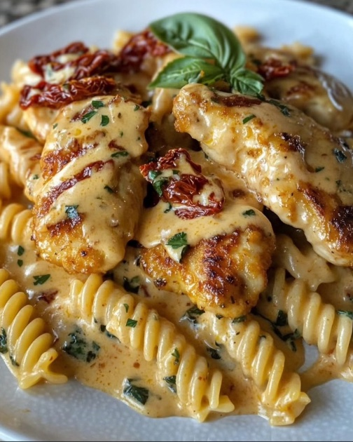

# Cheesy Tuscan Chicken Bites with Sun-Dried Tomato Rotini

## Ingredients

### For the chicken

- 1 lb boneless, skinless chicken thighs, cut into bite-sized pieces
- 2 tbsp olive oil
- 2 tbsp butter
- 2 cloves garlic, minced
- 1 tsp Italian seasoning
- 1/2 tsp garlic powder
- 1/2 tsp paprika
- Salt and black pepper, to taste
- 1/4 cup grated Parmesan cheese

### For the Sun-Dried Tomato Rotini

- 12 oz rotini pasta
- 2 tbsp butter
- 1/2 cup sun-dried tomatoes, chopped
- 2 cloves garlic, minced
- 1 cup heavy cream
- 1/2 cup chicken broth
- 1/2 cup grated Parmesan cheese
- 1/2 cup shredded mozzarella cheese
- 1 tsp Italian seasoning
- 2 cups baby spinach

## Instructions

1. Cook the rotini pasta according to package instructions until al dente. Drain and set aside.
2. While the pasta cooks, heat 2 tablespoons of olive oil and 1 tablespoon of butter in a large skillet over medium heat.
3. Season the chicken bites with Italian seasoning, garlic powder, paprika, salt, and pepper.
4. Add the chicken to the skillet and cook for 6-8 minutes until golden and cooked through.
5. Add the minced garlic and toss for 1 more minute.
6. Sprinkle with Parmesan cheese and remove the chicken from the skillet; set aside.
7. In the same skillet, melt 2 tablespoons of butter over medium heat.
8. Add the sun-dried tomatoes and garlic, cooking for 2 minutes until fragrant. Stir in the heavy cream and chicken broth, then bring to a gentle simmer.
9. Add the Parmesan, mozzarella, and Italian seasoning, stirring until the sauce becomes creamy and smooth.
10. Toss in the baby spinach and let it wilt for about 2 minutes.
11. Season with salt and black pepper to taste.
12. Add the cooked rotini to the skillet, tossing to coat the pasta evenly with the creamy sauce.
13. Return the chicken bites to the skillet and stir gently to combine.
14. Garnish with fresh basil and an extra sprinkle of Parmesan cheese before serving.
