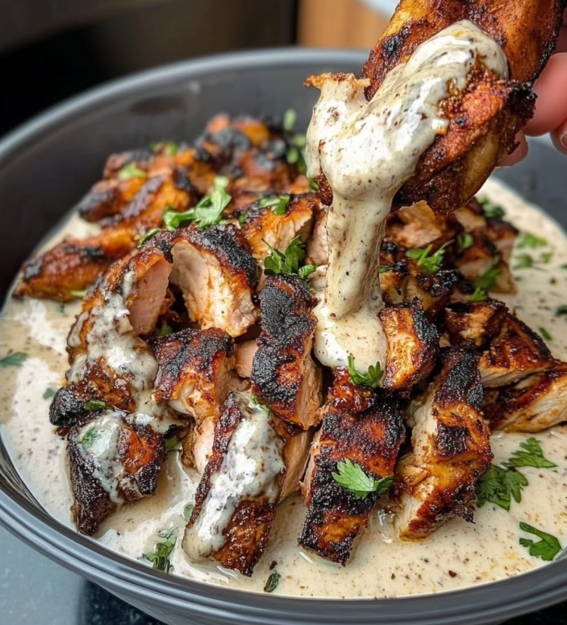

# Chicken Shawarma with Creamy Garlic Sauce

## Ingredients

### For the Chicken

- 2 lbs boneless, skinless chicken thighs
- 1 tsp ground cumin
- 1 tsp ground coriander
- 1 tsp paprika
- 1/2 tsp turmeric
- 1/2 tsp ground cinnamon
- 1/2 tsp ground ginger
- 1/4 tsp cayenne pepper (adjust to taste)
- 1 tbsp lemon juice
- 2 tbsp olive oil
- Salt and pepper to taste

### For the Garlic Sauce

- 1 cup plain Greek yogurt
- 2 cloves garlic, minced
- 1 tbsp lemon juice
- 1/2 tsp ground cumin
- Salt and pepper to taste
- Fresh parsley, for garnish

## Instructions

1. In a large bowl, combine the chicken, cumin, coriander, paprika, turmeric, cinnamon, ginger, cayenne pepper, lemon juice, olive oil, salt, and pepper. Mix well to coat the chicken evenly. Cover and marinate in the refrigerator for at least 30 minutes, or up to 24 hours.
2. Preheat your grill to medium-high heat. Grill the chicken for 4-5 minutes per side, or until cooked through and slightly charred.
3. In a small bowl, combine the yogurt, garlic, lemon juice, cumin, salt, and pepper. Mix well until the garlic is evenly distributed.
4. Slice the grilled chicken into thin strips. Serve immediately with the creamy garlic sauce and garnish with fresh parsley.

## Tips

- For extra flavor, marinate the chicken in the spices for longer.
- Serve the shawarma in warm pita bread with lettuce, tomatoes, and onions.
