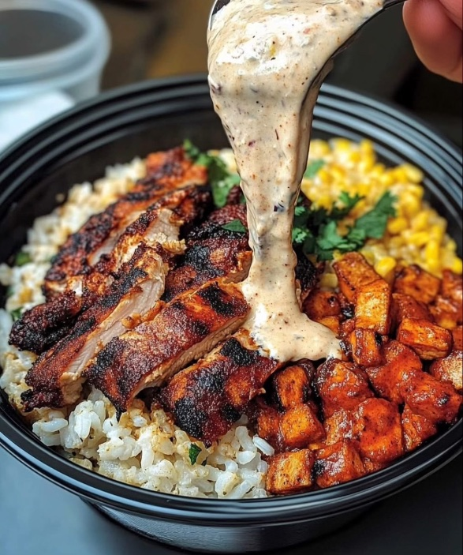

# Chipotle Chicken Burrito Rice Bowl

## Ingredients

### For the Chicken

- 1 lb boneless, skinless chicken thighs
- 1 tbsp olive oil
- 1 tsp chili powder
- 1/2 tsp cumin
- 1/4 tsp garlic powder
- 1/4 tsp onion powder
- 1/4 tsp salt
- 1/8 tsp black pepper

### For the Rice

- 1 cup white rice
- 2 cups chicken broth
- 1/4 tsp salt

### For the Toppings

- 1 cup cooked pinto beans
- 1 cup corn kernels (fresh, frozen, or canned)
- 1/2 cup diced red onion
- 1/2 cup diced tomato
- 1/4 cup chopped cilantro
- 1/4 cup crumbled cotija cheese (optional)
- Salsa (optional)
- Sour cream (optional)

### For the Chipotle Sauce

- 1/4 cup mayonnaise
- 2 tbsp chipotle peppers in adobo sauce
- 1 tbsp lime juice
- 1 tsp honey
- 1/2 tsp garlic powder
- 1/4 tsp cumin
- 1/8 tsp salt

## Instructions

1. Bring chicken broth and salt to a boil in a saucepan.
2. Add rice, reduce heat, cover, and simmer for 15-20 minutes or until tender.
3. In a bowl, combine chicken with olive oil, chili powder, cumin, garlic powder, onion powder, salt, and pepper.
4. Grill, pan-fry, or bake chicken until cooked through.
5. In a blender or food processor, combine mayonnaise, chipotle peppers in adobo sauce, lime juice, honey, garlic powder, cumin, and salt. Blend until smooth. Adjust consistency with water if needed.
6. Divide rice between two bowls. Top with chicken, pinto beans, corn, diced onion, tomato, and cilantro. Drizzle with Chipotle Sauce. Add cotija cheese, salsa, and sour cream as desired.

## Tips

- You can use brown rice or quinoa instead of white rice.
- For a spicier sauce, add more chipotle peppers or a pinch of red pepper flakes.
