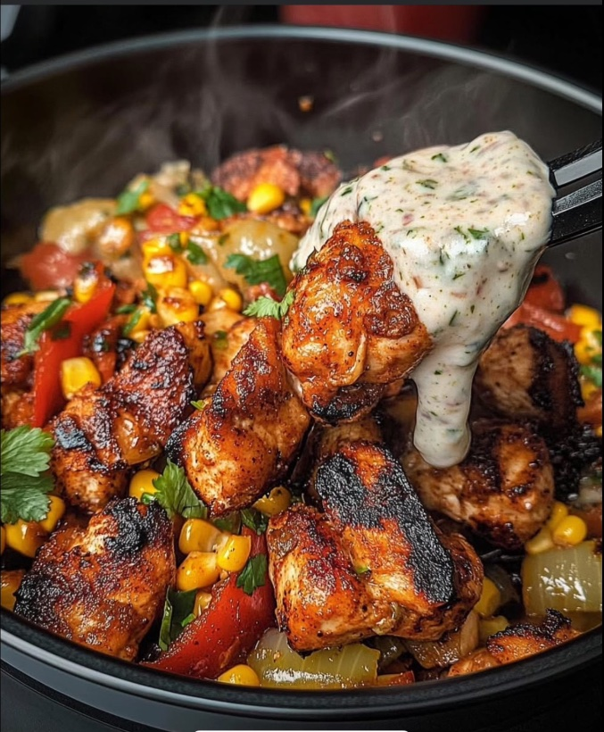

# Chipotle Lime Chicken with Corn & Peppers

## Ingredients

### For the Chicken

- 1 pound boneless, skinless chicken thighs, cut into bite-sized pieces
- 1 tbsp olive oil
- 1 1/2 tsp garlic powder
- 1 tsp onion powder
- 1/2 tsp salt
- 1/4 tsp black pepper
- 1 1/2 tsp chipotle powder
- 1 1/2 tbsp lime juice

### For the Vegetables

- 1 (15 ounce) can corn, drained
- 1 bell pepper (red, yellow or orange), chopped
- 1 onion, chopped

### For the Garlic Sauce

- 1/4 cup mayonnaise
- 2 cloves garlic, minced
- 1 tbsp lime juice
- 1/4 tsp garlic salt
- 1/8 teaspoon black pepper

## Instructions

1. In a bowl, combine chicken, olive oil, garlic powder, onion powder, salt, pepper, chipotle powder, and lime juice. Marinate for at least 30 minutes, or up to 2 hours.
2. Preheat a skillet to medium-high heat. Cook the chicken until browned and cooked through.
3. In the same skillet, add the onion and bell pepper and cook until softened. Add the corn and cook for 5 minutes more, or until heated through.
4. In a small bowl, whisk together mayonnaise, garlic, lime juice, salt, and pepper.
5. Divide the mixture among bowls and drizzle generously with the Garlic Sauce.

## Tips

- You can use any type of chicken you like for this recipe.
- For a spicier sauce, add more chipotle powder or a pinch of red pepper flakes to the marinade.
- Serve the bowls with your favorite side dishes, such as rice, quinoa, or a green salad.
