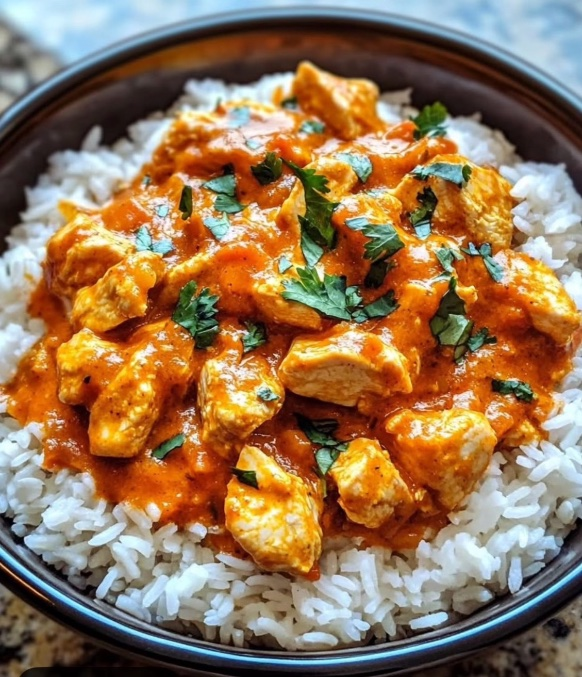

# Coconut Chicken Rice Bowl

## Ingredients

- 1 ½ lbs boneless skinless chicken thighs, diced
- 1 tsp kosher salt
- 1 tsp smoked paprika
- 1 tsp dried oregano
- ½ onion, minced
- 3 garlic cloves, minced
- 1 tsp fresh grated ginger (or more, to taste)
- ¼ cup chicken broth
- 1 ¼ cups light coconut milk
- 1 tbsp tomato paste
- Fresh cilantro, for garnish
- 3 cups cooked jasmine or basmati rice

## Instructions

1. Season chicken with salt, paprika, and oregano.
2. Sauté chicken in a hot skillet until browned; set aside.
3. In the same pan, sauté onion, garlic, and ginger for 1 minute.
4. Deglaze with broth.
5. Add tomato paste, coconut milk, and salt; simmer until thickened.
6. Return chicken to the skillet;
7. Cook for 3-4 minutes.
8. Serve over rice, garnish with cilantro, and drizzle with extra coconut milk, if desired.
