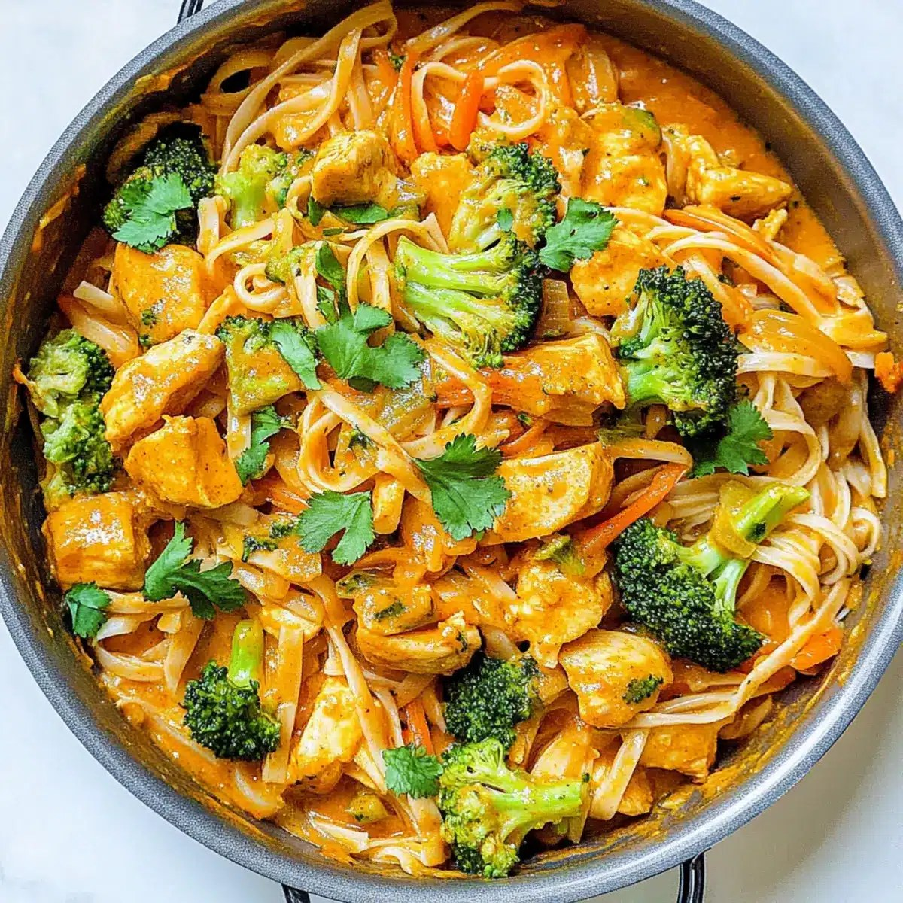

# Coconut Curry Chicken with Rice Noodles

## Ingredients

- 1 pound boneless, skinless chicken thighs cut into bite-sized pieces
- 1 tbsp vegetable oil
- 1 medium onion sliced
- 3 cloves garlic minced
- 1 tbsp fresh ginger grated
- 2 tbsp red curry paste (adjust for spice level)
- 1 can (14 ounces) coconut milk
- 1 cup chicken broth
- 2 tbsp fish sauce (or soy sauce for a non-fish alternative)
- 1 tbsp brown sugar
- 1 cup bell peppers, sliced (red, yellow, or green)
- 2 cups fresh spinach
- Salt and pepper to taste
- 8 ounces rice noodles
- Fresh cilantro for garnish
- Lime wedges, for serving

## Instructions

1. In a large skillet or wok, heat the vegetable oil over medium-high heat.
2. Add the chicken pieces and cook for about 5-7 minutes, or until browned and cooked through. Remove the chicken from the skillet and set aside.
3. In the same skillet, add the sliced onion and sauté for about 3-4 minutes until softened.
4. Stir in the minced garlic and grated ginger, cooking for another 1-2 minutes until fragrant.
5. Add the red curry paste and cook for 1-3 minutes to release its flavor.
6. Pour in the coconut milk and chicken broth, stirring to combine.
7. Bring to a gentle simmer.
8. Stir in the fish sauce, brown sugar, and season with salt and pepper to taste.

### Finish the Dish

9. Return the cooked chicken to the skillet, then add the sliced bell peppers and spinach. Cook for an additional 5-7 minutes, or until the vegetables are tender and the spinach is wilted.
10. In a separate pot, cook the rice noodles according to package instructions. Drain and rinse with cold water to prevent sticking.
11. Serve the coconut curry chicken over the cooked rice noodles. Garnish with fresh cilantro and lime wedges.

## Tips

- Adjust Spice Level: Feel free to adjust the amount of curry paste based on your heat preference.
- Add Extra Veggies: You can add other vegetables like carrots or snap peas for more color and nutrition.

*Photo: Meal Mirth — [Coconut Curry Chicken and Rice Noodles](https://mealmirth.com/coconut-curry-chicken-and-rice-noodles/)*
