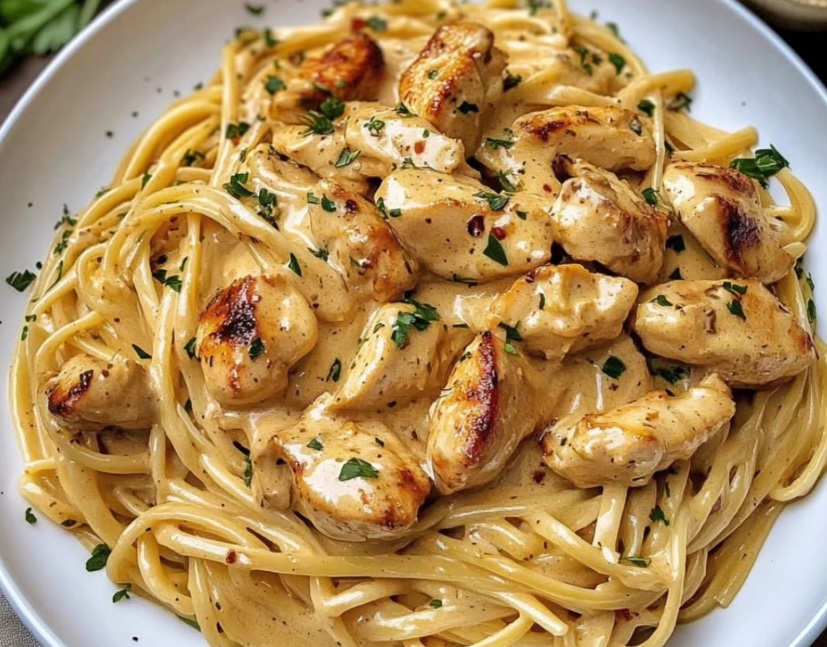

# Cowboy Butter Chicken Linguine

## Ingredients

- 6 boneless, skinless chicken thighs, cut into cubes
- 8 oz linguine pasta
- 1 tbsp olive oil
- 1 tbsp butter
- 1 tsp garlic powder
- 1 tsp onion powder
- 1/2 tsp smoked paprika
- 1/4 tsp cayenne pepper (optional, for heat)
- Salt and pepper to taste
- 1/2 cup butter, softened
- 2 tbsp fresh parsley, chopped
- 1 tbsp lemon juice
- 1/4 cup grated Parmesan cheese
- 1/4 cup chicken broth
- 1/4 cup heavy cream
- 1 tbsp Dijon mustard
- 1/2 tsp crushed red pepper flakes (optional)

## Instructions

1. Bring a large pot of salted water to a boil and cook the linguine according to package instructions until al dente. Drain and set aside, reserving 1/4 cup of pasta water for later.
2. While the pasta is cooking, heat olive oil in a large skillet over medium heat. Season the cubed chicken with salt, pepper, garlic powder, onion powder, smoked paprika, and cayenne pepper.
3. Cook the chicken in the skillet until golden brown and cooked through, about 6-8 minutes. Remove the chicken from the skillet and set aside.
4. In the same skillet, melt the butter over medium heat. Add the garlic and sauté for 1 minute until fragrant.
5. Add the chicken broth, heavy cream, and Dijon mustard to the skillet. Stir to combine, and let it simmer for 2-3 minutes until the sauce thickens slightly.
6. Return the chicken to the skillet and toss to coat with the sauce.
7. Add the cooked linguine, Parmesan cheese, lemon juice, and parsley. Stir to combine, adding the reserved pasta water a little at a time to reach your desired sauce consistency.
8. If desired, sprinkle with crushed red pepper flakes for a little extra kick.
9. Serve the Cowboy Butter Chicken Linguine warm, garnished with additional fresh parsley and Parmesan cheese.
