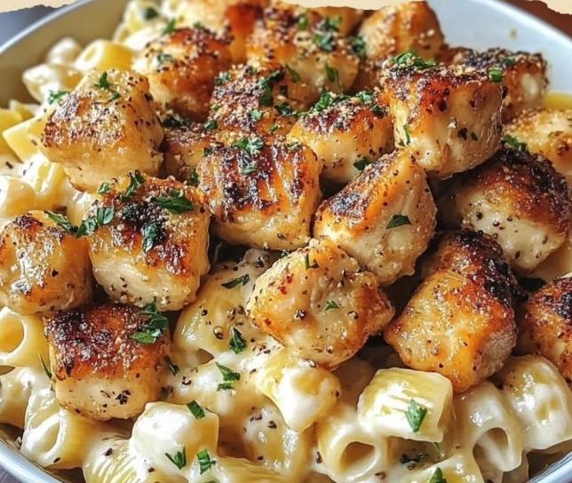

# Garlic Butter Chicken Bites with Creamy Parmesan Pasta

## Ingredients

- 1 lb boneless skinless chicken thighs, cubed
- 8 oz pasta (penne or rotini)
- 4 tbsp butter
- 2 cloves garlic, minced
- 1 cup heavy cream
- 1 cup grated Parmesan cheese
- Salt and pepper to taste
- Fresh basil, for garnish

## Instructions

1. Prepare pasta according to the package directions. Drain and set aside.
2. In a skillet, melt the butter over medium heat. Add the minced garlic and cubed chicken, cooking until the chicken is golden brown and fully cooked.
3. Stir in the heavy cream and Parmesan cheese, allowing it to cook until the sauce becomes creamy.
4. Season with salt and pepper to taste.
5. Toss the cooked pasta in the creamy sauce.
6. Garnish with fresh basil and serve hot.
