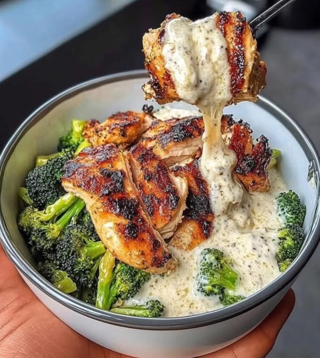

# Grilled Chicken & Broccoli Bowls with Creamy Garlic Sauce

## Ingredients

### For the Chicken

- 2 lbs boneless, skinless chicken thighs
- 1 tbsp olive oil
- 1 tsp paprika
- 1/2 tsp garlic powder
- 1/4 tsp salt
- 1/4 tsp black pepper
- 1/4 tsp cayenne pepper
- 1 lime, juiced

### For the Creamy Garlic Sauce

- 1/2 cup mayonnaise
- 1/4 cup sour cream
- 2 cloves garlic, minced
- 1 tbsp lemon juice
- 1 tsp Dijon mustard
- 1/4 tsp salt
- 1/4 tsp black pepper

### For the Bowls

- 1 lb broccoli florets, steamed or roasted
- 2 cups cooked rice or quinoa
- Lime wedges, for serving

## Instructions

1. In a large bowl, combine the chicken, olive oil, paprika, garlic powder, salt, pepper, and cayenne pepper (if using). Add the lime juice and toss to coat. Let the chicken marinate for at least 30 minutes, or up to 24 hours.
2. Grill or pan-fry the chicken until cooked through and slightly charred, about 5-7 minutes per side. Let the chicken rest for a few minutes before slicing.
3. In a small bowl, whisk together the mayonnaise, sour cream, garlic, lemon juice, Dijon mustard, salt, and pepper.
4. Divide the rice or quino. between two bowls.
5. Divide the rice or quinoa between two bowls.
6. Top with the steamed broccoli and sliced chicken. Drizzle with the Creamy Garlic Sauce. Serve with lime wedges.

## Tips

- For a spicier dish, add more cayenne pepper to the chicken seasoning.
- You can use any type of cooked grain you like, such as brown rice or quinoa.
- Serve the bowls with your favorite toppings, such as avocado, shredded cheese, or a dollop of sour cream.
