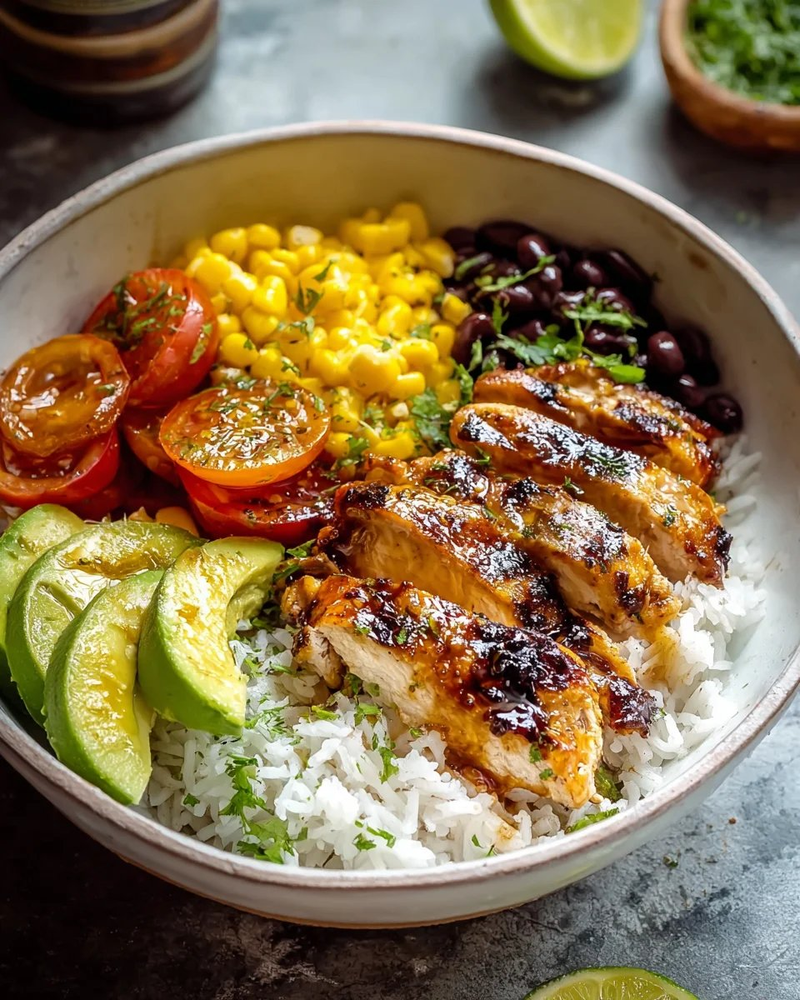

# Honey Lime Chicken Bowls with Creamy Cilantro Lime Drizzle

Serves 4

## Ingredients

### Chicken

- 1½ lbs boneless, skinless chicken thighs
- 2 tbsp olive oil
- 3 tbsp honey
- 2 tbsp lime juice
- Zest of 1 lime
- 3 garlic cloves, minced
- 1 tsp chili powder
- ½ tsp cumin
- ¾ tsp salt
- ¼ tsp black pepper

### Bowls

- 3 cups cooked rice
- 1½ cups corn
- 2 avocados, diced
- 1½ cups cherry tomatoes, halved
- ¼ cup diced red onion
- ¼ cup chopped cilantro
- 1 tbsp lime juice
- Lime wedges, for serving

### Creamy cilantro lime drizzle

- ½ cup sour cream or plain Greek yogurt
- 2 tbsp mayonnaise
- 2 tbsp lime juice
- ¼ cup finely chopped cilantro
- 1 small garlic clove, grated
- Salt, to taste
- 1–3 tbsp water, to thin

## Instructions

1. Marinate the chicken: Mix olive oil, honey, lime juice, zest, garlic, and seasonings. Add chicken and refrigerate for 20–30 minutes.
2. Make the drizzle: Whisk together the sauce ingredients, adding enough water for a pourable consistency.
3. Char the corn: Heat a lightly oiled skillet over medium-high heat. Cook corn for 5–7 minutes, stirring occasionally, until lightly browned. Set aside.
4. Cook the chicken: Let excess marinade drip off, then cook in a lightly oiled skillet over medium heat for about 5–7 minutes per side, depending on thickness, until the center reaches 165°F. Lower the heat if the honey browns too quickly. Rest for 5 minutes, then slice.
5. Prepare the toppings: Toss tomatoes and red onion with lime juice and a pinch of salt.
6. Build your bowls: Divide rice among four bowls. Add chicken, corn, avocado, and tomato mixture. Finish with cilantro, a creamy cilantro lime drizzle, and lime wedges.

*Source: [@the__crave on TikTok](https://www.tiktok.com/@the__crave/photo/7694899555892088077)*
*Photo: chefwatermelon.com — [Honey Lime Chicken Rice Bowl](https://chefwatermelon.com/honig-limetten-huhnchen-reis-bowl-unglaubliches-rezept/)*
