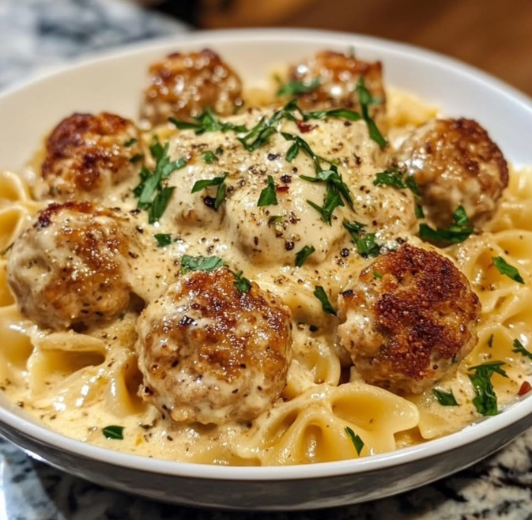

# Italian Garlic Chicken Meatballs with Creamy Bowties

## Ingredients

- 8 oz bowtie pasta
- 1 lb ground chicken
- 2 cloves garlic, minced
- 1/4 cup grated Parmesan cheese
- 1/4 cup breadcrumbs
- 1 large egg
- 1 tsp dried oregano
- 1 tsp dried basil
- Salt and pepper to taste
- 2 tbsp olive oil
- 1 cup heavy cream
- 1/2 cup chicken broth
- 1/2 cup shredded mozzarella cheese
- Fresh parsley, chopped (for garnish)

## Instructions

1. Preheat your oven to 375°F.
2. Line a baking sheet with parchment paper and set aside.
3. In a large mixing bowl, combine the ground chicken, minced garlic, Parmesan cheese, breadcrumbs, egg, oregano, basil, salt, and pepper. Mix until well combined.
4. Shape the mixture into meatballs, about 1 inch in diameter, and place them on the prepared baking sheet.
5. Bake the meatballs in the preheated oven for 15-18 minutes, or until they are cooked through and browned on the outside.
6. While the meatballs are baking, cook the bowtie pasta according to package instructions until al dente. Drain and set aside.
7. In a large skillet, heat olive oil over medium heat. Add the heavy cream and chicken broth, stirring to combine. Bring to a simmer, then stir in the mozzarella cheese and continue stirring until the sauce is smooth and creamy.
8. Add the cooked meatballs and pasta to the skillet with the creamy sauce. Toss to coat the pasta and meatballs evenly in the sauce.
9. Garnish with chopped fresh parsley and serve immediately.
