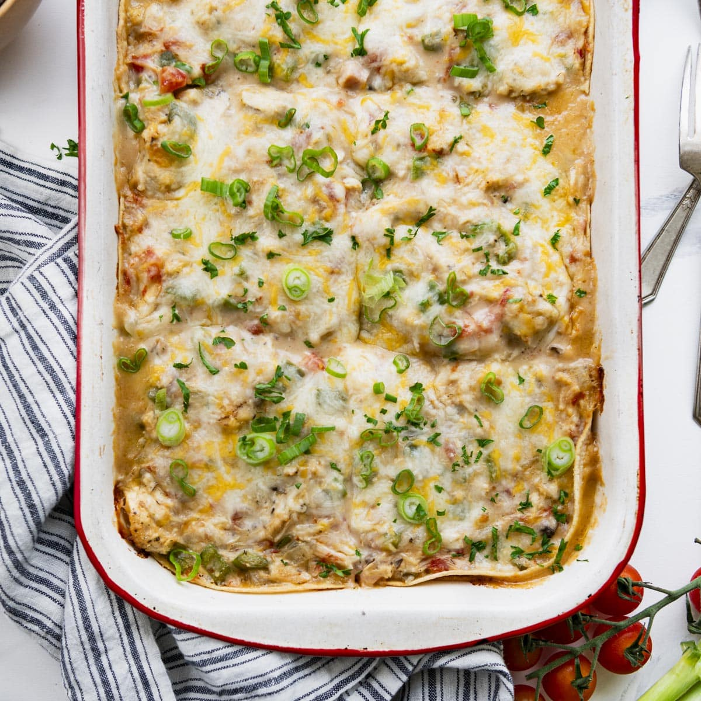

# King Ranch Chicken

## Ingredients

- 1/4 cup butter
- 1/2 cup green bell pepper chopped
- 1/2 cup yellow onion chopped
- 1 can cream of chicken soup
- 1 can cream of mushroom soup
- 1 can Rotel tomatoes
- 2 cups chopped cooked chicken breast
- 12 corn tortillas torn cut into quarters
- 2 cups shredded Cheddar cheese

## Instructions

1. Preheat oven to 325°F. Spray 13x9-inch baking dish with cooking spray; set aside.
2. Butter in large saucepan over medium heat. Add bell pepper and onion; cook and stir about 5 minutes or until tender. Stir in both soups, undrained tomatoes and chicken.
3. Layer one-third each of tortillas, chicken mixture and cheese evenly in dish. Repeat layers twice more. Bake uncovered 40 minutes or until hot and bubbly.

*Photo: The Seasoned Mom — [King Ranch Chicken](https://www.theseasonedmom.com/king-ranch-chicken-casserole/)*
