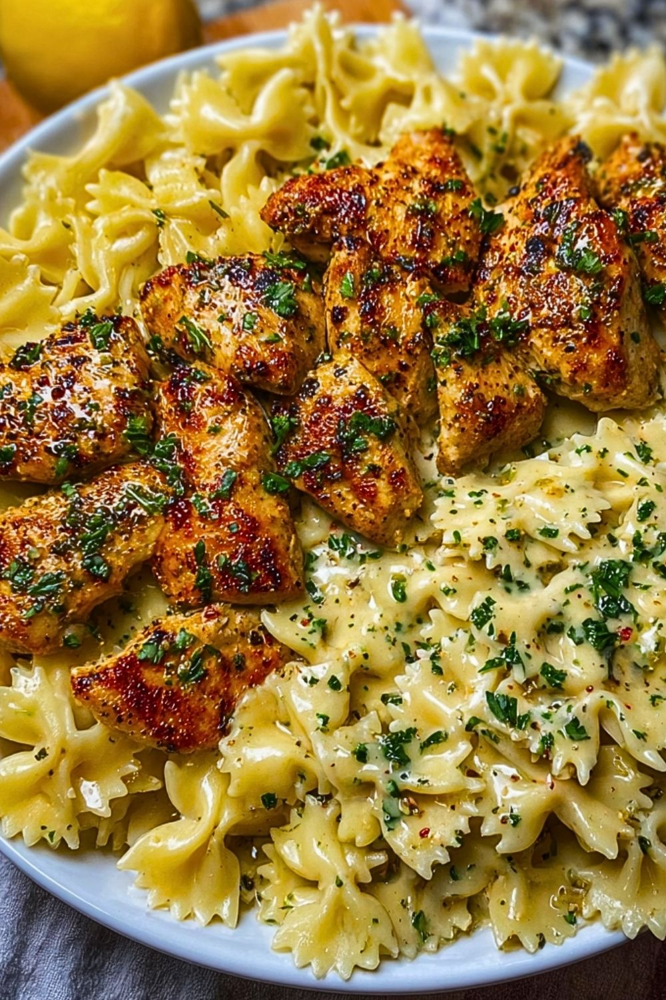

# Lemon Garlic Chicken with Creamy Bowtie Pasta

## Ingredients

### Chicken

- 1 lb boneless skinless chicken thighs cut into bite size pieces
- 2 tbsp olive oil
- 2 tbsp butter
- 3 cloves garlic minced
- 1 tbsp lemon juice
- 1 tsp lemon zest
- 1/2 tsp paprika
- Salt and pepper to taste
- 1 tbsp fresh parsley chopped for garnish

### Pasta

- 8 oz bow tie pasta
- 1 cup heavy cream
- 1/2 cup chicken broth
- 1/2 cup Parmesan cheese grated
- 1 tbsp butter
- Salt and pepper to taste
- Fresh parsley chopped for garnish
- Fresh basil chopped for garnish

## Instructions

1. Cook the pasta according to package instructions until al dente. Drain and set aside.
2. In a large skillet, heat the olive oil and butter over medium heat. Season the chicken with salt, pepper and paprika. Add the chicken to the skillet and cook until browned and cooked through.
3. Add the minced garlic, lemon juice and lemon zest to the skillet and cook until fragrant.
4. Remove the chicken and set aside.
5. In the same skillet add butter, heavy cream and chicken broth. Stir and bring to a simmer over medium heat.
6. Add the grated Parmesan cheese, stirring until the cheese is melted and the sauce is creamy. Season with salt and pepper to taste.
7. Return the pasta to the skillet, tossing to coat the pasta evenly.
8. Return the chicken to the pasta, stirring to mix into the pasta.
9. Garnish with chopped parsley, basil and grated Parmesan cheese.
10. Serve hot.

*Photo: Sally Meals — [Lemon Garlic Chicken with Creamy Bowtie Pasta](https://sallymeals.com/lemon-garlic-chicken-with-creamy-bowtie-pasta/)*
