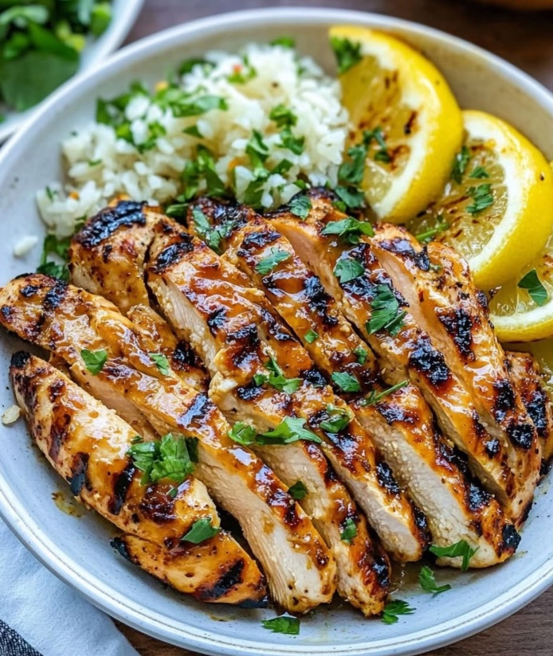

# Lemon Ginger Soy Marinated Grilled Chicken

## Ingredients

- 1 ½ lbs chicken thighs
- ¼ cup soy sauce
- ¼ cup fresh lemon juice
- 2 tbsp honey
- 1 tbsp fresh ginger, grated
- 2 cloves garlic, minced
- 1 tbsp olive oil
- Salt and pepper, to taste
- Lemon slices (for serving)
- Chopped green onions (for garnish)

## Instructions

1. In a bowl, mix together soy sauce, lemon juice, honey, ginger, garlic, olive oil, salt, and pepper.
2. Place the chicken thighs in a zip-lok bag or bowl. Pour the marinade over the chicken, making sure it's well-coated. Seal the bag or cover the bowl and refrigerate for at least 30 minutes (up to 4 hours for more flavor).
3. Heat your grill to medium-high heat.
4. Remove the chicken from the marinade and let any excess drip off. Grill the chicken for about 6-7 minutes on each side or until the internal temperature reaches 165°F.
5. Let the chicken rest for a few minutes, then slice and serve with lemon slices and chopped green onions on top. Enjoy your flavorful grilled chicken!
