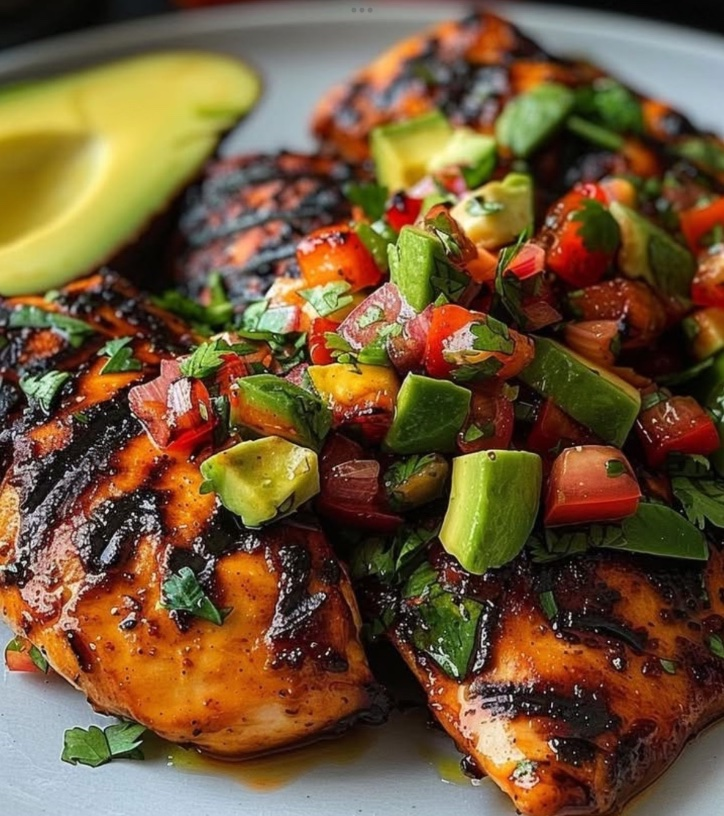

# Lime-Marinated Chicken with Avocado Salsa

## Ingredients

- 6 boneless, skinless chicken thighs
- 1/4 cup lime juice
- 2 tbsp olive oil
- 1 tsp garlic powder
- 1 tsp onion powder
- 1 tsp cumin
- Salt and pepper to taste
- 2 ripe avocados, diced
- 1 tomato, diced
- 1/4 red onion, finely chopped
- 1/4 cup cilantro, chopped
- 1 jalapeño, minced (optional)
- Salt and lime juice to taste

## Instructions

1. In a mixing bowl, whisk together lime juice, olive oil, garlic powder, onion powder, cumin, salt, and pepper.
2. Add the chicken breasts to the marinade, ensuring they are well-coated. Let them marinate for at least 30 minutes.
3. Preheat your grill to medium-high heat. Once hot, place the marinated chicken thighs on the grill. Cook for until they are fully cooked and have nice grill marks.
4. While the chicken is grilling, prepare the avocado salsa. In a separate bowl, combine the diced avocados, tomato, red onion, cilantro, and jalapeño (if using). Season with salt and add lime juice to taste, mixing gently to combine.
5. Once the chicken is cooked, remove it from the grill and let it sit for a few minutes.
6. Serve the grilled chicken topped with the fresh avocado salsa for a delicious and vibrant meal.
