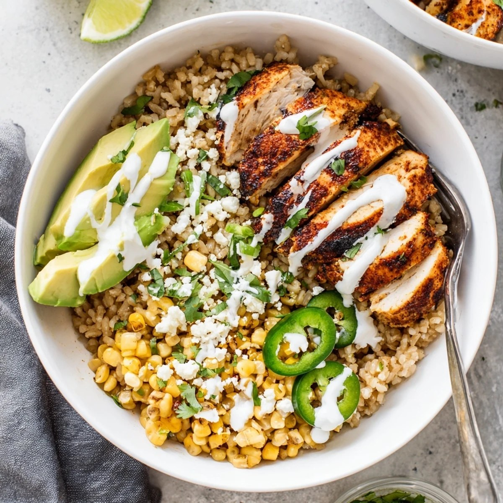

# Mexican Street Corn Chicken Bowls

## Ingredients

- 2 lbs boneless skinless chicken thighs

### Marinade

- 1/4 cup olive oil
- 1/4 cup lime juice
- 2 tbsp chopped fresh cilantro
- 1 tsp cumin
- 1 tsp paprika
- 2 cloves minced garlic
- 1/2 tsp salt
- 1/4 tsp black pepper

### Mexican street corn salad

- 2 cups grilled corn kernels
- 1/3 cup mayo
- 2 tbsp fresh chopped cilantro
- 2 tbsp lime juice
- 1/2 tbsp minced garlic
- 1/2 tsp chili powder
- 1/4 tsp paprika
- 1/4 tsp salt
- 1/8 tsp black pepper
- 1/4 cup diced red onion
- 1/4 cup cojita cheese

### Topping suggestions

- cherry tomatoes halved
- pickled jalapeno slices
- lime wedges
- cilantro
- sour cream
- avocado slices

## Instructions

1. Combine all marinade ingredients in a bowl. Place chicken in a ziplock bag or bowl and cover with the marinade. refrigerate for at least 15 minutes to and hour. Preheat grill to 400/450 F. Place chick over direct heat for 4-6 minutes per side. Move chicked to indirect heat and cook until internal temp is 160F. Remove from grill and let it rest until 165F. Slice or cube the chicken.
2. Toast corn in a skillet with butter until slightly chared. In a bowl combine the corn, mayo, cilantro, lime juice garlic, chili powder, paprika. salt, pepper, red onion and cojita cheese. Mix well and adjust seasoning to taste.
3. Serve over rice.
4. Build your bowl how you like it!

*Photo: Auntie Fork — [Street Corn Chicken Bowl](https://auntiefork.com/recipes/street-corn-chicken-bowl)*
