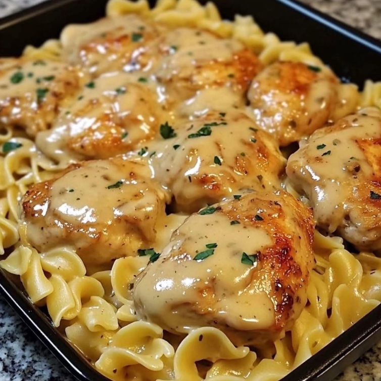

# One-Pan Chicken with Buttered Noodles

## Ingredients

- 6 boneless, skinless chicken thighs
- 2 tbsp olive oil
- 3 garlic cloves, minced
- 2 cups chicken broth
- 1 cup heavy cream
- 8 oz egg noodles
- 3 tbsp butter
- 1/4 cup grated Parmesan cheese
- Salt and pepper, to taste
- Fresh parsley, chopped (optional)

## Instructions

1. Heat olive oil in a large skillet over medium heat.
2. Season chicken with salt and pepper, then until golden and cooked through. Remove and set aside.
3. In the same skillet, add garlic and cook until fragrant.
4. Stir in chicken broth and heavy cream, then bring to a simmer. Add egg noodles, cover, and cook until tender.
5. Stir in butter and Parmesan cheese until melted and creamy.
6. Return chicken to the skillet to heat through.
7. Garnish with parsley and serve warm.
