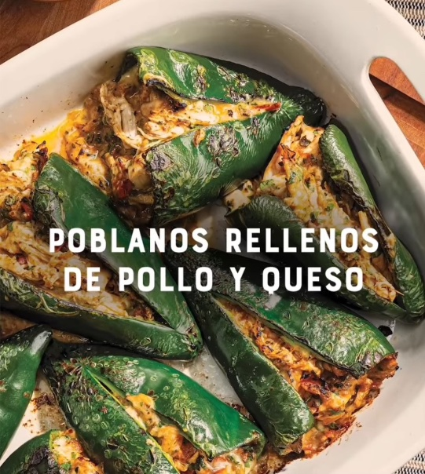

# Poblanos Rellenos de Pollo y Queso (Chicken & Cheese Stuffed Poblanos)

## Ingredients

- 8 medium poblano peppers
- 2 tbsp avocado oil
- 1 small yellow onion, halved and finely chopped
- 3 garlic cloves, minced
- 2 Roma tomatoes, finely chopped
- 2 tsp Mexican oregano
- 1 tsp ground cumin
- 3 cups shredded skinless rotisserie chicken meat
- 2 cups shredded Chihuahua cheese
- 1/4 cup chopped fresh cilantro
- Mexican crema and/or hot sauce for serving (optional)

## Instructions

1. Preheat oven to 425° and spray a 13 x 9-inch baking dish with cooking spray.
2. Slice the tops off the poblano peppers and remove seeds.
3. Heat oil in a skillet, cook onion, garlic, and tomatoes until fragrant.
4. Add oregano, cumin, chicken, cheese, and cilantro.
5. Stuff peppers with the chicken mixture and bake for 20 minutes, then broil for 3 minutes until lightly charred.
6. Serve drizzled with crema or hot sauce if desired.
