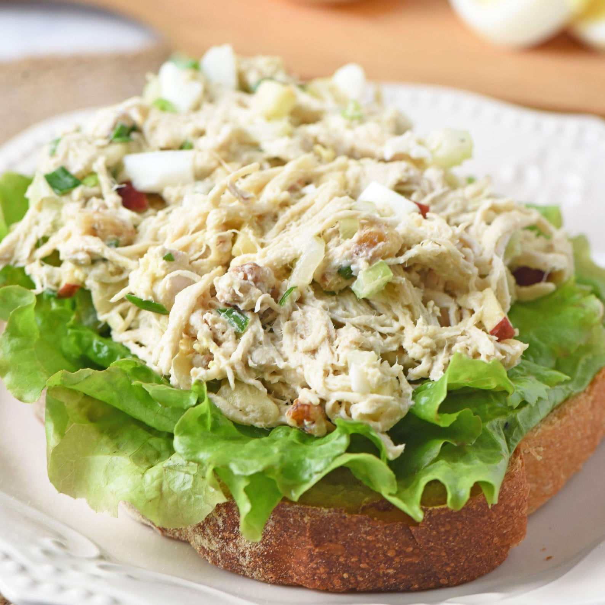

# Rotisserie Chicken Salad

Servings: 5

> Source: screenshot IMG_6423.PNG, 2026-11-10 — ingredients only; instructions were not in the screenshot. Photo from https://i.etsystatic.com/27488557/r/il/b577e6/7915980407/il_1588xN.7915980407_9en1.jpg

## Ingredients

- 1 whole rotisserie chicken
- 2 tbsp olive oil
- 2 stalks celery, chopped
- 3 whole scallions, thinly sliced
- 2 tbsp fresh dill
- 1 tbsp fresh parsley
- 1 cup mayonnaise
- 1 lemon, lemon juice
- 1 tbsp Dijon mustard
- 1 tsp salt
- 1/2 tsp black pepper

## Instructions

Shred the rotisserie chicken, then mix everything together.
