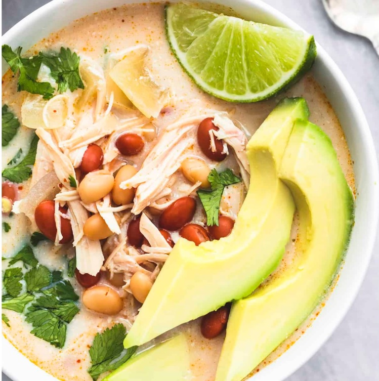

# Slow Cooker Cream Cheese Chicken Chili

## Ingredients

- 3 lbs boneless skinless chicken thighs
- 5 cups chicken broth
- 2 cans pinto beans drained and rinsed
- 1 can white beans drained and rinsed
- 1 small onion diced
- 3 tsp ground cumin
- 2 tsp chili powder
- 2 tsp garlic powder
- Salt and pepper to taste
- 8 ounces cream cheese softened
- handful cilantro roughly chopped

### Toppings

- shredded cheese
- avocado
- limes for squeezing

## Instructions

1. Add chicken, broth, beans, onion, and seasonings to slow cooker. Cover and cook on high 2-3 hours, or on low 4-5 hours.
2. About 30 minutes before serving, add cream cheese. Cover and cook another half hour.
3. Uncover, stir to mix cream cheese into soup and shred chicken with two forks. Taste, add salt and pepper to taste as needed. Stir in chopped cilantro. Serve hot and top with shredded cheese and avocado slices if desired.
