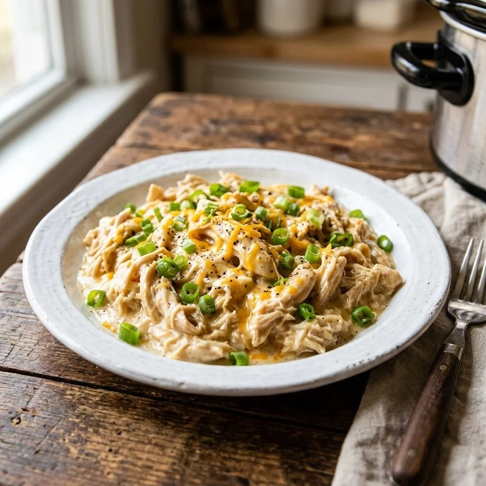

# Slow Cooker Cream Cheese Chicken

## Ingredients

- 3 lb boneless skinless chicken thighs
- 1 (8 oz) package cream cheese softened
- 1 (1 oz) packet ranch dressing mix
- 1 cup chicken broth
- 1 cup shredded cheddar cheese
- 1/2 cup chopped green onions for garnish
- Salt and pepper to taste
- Optional: Cooked rice or pasta for serving

## Instructions

1. Place the chicken breasts at the bottom of the slow cooker.
2. In a bowl, mix the cream cheese, ranch dressing mix, and chicken broth until well combined. Pour this mixture over the chicken in the slow cooker. Season with salt and pepper.
3. Cover and cook on low for 6-8 hours or on high for 3-4 hours, until the chicken is cooked through and tender.
4. Once cooked, shred the chicken using two forks and mix it well with the creamy sauce. Stir in the shredded cheddar cheese until melted and creamy.
5. Serve the cream cheese chicken over rice or pasta, and garnish with chopped green onions for a pop of color.

*Photo: Crock Cozy — [Slow Cooker Cream Cheese Chicken](https://www.crockcozy.com/slow-cooker-cream-cheese-chicken/)*
