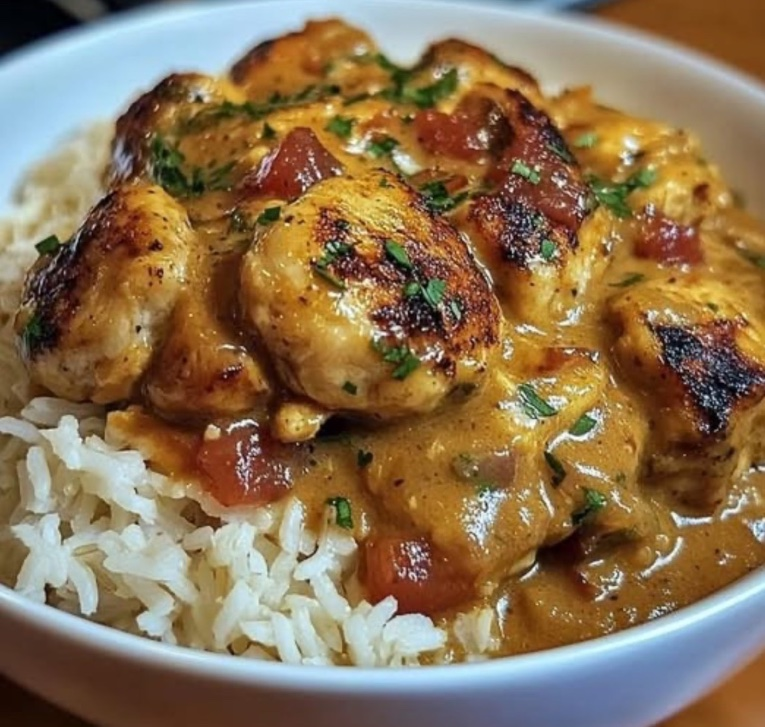

# Smothered Chicken and Rice

## Ingredients

- 8 boneless, skinless chicken thighs, cut into chunks
- 2 tbsp olive oil
- 1 medium onion, diced
- 2 cloves garlic, minced
- 1 cup chicken broth
- 1/2 cup heavy cream
- 1/2 cup diced tomatoes (optional)
- 1 tsp paprika
- 1 tsp dried thyme
- 1/2 tsp cayenne pepper (adjust to taste)
- Salt and pepper, to taste
- 2 tbsp fresh parsley, chopped (for garnish)
- 2 cups cooked white rice

## Instructions

1. Heat olive oil in a large skillet over medium-high heat. Season chicken pieces with salt, pepper, and paprika. Sear until golden brown on all sides. Remove and set aside.
2. In the same skillet, add diced onions and cook until translucent.
3. Stir in garlic and cook for 1 minute until fragrant.
4. Pour in the chicken broth and heavy cream. Add diced tomatoes, thyme, and cayenne pepper. Stir and let it simmer for 3-4 minutes.
5. Return the chicken to the skillet, cover, and let it simmer in the sauce for 10-15 minutes, or until the chicken is fully cooked and the sauce thickens.
6. Spoon the smothered chicken and sauce over cooked white rice or mashed potatoes.
7. Garnish with freshly chopped parsley.
