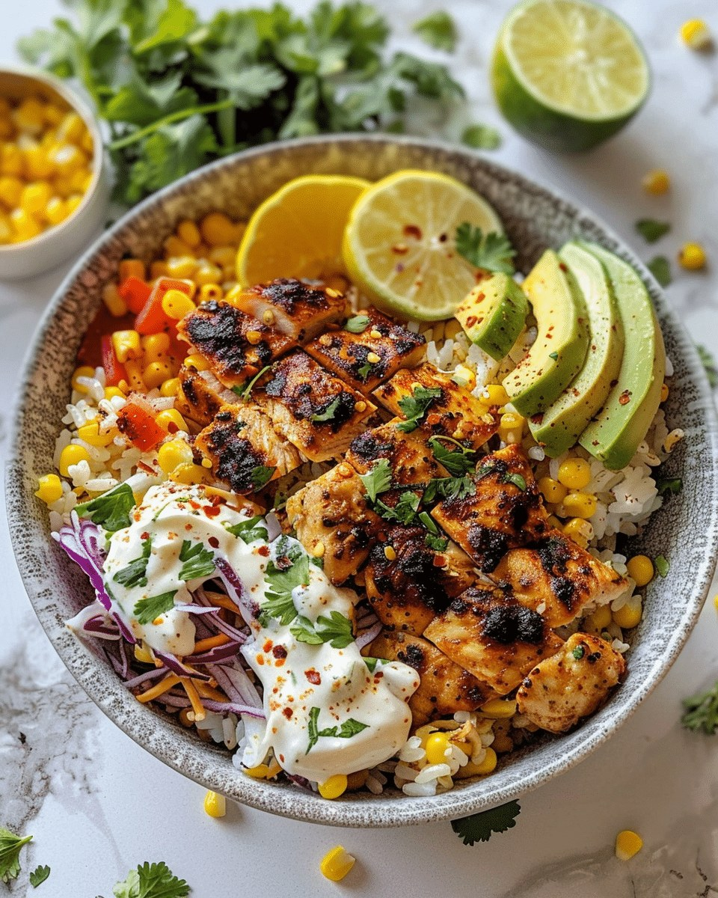

# Street Corn Chicken Rice Bowl

## Ingredients

- 1 lb boneless skinless chicken thighs cut into bite-sized pieces
- 1 tbsp olive oil
- 1 tsp smoked paprika
- 1/2 tsp cumin
- 1/2 tsp garlic powder
- 1/2 tsp onion powder
- 1/2 tsp chili powder
- Salt and pepper to taste
- Juice of 1 lime
- 4 cups cooked rice

### For the topping

- 2 cups corn kernels
- 1/4 cup mayonnaise
- 2 tbsp sour cream
- 1/2 tsp smoke paprika
- 1/4 tsp chili powder
- 1/4 cup cojita cheese
- Juice of 1/2 lime
- 1/4 cup fresh cilantro

### Extra toppings

- Red onion diced
- Avocado diced
- Sliced jalapeño

## Instructions

1. In a medium bowl, combine the chicken pieces with olive oil, smoked paprika, cumin garlic powder, onion powder, salt, pepper and lime juice. Mix until the chicken is coated evenly.
2. Heat a large skillet over medium-high heat. Add the chicken and cook until the chicken is cooked through and golden brown. Set aside.
3. In a large bowl, combine the corn kernels, mayonnaise, sour cream, smoke paprika, chili powder, cojita cheese, lime juice and chopped cilantro. Mix well until the corn is evenly coated.
4. Divide cooked rice between 4 bowls. Top each bowl with the chicken, street corn mixture, red onion, jalapeño slices and diced avocado. Garnish with cilantro and serve with lime wedges on the side.

*Photo: KQ Education Group — [Easy Street Corn Chicken Rice Bowl](https://recipes.kqeducationgroup.com/easy-street-corn-chicken-rice-bowl/)*
