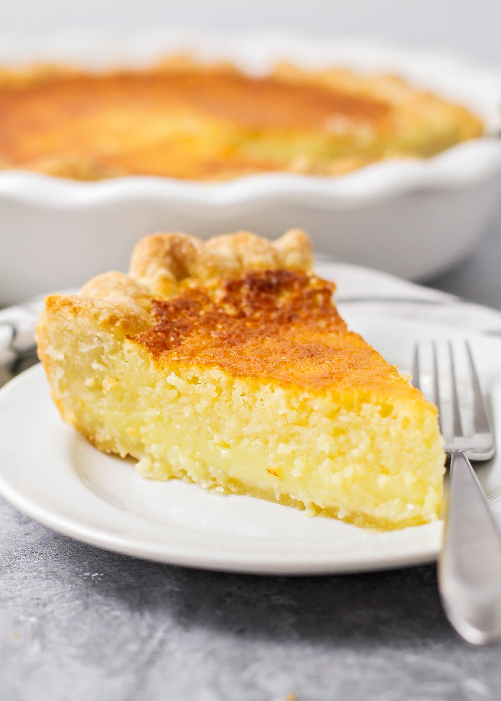
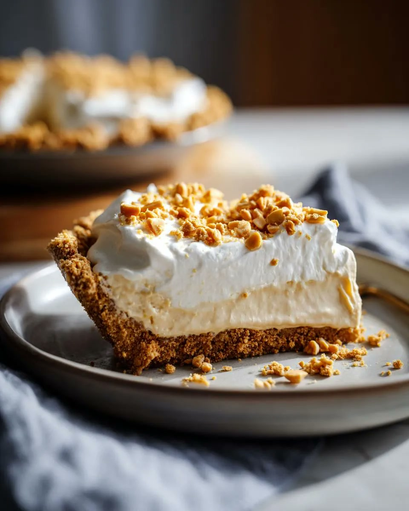
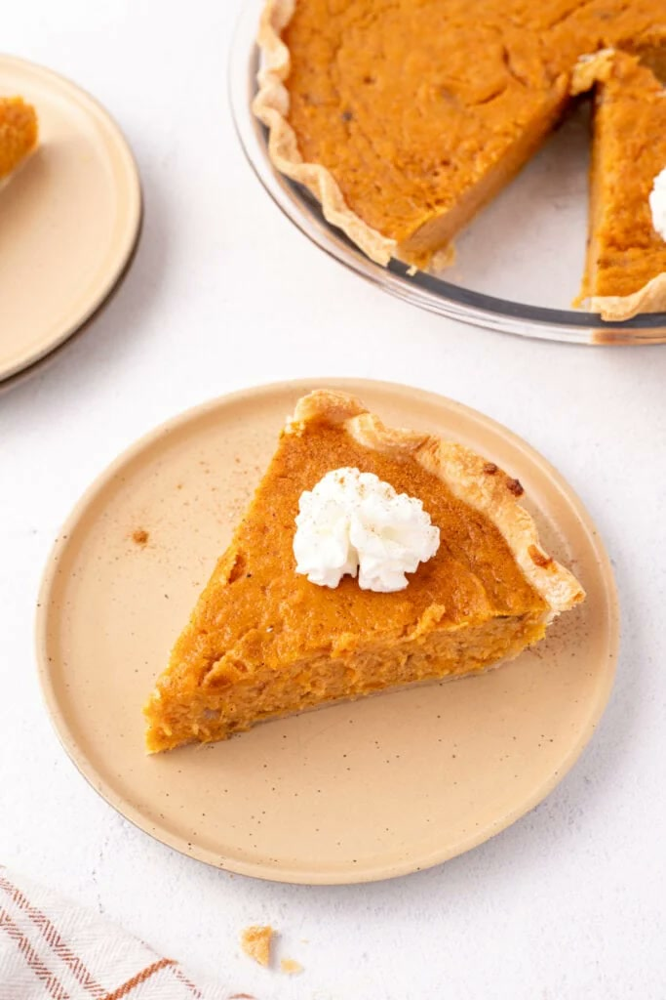

# Desserts Recipes

3 recipes.



<div class="recipe-grid">
<div class="recipe-card"><a href="https://chknfrdstk.github.io/Recipes/desserts/buttermilk-pie.html"><span class="recipe-title">Buttermilk Pie</span></a></div>
<div class="recipe-card"><a href="https://chknfrdstk.github.io/Recipes/desserts/peanut-butter-cream-pie.html"><span class="recipe-title">Peanut Butter Cream Pie</span></a></div>
<div class="recipe-card"><a href="https://chknfrdstk.github.io/Recipes/desserts/sweet-potato-pie.html"><span class="recipe-title">Sweet Potato Pie</span></a></div>
</div>

- [Back to all recipes](https://chknfrdstk.github.io/Recipes/)

## Folder structure

```
desserts/
├── README.md
├── buttermilk-pie.md
├── images/
│   ├── buttermilk-pie.jpg
│   ├── peanut-butter-cream-pie.jpg
│   └── sweet-potato-pie.jpg
├── peanut-butter-cream-pie.md
└── sweet-potato-pie.md
```
