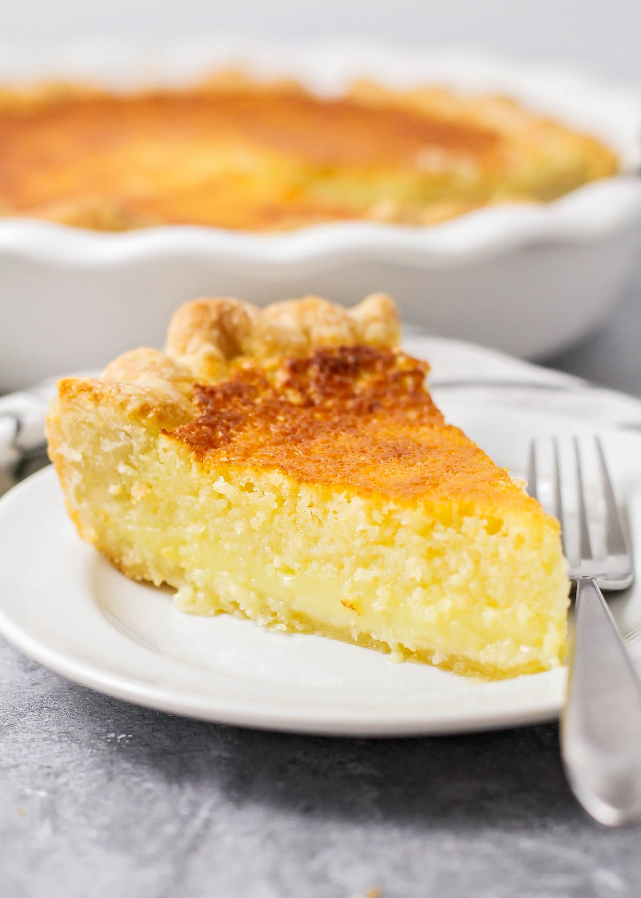

# Buttermilk Pie

## Ingredients

- 1⁄2 cup butter or 1/2 cup margarine, melted
- 1 1⁄2 cups sugar
- 3 tablespoons flour
- 3 eggs, beaten
- 1 pinch salt
- 1 teaspoon vanilla
- 1 cup buttermilk
- 2 deep dish pie shells

## Instructions

1. Preheat oven to 400°F
2. Beat the butter and sugar together until light.
3. Add the eggs and beat; then beat in vanilla.
4. Sift the dry ingredients together and add to the batter alternatively with the buttermilk; beat until smooth.
5. Divide between the deep dish pie shells and bake at 400F for 10 minutes, reduce heat to 350F and bake for 50-60 additional minutes.
6. Pie should turn a nice golden brown and a knife inserted should come out clean.

*Photo: Lil' Luna — [Buttermilk Pie](https://lilluna.com/buttermilk-pie/)*
