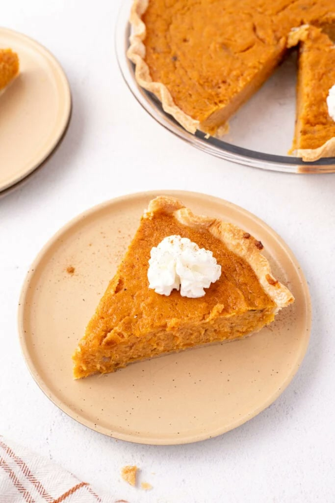

# Sweet Potato Pie

## Ingredients

- 4 medium sweet potatoes
- 1/2 stick butter, softened
- 1/4 cup sugar
- 3/4 cup brown sugar
- 2 eggs, beaten
- 1 teaspoon pure vanilla extract
- 1/2 teaspoon ground cinnamon
- 1/8 teaspoon ground ginger
- 1/8 teaspoon ground nutmeg
- 1/8 teaspoon ground allspice
- 1/2 teaspoon salt
- 3/4 cup evaporated milk
- 1 unbaked pie crust

### Maple Whipped Topping

- 1 cup heavy whipping cream
- 1/4 cup confectioners' sugar
- 2 tablespoons maple syrup

## Instructions

1. Preheat oven to 350 degree F.
2. Bake sweet potatoes for 1 hour in the oven on a baking sheet. When done, let cool. Scrape the pulp out of the skin, transfer to a large bowl, and mash. Set aside.
3. In a medium bowl, beat together butter, sugar, and brown sugar until creamy. Add eggs, vanilla, cinnamon, ginger, nutmeg, allspice and salt. Add evaporated milk and stir mixture into sweet potatoes. Beat together with mixer until smooth and pour into an unbaked pie shell.
4. Bake on bottom rack of oven for 1 hour or until center of pie is firm. Serve warm. Add dollop of whipped cream if desired.

### Maple Whipped Topping

In a medium bowl, beat together whipping cream and confectioners' sugar. Add maple syrup. Beat together until soft peaks form.

*Photo: Love Bakes Good Cakes — [Sweet Potato Pie](https://www.lovebakesgoodcakes.com/sweet-potato-pie/)*
