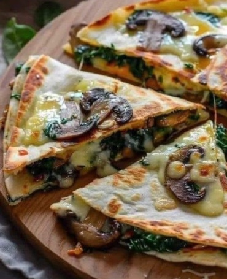
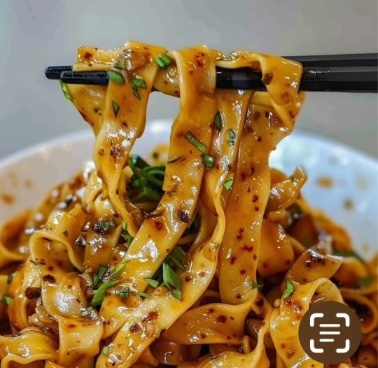
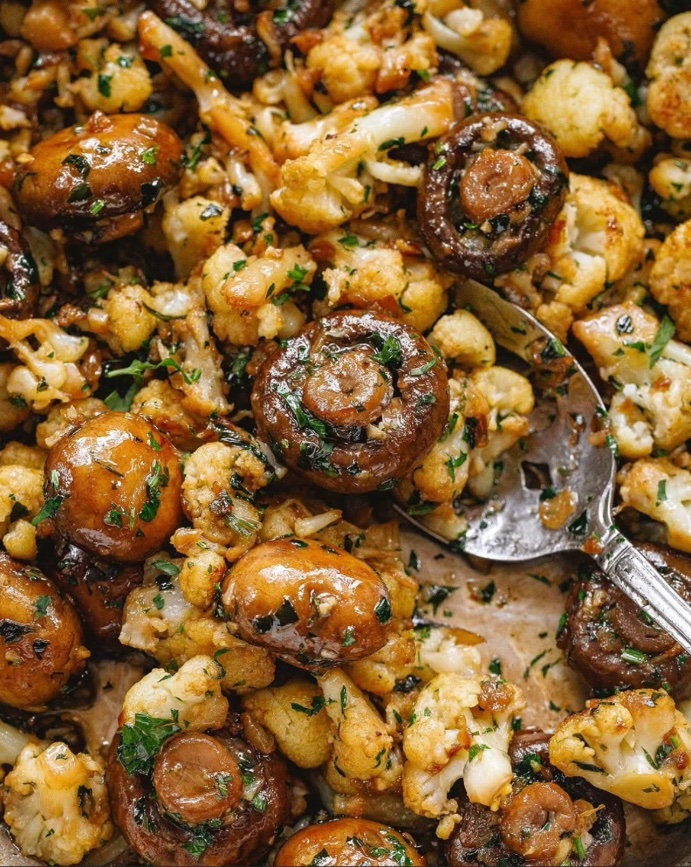
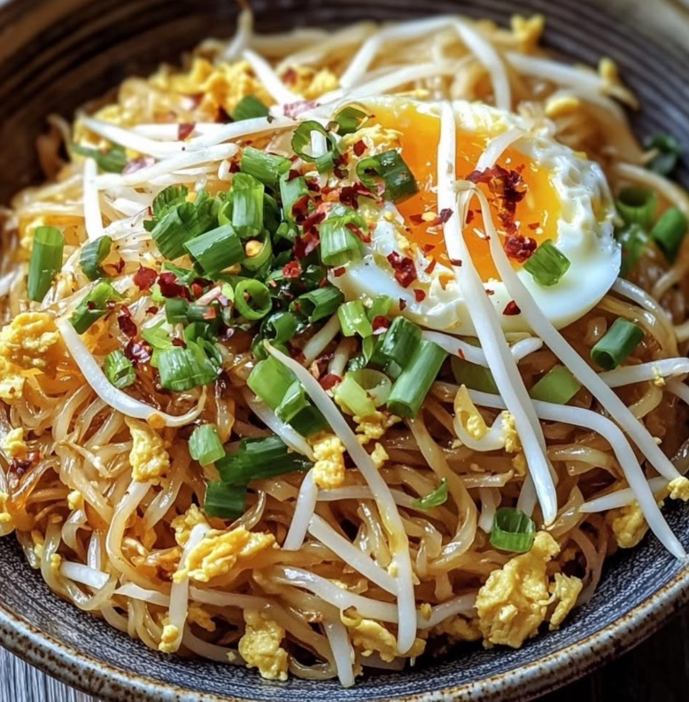
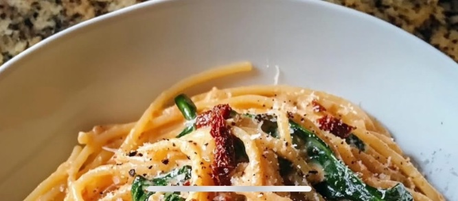

# No Meat Recipes

7 recipes.

<a href="baked-spinach-mushroom-quesadillas.md">Baked Spinach Mushroom Quesadillas</a>

<a href="cilantro-lime-noodles.md">Cilantro Lime Noodles</a>

<a href="garlic-mushrooms-cauliflower-skillet.md">Garlic Mushrooms Cauliflower Skillet</a>

<a href="italian-drunken-noodles.md">Italian Drunken Noodles</a>

<a href="pad-thai-noodles.md">Pad Thai Noodles</a>

<a href="ravioli-with-tomatoes-asparagus-garlic-and-herbs.md">Ravioli with Tomatoes, Asparagus, Garlic, and Herbs</a>

<a href="spaghetti-spinach-with-sun-dried-tomato-cream-sauce.md">Spaghetti & Spinach with Sun-Dried Tomato Cream Sauce</a>

- [Back to all recipes](../README.md)
